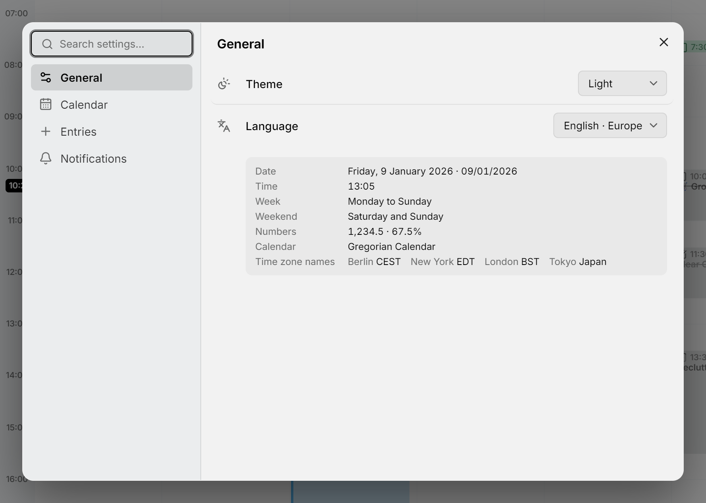

Mitra guarda sus ajustes en un único cuadro de diálogo. Ábrelo con **Ajustes** al final de la barra lateral, con <kbd>Ctrl</kbd>+<kbd>,</kbd> (<kbd>⌘</kbd>+<kbd>,</kbd> en un Mac) desde cualquier lugar, o desde la [paleta de comandos](shortcuts.md). Cuando inicias sesión con una cuenta, **Ajustes** es el engranaje de la tarjeta de tu cuenta al final de la barra lateral, y el **⋯** junto a él contiene **Cerrar sesión**.

<picture>
  <source media="(prefers-color-scheme: dark)" srcset="../assets/screenshots/settings-detail-dark.webp">
  
</picture>

Nunca tienes que cambiar nada. Un ajuste que dejas como está sigue el valor predeterminado de Mitra, así que cuando una versión posterior mejora un valor predeterminado, obtienes el nuevo. Elegir tú mismo el valor predeterminado cuenta como dejarlo como está.

## Encontrar un ajuste

Escribe en **Buscar ajustes…** en la parte superior del diálogo. Busca a la vez en las páginas y en los ajustes, y agrupa lo que encuentra por página: «calendario» muestra la página **Calendario** entera junto con el ajuste **Calendario predeterminado** de **Entradas**. Puedes cambiar un ajuste directamente en los resultados.

La paleta de comandos conoce las mismas palabras y cambia la mayoría de los ajustes sin abrir el diálogo. Escribe «oscuro» y elige **Tema: Oscuro**, o «ajustar» y elige **Ajustar a: 30 min**. Solo ofrece valores que aún no has elegido. Un ajuste que no puede cambiar en un solo paso, como la vista predeterminada, ofrece en su lugar **Cambiar vista predeterminada…**, que abre el diálogo en ese ajuste.

## Tu cuenta o este dispositivo

La mayoría de los ajustes pertenecen a tu cuenta y te siguen a todos los dispositivos y navegadores desde los que inicias sesión: la vista predeterminada, **Ocultar tareas completadas**, **Ocultar disponibilidad**, el calendario predeterminado, la duración predeterminada, **Ajustar a** y ambos recordatorios predeterminados.

Los demás pertenecen al dispositivo en el que estás, así que tu teléfono y tu portátil pueden diferir: el tema, el idioma, las líneas de conexión y si este navegador muestra notificaciones.

Mitra también recuerda algunas cosas en cada dispositivo a medida que lo usas: cuánto has ampliado, si la barra lateral está abierta y en qué pestaña, qué zonas horarias has plegado y el periodo que muestra la vista de tabla.

## General

**Tema** es **Como el sistema**, **Claro** u **Oscuro**. **Como el sistema**, el valor predeterminado, sigue el modo claro u oscuro de tu dispositivo.

**Idioma** ofrece inglés, alemán, francés, español, portugués, italiano, persa y chino, cada uno con el nombre en su propio idioma; el chino se escribe en caracteres simplificados. El cambio se aplica al instante, sin recargar, y el persa coloca Mitra de derecha a izquierda.

Cada idioma decide también cómo se escriben las fechas y las horas, qué día empieza la semana y qué días son fin de semana. Al principio sigue cómo escribe tu navegador el idioma, así que el inglés suele escribirse como en Estados Unidos, el alemán como en Alemania y el persa como en Irán. La flecha al final de un idioma despliega los países y zonas donde se escribe, como el Reino Unido o Europa para el inglés: el inglés del Reino Unido escribe 9 Oct 2026 y 13:00 y empieza las semanas en lunes, el de Estados Unidos escribe Oct 9, 2026 y 1:00 PM y las empieza en domingo. Al cambiar de idioma desde la paleta de comandos se conserva tu país si el nuevo idioma se escribe allí. Una vista previa bajo el ajuste muestra cómo se escriben las fechas, las horas, la semana, los números y los nombres de las zonas horarias. Un país aquí no es una zona horaria: Nueva York y Los Ángeles comparten uno.

## Calendario

**Vista predeterminada** es la vista en la que se abre Mitra: **Semana**, a menos que elijas **Mes**, **Año**, **Cronograma** o **Tabla**.

**Ocultar tareas completadas** quita las tareas hechas y canceladas de las vistas de semana, mes y año y de la pestaña Planificación. La búsqueda sigue encontrándolas, siguen contando para el progreso de su tarea padre y la vista de tabla sigue enumerándolas. Una tarea que tienes abierta permanece a la vista hasta que la cierras.

**Ocultar disponibilidad** quita la [disponibilidad](availability.md) de la vista de semana. Se queda en sus calendarios, y la disponibilidad ocupada sigue apareciendo como ocupada para los demás.

**Líneas de conexión en la vista de semana**, **Líneas de conexión en la vista de mes** y **Líneas de conexión en el cronograma** activan o desactivan en cada vista las líneas entre [subtareas](subtasks.md) y [dependencias](dependencies.md). Al principio están todas activadas.

## Entradas

**Calendario predeterminado** es donde van los eventos y las tareas nuevos. Es la misma elección que el icono relleno de la barra lateral: consulta [dónde se guardan las entradas nuevas](calendars.md#where-new-entries-land). Sin uno, o mientras está oculto, las entradas nuevas van al primer calendario que se está mostrando.

**Duración predeterminada** es cuánto dura una entrada nueva cuando no le das una duración, por ejemplo cuando haces clic en la cuadrícula, arrastras una tarea sin programar que no tiene estimación o desactivas **Todo el día**. Va de 15 minutos a 2 horas y es de una hora a menos que la cambies.

**Ajustar a** es el paso en el que se detienen el arrastre y el cambio de tamaño: 5, 10, 15 o 30 minutos, 15 a menos que lo cambies.

## Notificaciones

**Notificaciones de recordatorio** decide si este navegador puede avisarte. Pulsa **Permitir** y tu navegador pide permiso; la fila pasa entonces a decir **Permitidas** o **Bloqueadas**. Para deshacer un bloqueo, permite las notificaciones de Mitra en los ajustes del sitio del navegador. Los recordatorios que añades se guardan en cualquier caso. En un navegador que no puede mostrar notificaciones de Mitra, esta fila no aparece; consulta la [solución de problemas](reminders.md#troubleshooting).

**Recordatorio predeterminado de eventos** y **Recordatorio predeterminado de tareas** fijan los recordatorios con los que empiezan las entradas nuevas: 30 minutos antes para un evento y a la hora de la tarea para una tarea, o **Ninguno**. Solo se aplican a las entradas con hora.

Cuando este navegador permite notificaciones, la página también enumera tus **Dispositivos**, donde puedes cambiarles el nombre, enviar un recordatorio de prueba o quitar uno. Consulta [Recordatorios](reminders.md#your-devices).
