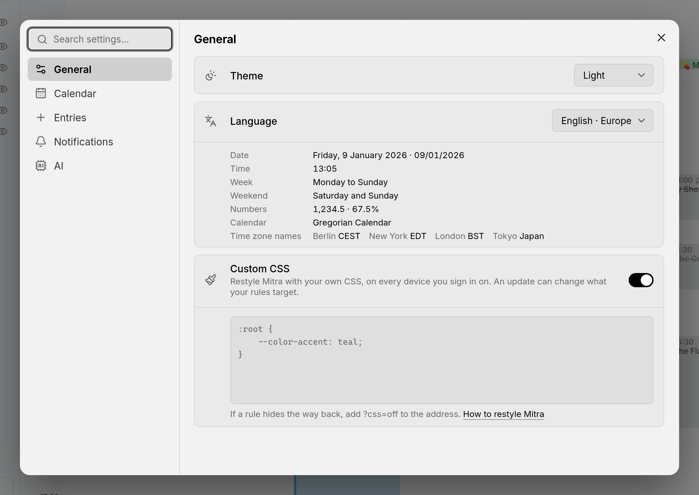

Mitra の設定は 1 つのダイアログにまとまっています。サイドバー下部の **設定** から、どこにいても <kbd>Ctrl</kbd>+<kbd>,</kbd>（Mac では <kbd>⌘</kbd>+<kbd>,</kbd>）で、または[コマンドパレット](shortcuts.md)から開きます。アカウントでサインインしている場合、**設定** はサイドバー下部のアカウントカードにある歯車になり、隣の **⋯** に **サインアウト** があります。

<picture>
  <source media="(prefers-color-scheme: dark)" srcset="../assets/screenshots/settings-detail-dark.webp">
  
</picture>

何も変更する必要はありません。手を付けない設定は Mitra のデフォルトに従うので、あとのバージョンでデフォルトが改善されれば新しい値が使われます。自分でデフォルト値を選んだ場合も、手を付けないのと同じ扱いです。

## 設定を探す

ダイアログ上部の **設定を検索…** に入力します。ページと設定をまとめて検索し、見つかったものをページごとにまとめて表示します。「カレンダー」と入れれば、**カレンダー** ページ全体と **項目** の **デフォルトのカレンダー** 設定が出てきます。結果の中からそのまま設定を変更できます。

コマンドパレットも同じ言葉を知っていて、ダイアログを開かずにほとんどの設定を変えられます。「ダーク」と入力して **テーマ: ダーク** を選んだり、「スナップ」と入力して **スナップ: 30 分** を選んだりできます。すでに選んでいる値は候補に出ません。デフォルトのビューのように一手で変えられない設定は、代わりに **デフォルトのビューを変更…** が出て、その設定を開いた状態でダイアログが開きます。

## アカウントとこのデバイス

ほとんどの設定はアカウントに紐づき、サインインするすべてのデバイスとブラウザーに付いてきます。言語、デフォルトのビュー、**完了したタスクを非表示**、**キャンセル済みを非表示**、**対応可能時間を非表示**、デフォルトのカレンダー、デフォルトの所要時間、**スナップ**、2 つのデフォルトリマインダー、そして **カスタムCSS** です。

残りは今使っているデバイスに紐づくので、スマートフォンとノート PC で異なる設定にできます。テーマ、接続線、このブラウザーで通知を表示するかどうかです。

Mitra は使うたびに、デバイスごとの状態もいくつか覚えます。どこまでズームしたか、サイドバーが開いているかとどのタブか、畳んだタイムゾーン、テーブルビューに表示する期間です。

## 一般

**テーマ** は **システムに合わせる**・**ライト**・**ダーク** です。デフォルトの **システムに合わせる** は、デバイスのライト/ダークモードに従います。

**言語** には、英語・ドイツ語・フランス語・スペイン語・ポルトガル語・イタリア語・ペルシア語・中国語・ポーランド語・オランダ語・アラビア語・ロシア語・日本語・韓国語があり、それぞれ自身の言語名で表示されます。中国語は簡体字で書かれます。変更は再読み込みなしで即座に適用され、ペルシア語とアラビア語では Mitra が右から左にレイアウトされます。

言語は、日時の読み方、週が始まる曜日、週末の曜日も決めます。最初はブラウザーがその言語を書く地域の表記になるので、英語はたいていアメリカ流に、ドイツ語はドイツ流に、ペルシア語はイラン流になります。言語の末尾の矢印を開くと、その言語が書かれる国や地域が展開されます。例えば英語ならイギリスやヨーロッパです。イギリスの英語は「9 Oct 2026」「13:00」と書き週は月曜始まりですが、アメリカでは「Oct 9, 2026」「1:00 PM」で日曜始まりです。コマンドパレットから別の言語に切り替えても、新しい言語がその国で書かれていれば国は保たれます。設定の下のプレビューで、日時・週・数字・タイムゾーン名の読み方を確認できます。ここでいう国はタイムゾーンではありません。ニューヨークとロサンゼルスは同じ国でもタイムゾーンは別々です。

**カスタムCSS** は自分の CSS で Mitra の見た目を変えます。入力したそばから適用され、アカウントに保存されます。隣のスイッチで、内容を失わずにオフにできます。何ができるかは[カスタムCSS](custom-css.md)を参照してください。サインインを使う環境では、管理者は **管理** の下に **全員向けカスタムCSS** も見つけます。これはサーバー上の全員の Mitra の見た目を変えます。

## カレンダー

**デフォルトのビュー** は Mitra が開くビューです。**月**・**年**・**タイムライン**・**テーブル** を選ばない限り **週** です。

**完了したタスクを非表示** は、完了したタスクを週ビュー・月ビュー・年ビューと計画タブから外します。**キャンセル済みを非表示** は、キャンセル済みのタスクと予定に同じことをします。検索には引き続き見つかり、親タスクの進捗にも数えられ、テーブルビューにも残ります。開いているタスクは、閉じるまで見えたままです。

**対応可能時間を非表示** は[対応可能時間](availability.md)を週ビューから外します。カレンダーには残り、予定ありの対応可能時間は他の人には引き続き予定ありとして見えます。

**週ビューの接続線**・**月ビューの接続線**・**タイムラインの接続線** は、各ビューで[サブタスク](subtasks.md)や[依存関係](dependencies.md)の間の線をオン・オフします。最初はすべてオンです。

## 項目

**デフォルトのカレンダー** は、新しい予定とタスクの行き先です。サイドバーで塗りつぶされたアイコンと同じ選択です。[新しい項目の行き先](calendars.md#where-new-entries-land)を参照してください。設定していないか、非表示になっている間は、新しい項目は表示中の最初のカレンダーに入ります。

**デフォルトの所要時間** は、長さを指定しない新しい項目の所要時間です。例えばグリッドをクリックしたとき、見積もりのない日付未定のタスクをドラッグして入れたとき、**終日** をオフにしたときに使われます。15 分から 2 時間までの範囲で、変更しない限り 1 時間です。

**スナップ** は、ドラッグやリサイズが吸着する刻みです。5・10・15・30 分で、変更しない限り 15 分です。

## 通知

**リマインダー通知** は、このブラウザーが通知を出してよいかを決めます。**許可** を押すとブラウザーが権限を尋ね、行には **許可済み** または **ブロック中** と表示されます。ブロックを解除するには、ブラウザーのサイト設定で Mitra の通知を許可します。追加したリマインダーはどちらにしても保存されます。Mitra の通知を表示できないブラウザーでは、この行自体がありません。[トラブルシューティング](reminders.md#troubleshooting)を参照してください。

**予定のデフォルトリマインダー** と **タスクのデフォルトリマインダー** は、新しい項目に最初から付くリマインダーを設定します。予定は 30 分前、タスクはタスクの時刻、または **なし** です。時刻のある項目にだけ適用されます。

このブラウザーで通知を許可すると、ページには **デバイス** の一覧も表示され、名前の変更、テストリマインダーの送信、削除ができます。[リマインダー](reminders.md#your-devices)を参照してください。
