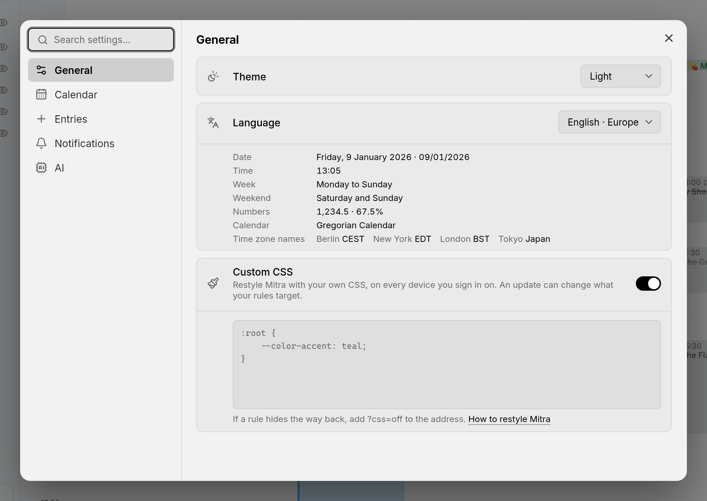

Mitra의 설정은 하나의 대화 상자에 모여 있습니다. 사이드바 아래쪽의 **설정**을 누르거나, 어디서든 <kbd>Ctrl</kbd>+<kbd>,</kbd>(Mac에서는 <kbd>⌘</kbd>+<kbd>,</kbd>)를 누르거나, [명령 팔레트](shortcuts.md)에서 여세요. 계정으로 로그인한 경우 **설정**은 사이드바 아래쪽 계정 카드의 톱니바퀴이고, 그 옆의 **⋯** 메뉴에 **로그아웃**이 있습니다.

<picture>
  <source media="(prefers-color-scheme: dark)" srcset="../assets/screenshots/settings-detail-dark.webp">
  
</picture>

아무것도 바꾸지 않아도 됩니다. 손대지 않은 설정은 Mitra의 기본값을 따르므로, 이후 버전에서 기본값이 개선되면 새 기본값이 적용됩니다. 기본값을 직접 고르는 것도 손대지 않은 것으로 칩니다.

## 설정 찾기

대화 상자 위쪽의 **설정 검색…** 입력란에 입력하세요. 페이지와 설정을 한꺼번에 검색하고, 찾은 결과를 페이지별로 묶어 보여 줍니다. 예를 들어 "캘린더"를 입력하면 **캘린더** 페이지 전체와 함께 **항목** 페이지의 **기본 캘린더** 설정이 나타납니다. 검색 결과에서 바로 설정을 바꿀 수 있습니다.

명령 팔레트도 같은 단어를 알아듣고, 대화 상자를 열지 않고도 대부분의 설정을 바꿉니다. "다크"를 입력하고 **테마: 다크**를 고르거나, "맞춤"을 입력하고 **맞춤 간격: 30분**을 고르세요. 이미 선택한 값은 제안하지 않습니다. 기본 보기처럼 한 번에 바꿀 수 없는 설정은 대신 **기본 보기 변경…** 명령을 제안하며, 이 명령은 대화 상자를 열어 해당 설정을 보여 줍니다.

## 계정 설정과 기기 설정

대부분의 설정은 계정에 속하므로, 로그인하는 모든 기기와 브라우저에서 똑같이 적용됩니다. 언어, 기본 보기, **완료된 작업 숨기기**, **취소된 항목 숨기기**, **가용 시간 숨기기**, 기본 캘린더, 기본 길이, **맞춤 간격**, 두 가지 기본 알림, 그리고 **사용자 지정 CSS**가 여기에 해당합니다.

나머지 설정은 지금 쓰는 기기에 속하므로 휴대폰과 노트북에서 서로 다르게 둘 수 있습니다. 테마, 연결선, 그리고 이 브라우저에서 알림을 표시할지 여부입니다.

Mitra는 쓰는 동안 기기마다 몇 가지를 기억하기도 합니다. 확대 정도, 사이드바가 열려 있는지와 어느 탭이 열려 있는지, 접어 둔 시간대, 표 보기에 표시하는 기간입니다.

## 일반

**테마**는 **시스템 설정에 맞춤**, **라이트**, **다크** 중 하나입니다. 기본값인 **시스템 설정에 맞춤**은 기기의 밝은 모드나 어두운 모드를 따릅니다.

**언어**에서는 영어, 독일어, 프랑스어, 스페인어, 포르투갈어, 이탈리아어, 페르시아어, 중국어, 폴란드어, 네덜란드어, 아랍어, 러시아어, 일본어, 한국어, 베트남어를 고를 수 있으며, 각 언어는 그 언어로 된 이름으로 표시됩니다. 중국어는 간체자로 쓰입니다. 바꾸면 새로 고침 없이 바로 적용되고, 페르시아어와 아랍어에서는 Mitra가 오른쪽에서 왼쪽으로 배치됩니다.

언어는 날짜와 시각을 쓰는 방식, 한 주가 시작하는 요일, 주말에 해당하는 요일도 정합니다. 처음에는 브라우저가 그 언어를 쓰는 방식을 따르므로, 영어는 보통 미국식으로, 독일어는 독일식으로, 페르시아어는 이란식으로 표시됩니다. 언어 끝의 화살표를 누르면 영어의 경우 영국이나 유럽처럼 그 언어를 쓰는 나라와 지역이 펼쳐집니다. 영국 영어는 9 Oct 2026, 13:00으로 쓰고 한 주를 월요일에 시작하지만, 미국 영어는 Oct 9, 2026, 1:00 PM으로 쓰고 한 주를 일요일에 시작합니다. 명령 팔레트에서 다른 언어로 바꿀 때, 새 언어가 쓰이는 나라라면 지금의 나라가 유지됩니다. 설정 아래의 미리 보기에서 날짜, 시각, 주, 숫자, 시간대 이름이 어떻게 표시되는지 볼 수 있습니다. 여기서 고르는 나라는 시간대가 아닙니다. 뉴욕과 로스앤젤레스는 같은 나라입니다.

**사용자 지정 CSS**를 쓰면 직접 작성한 CSS로 Mitra의 모양을 바꿀 수 있습니다. 입력하는 대로 적용되고 계정에 저장됩니다. 옆의 스위치를 끄면 내용을 잃지 않고 끌 수 있습니다. 무엇을 할 수 있는지는 [사용자 지정 CSS](custom-css.md)를 참고하세요. 여러 사람이 로그인하는 서버라면 관리자는 **관리** 아래에서 **모두를 위한 사용자 지정 CSS**도 찾을 수 있으며, 이 설정은 서버의 모든 사람에게 Mitra의 모양을 바꿉니다.

## 캘린더

**기본 보기**는 Mitra를 열 때 처음 보이는 보기입니다. **월**, **연도**, **타임라인**, **표** 중에서 고르지 않으면 **주**입니다.

**완료된 작업 숨기기**는 주 보기, 월 보기, 연도 보기와 계획 탭에서 완료된 작업을 숨기고, **취소된 항목 숨기기**는 취소된 작업과 일정을 똑같이 숨깁니다. 숨긴 항목도 검색에서는 찾을 수 있고, 상위 작업의 진행률에 계속 반영되며, 표 보기에는 계속 나열됩니다. 열어 둔 작업은 닫을 때까지 보입니다.

**가용 시간 숨기기**는 주 보기에서 [가용 시간](availability.md)을 숨깁니다. 가용 시간은 캘린더에 그대로 남고, 바쁨으로 표시된 가용 시간은 다른 사람에게 계속 바쁨으로 보입니다.

**주 보기의 연결선**, **월 보기의 연결선**, **타임라인의 연결선**은 각 보기에서 [하위 작업](subtasks.md)과 [종속 관계](dependencies.md) 사이의 선을 켜거나 끕니다. 처음에는 모두 켜져 있습니다.

## 항목

**기본 캘린더**는 새 일정과 작업이 들어가는 곳입니다. 사이드바의 채워진 아이콘과 같은 선택입니다. [새 항목이 들어가는 곳](calendars.md#where-new-entries-land)을 참고하세요. 기본 캘린더가 없거나 숨겨져 있으면 새 항목은 표시 중인 첫 번째 캘린더에 들어갑니다.

**기본 길이**는 길이를 정하지 않은 새 항목이 이어지는 시간입니다. 예를 들어 격자를 클릭하거나, 예상 시간이 없는 날짜 미정 작업을 끌어 넣거나, **종일**을 끌 때 적용됩니다. 15분부터 2시간까지 고를 수 있고, 바꾸지 않으면 1시간입니다.

**맞춤 간격**은 드래그하거나 크기를 조절할 때 맞춰지는 단위입니다. 5분, 10분, 15분, 30분 중에서 고를 수 있고, 바꾸지 않으면 15분입니다.

## 알림

**알림 표시**는 이 브라우저가 알림을 보낼 수 있는지 정합니다. **허용**을 누르면 브라우저가 권한을 묻고, 그 뒤 이 줄에 **허용됨** 또는 **차단됨**이 표시됩니다. 차단을 풀려면 브라우저의 사이트 설정에서 Mitra의 알림을 허용하세요. 추가한 알림은 어느 쪽이든 저장됩니다. Mitra의 알림을 표시할 수 없는 브라우저에서는 이 줄이 나타나지 않습니다. [문제 해결](reminders.md#troubleshooting)을 참고하세요.

**기본 일정 알림**과 **기본 작업 알림**은 새 항목에 처음부터 붙는 알림을 정합니다. 일정은 30분 전, 작업은 작업 시각에 알리며, **없음**을 고를 수도 있습니다. 시각이 있는 항목에만 적용됩니다.

이 브라우저에서 알림을 허용하면 페이지에 **기기** 목록도 나타납니다. 여기서 기기 이름을 바꾸거나, 테스트 알림을 보내거나, 기기를 제거할 수 있습니다. [알림](reminders.md#your-devices)을 참고하세요.
