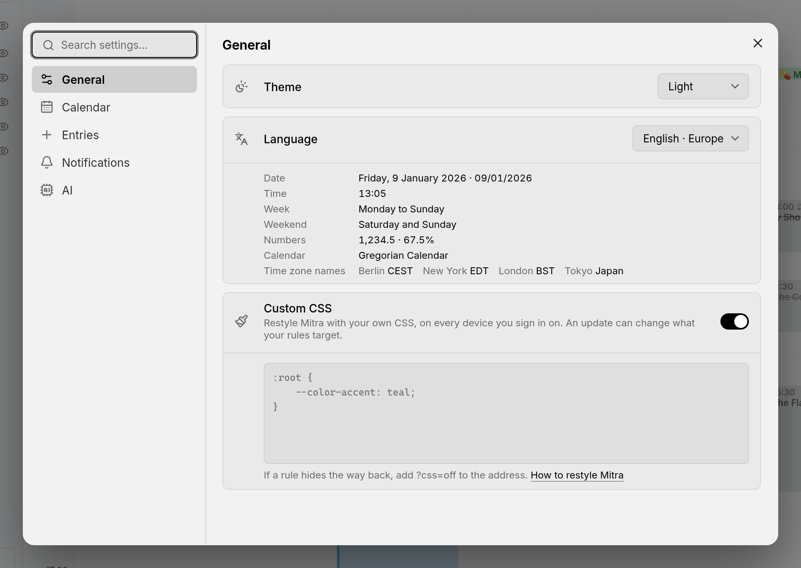

Mitra giữ các cài đặt của nó trong một hộp thoại. Mở nó bằng **Cài đặt** ở cuối thanh bên, bằng <kbd>Ctrl</kbd>+<kbd>,</kbd> (<kbd>⌘</kbd>+<kbd>,</kbd> trên máy Mac) từ bất cứ đâu, hoặc từ [bảng lệnh](shortcuts.md). Khi bạn đăng nhập bằng một tài khoản, **Cài đặt** là biểu tượng bánh răng trên thẻ tài khoản của bạn ở cuối thanh bên, và **⋯** bên cạnh chứa **Đăng xuất**.

<picture>
  <source media="(prefers-color-scheme: dark)" srcset="../assets/screenshots/settings-detail-dark.webp">
  
</picture>

Bạn không bao giờ phải thay đổi gì. Một cài đặt bạn không đụng đến sẽ theo mặc định của Mitra, nên khi một phiên bản sau cải thiện mặc định, bạn nhận được giá trị mới. Tự chọn giá trị mặc định cũng được tính là không đụng đến.

## Tìm một cài đặt

Gõ vào **Tìm cài đặt…** ở đầu hộp thoại. Nó tìm trong các trang và các cài đặt cùng lúc, và nhóm kết quả theo trang: “lịch” hiện cả trang **Lịch** cùng với cài đặt **Lịch mặc định** từ **Mục**. Bạn có thể đổi một cài đặt ngay trong kết quả.

Bảng lệnh biết cùng những từ đó, và thay đổi hầu hết cài đặt mà không cần mở hộp thoại. Gõ “tối” và chọn **Giao diện: Tối**, hoặc “căn” và chọn **Căn theo: 30 phút**. Nó chỉ đưa ra các giá trị bạn chưa chọn. Một cài đặt mà nó không thể đổi trong một bước, như chế độ xem mặc định, đưa ra **Đổi Chế độ xem mặc định…**, mở hộp thoại tại cài đặt đó.

## Tài khoản của bạn hoặc thiết bị này

Hầu hết cài đặt thuộc về tài khoản của bạn và theo bạn đến mọi thiết bị và trình duyệt bạn đăng nhập: ngôn ngữ, chế độ xem mặc định, **Ẩn công việc đã xong**, **Ẩn mục đã hủy**, **Ẩn thời gian khả dụng**, lịch mặc định, thời lượng mặc định, **Căn theo**, cả hai lời nhắc mặc định và **CSS tùy chỉnh** của bạn.

Những cài đặt còn lại thuộc về thiết bị bạn đang dùng, nên điện thoại và máy tính xách tay của bạn có thể khác nhau: giao diện, đường nối, và việc trình duyệt này có hiện thông báo hay không.

Mitra cũng nhớ một số thứ trên mỗi thiết bị khi bạn dùng: bạn đã phóng to đến đâu, thanh bên đang mở hay không và ở thẻ nào, những múi giờ bạn đã gập lại, và khoảng thời gian mà chế độ xem bảng hiển thị.

## Chung

**Giao diện** là **Theo hệ thống**, **Sáng** hoặc **Tối**. **Theo hệ thống**, mặc định, theo chế độ sáng hoặc tối của thiết bị bạn.

**Ngôn ngữ** gồm tiếng Anh, tiếng Đức, tiếng Pháp, tiếng Tây Ban Nha, tiếng Bồ Đào Nha, tiếng Ý, tiếng Ba Tư, tiếng Trung, tiếng Ba Lan, tiếng Hà Lan, tiếng Ả Rập, tiếng Nga, tiếng Nhật, tiếng Hàn và tiếng Việt; trong danh sách, mỗi ngôn ngữ hiện bằng chính tên của nó, và tiếng Trung được viết bằng chữ giản thể. Thay đổi có hiệu lực ngay, không cần tải lại, và tiếng Ba Tư cùng tiếng Ả Rập bố trí Mitra từ phải sang trái.

Mỗi ngôn ngữ cũng quyết định cách ngày và giờ được đọc, tuần bắt đầu từ ngày nào, và những ngày nào là cuối tuần. Ban đầu nó đọc theo cách trình duyệt của bạn viết ngôn ngữ đó, nên tiếng Anh thường đọc như ở Hoa Kỳ, tiếng Đức như ở Đức và tiếng Ba Tư như ở Iran. Mũi tên ở cuối một ngôn ngữ mở ra các quốc gia và khu vực nó được viết ở đó, như Vương quốc Anh hoặc châu Âu cho tiếng Anh: tiếng Anh cho Vương quốc Anh viết 9 Oct 2026 và 13:00 và bắt đầu tuần vào thứ Hai, còn cho Hoa Kỳ thì viết Oct 9, 2026 và 1:00 PM và bắt đầu vào Chủ nhật. Chuyển sang ngôn ngữ khác từ bảng lệnh giữ nguyên quốc gia của bạn khi ngôn ngữ mới được viết ở đó. Một bản xem trước dưới cài đặt cho thấy cách ngày, giờ, tuần, số và tên múi giờ được đọc. Quốc gia ở đây không phải múi giờ: New York và Los Angeles dùng chung một quốc gia.

**CSS tùy chỉnh** đổi giao diện Mitra bằng CSS của riêng bạn, áp dụng ngay khi bạn gõ và được lưu trong tài khoản của bạn. Công tắc bên cạnh tắt nó đi mà không làm mất nó. Xem [CSS tùy chỉnh](custom-css.md) để biết bạn có thể làm gì với nó. Ở nơi mọi người đăng nhập, quản trị viên còn thấy **CSS tùy chỉnh cho mọi người** trong **Quản trị**, dùng để đổi giao diện Mitra cho mọi người trên máy chủ.

## Lịch

**Chế độ xem mặc định** là chế độ xem Mitra mở lên: **Tuần**, trừ khi bạn chọn **Tháng**, **Năm**, **Dòng thời gian** hoặc **Bảng**.

**Ẩn công việc đã xong** đưa các công việc đã xong ra khỏi chế độ xem tuần, tháng và năm cũng như thẻ Kế hoạch, và **Ẩn mục đã hủy** làm tương tự với công việc và sự kiện đã hủy. Tìm kiếm vẫn thấy chúng, chúng vẫn được tính vào tiến độ của mục cha, và chế độ xem bảng vẫn liệt kê chúng. Một công việc bạn đang mở vẫn hiện cho đến khi bạn đóng nó.

**Ẩn thời gian khả dụng** đưa [thời gian khả dụng](availability.md) ra khỏi chế độ xem tuần. Nó vẫn ở trong các lịch của nó, và thời gian khả dụng bận vẫn hiện là bận với người khác.

**Đường nối trong chế độ xem tuần**, **Đường nối trong chế độ xem tháng** và **Đường nối trong dòng thời gian** bật hoặc tắt các đường giữa [công việc con](subtasks.md) và [phụ thuộc](dependencies.md) trong từng chế độ xem. Ban đầu tất cả đều bật.

## Mục

**Lịch mặc định** là nơi các sự kiện và công việc mới được đưa vào. Đó là cùng một lựa chọn với biểu tượng được tô đầy trên thanh bên: xem [nơi các mục mới được đặt](calendars.md#where-new-entries-land). Nếu không có, hoặc khi nó bị ẩn, các mục mới vào lịch đầu tiên đang hiển thị.

**Thời lượng mặc định** là thời gian một mục mới kéo dài khi bạn không cho độ dài, ví dụ khi bạn nhấp vào lưới, kéo vào một công việc chưa lên lịch không có ước tính, hoặc tắt **Cả ngày**. Nó từ 15 phút đến 2 giờ, và là một giờ trừ khi bạn đổi.

**Căn theo** là bước mà việc kéo và đổi kích thước dừng lại: 5, 10, 15 hoặc 30 phút, 15 trừ khi bạn đổi.

## Thông báo

**Thông báo lời nhắc** quyết định trình duyệt này có được phép báo cho bạn hay không. Nhấn **Cho phép**, và trình duyệt của bạn xin quyền; hàng đó sau đó hiện **Đã cho phép** hoặc **Đã chặn**. Để hoàn tác một lần chặn, hãy cho phép thông báo cho Mitra trong cài đặt trang web của trình duyệt. Các lời nhắc bạn thêm vẫn được lưu trong cả hai trường hợp. Ở trình duyệt không thể hiện thông báo từ Mitra, hàng này không có; xem [khắc phục sự cố](reminders.md#troubleshooting).

**Lời nhắc mặc định cho sự kiện** và **Lời nhắc mặc định cho công việc** đặt các lời nhắc mà mục mới bắt đầu với: 30 phút trước cho một sự kiện, và đúng thời điểm của công việc cho một công việc, hoặc **Không có**. Chúng chỉ áp dụng cho các mục có giờ.

Khi trình duyệt này cho phép thông báo, trang cũng liệt kê **Thiết bị** của bạn, nơi bạn có thể đổi tên chúng, gửi lời nhắc thử hoặc gỡ một thiết bị. Xem [Lời nhắc](reminders.md#your-devices).
