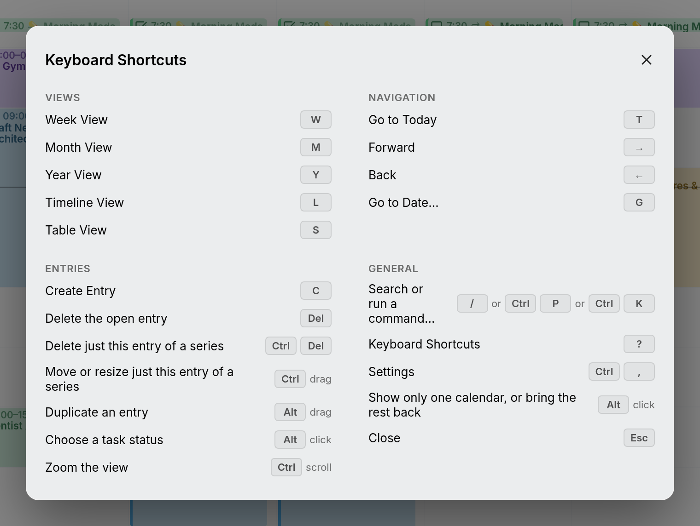
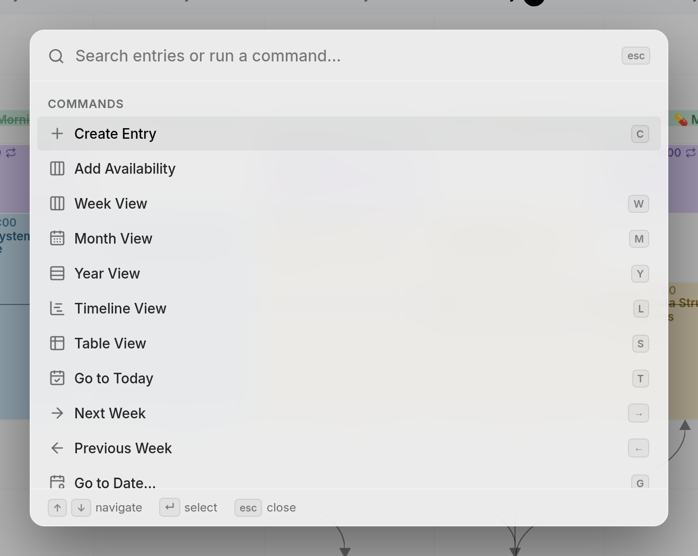

カレンダーのどこでも <kbd>?</kbd> を押すと、ショートカットの一覧が開きます。常に実行中のバージョンに対応した内容です。キーは Google カレンダー、Notion カレンダー、Proton カレンダーといったウェブカレンダーの慣例に従っているので、知っている操作をそのまま使えます。

<picture>
  <source media="(prefers-color-scheme: dark)" srcset="../assets/screenshots/shortcuts-detail-dark.webp">
  
</picture>

## ビュー

| 操作 | キー |
| --- | --- |
| 週ビュー | <kbd>W</kbd> |
| 月ビュー | <kbd>M</kbd> |
| 年ビュー | <kbd>Y</kbd> |
| タイムラインビュー | <kbd>L</kbd> |
| テーブルビュー | <kbd>S</kbd> |

## ナビゲーション

| 操作 | キー |
| --- | --- |
| 今日へ移動 | <kbd>T</kbd> |
| 1 週 / 1 か月 / 1 年先へ進む | <kbd>→</kbd> |
| 1 週 / 1 か月 / 1 年前へ戻る | <kbd>←</kbd> |
| 指定した日付へ移動 | <kbd>G</kbd> |

## 項目

| 操作 | キー |
| --- | --- |
| 項目を作成 | <kbd>C</kbd> |
| 開いている項目を削除 | <kbd>Delete</kbd> または <kbd>Backspace</kbd> |
| シリーズのこの項目だけを削除 | <kbd>Ctrl</kbd> <kbd>Delete</kbd> |
| シリーズのこの項目だけを移動・リサイズ | ドロップ時に <kbd>Ctrl</kbd> を押したまま |
| 項目を複製 | ドロップ時に <kbd>Alt</kbd> を押したまま |
| タスクのステータスを選択 | <kbd>Alt</kbd> + チェックボックスをクリック、または右クリック |
| ビューをズーム | <kbd>Ctrl</kbd> + スクロール |

## 一般

| 操作 | キー |
| --- | --- |
| 項目を検索、またはコマンドを実行 | <kbd>/</kbd> または <kbd>Ctrl</kbd> <kbd>P</kbd> または <kbd>Ctrl</kbd> <kbd>K</kbd> |
| キーボードショートカット | <kbd>?</kbd> |
| [設定](settings.md) | <kbd>Ctrl</kbd> <kbd>,</kbd> |
| [1 つのカレンダーだけを表示](calendars.md#show-only-one-calendar)、または残りを戻す | サイドバーで <kbd>Alt</kbd> + その目のアイコンをクリック |
| 閉じる、または戻る | <kbd>Esc</kbd> |

> [!NOTE]
> Mac では、文中の <kbd>Ctrl</kbd> はすべて <kbd>⌘</kbd>、<kbd>Alt</kbd> は <kbd>⌥</kbd> と読み替えてください。また <kbd>⌫</kbd> が <kbd>Delete</kbd> の代わりになります（どこでも <kbd>Backspace</kbd> でも削除できます）。

テキストフィールドに入力している間、単独の文字キーのショートカットは働きません。

## コマンドパレット

<kbd>/</kbd>、<kbd>Ctrl</kbd> + <kbd>K</kbd>、<kbd>Ctrl</kbd> + <kbd>P</kbd> のいずれかを押すと、項目を検索したりコマンドを実行したりできます。3 つとも同じ動作です。検索は、画面に出ている日付だけでなく、すべてのカレンダーのタイトル・説明・場所を対象とし、繰り返しの項目は 1 回だけ表示します。非表示のカレンダーにある項目は薄く表示されます。項目を選ぶとその日付へ移動して開き、非表示だったカレンダーは再び表示されます。コマンドはビュー、ナビゲーション、新規項目、カレンダー、設定を網羅し、それぞれに対応するキーが横に表示されるので、使いながら覚えられます。

<picture>
  <source media="(prefers-color-scheme: dark)" srcset="../assets/screenshots/palette-detail-dark.webp">
  
</picture>
