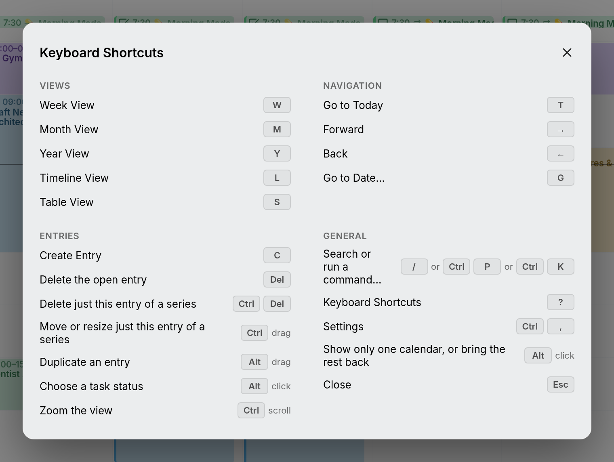
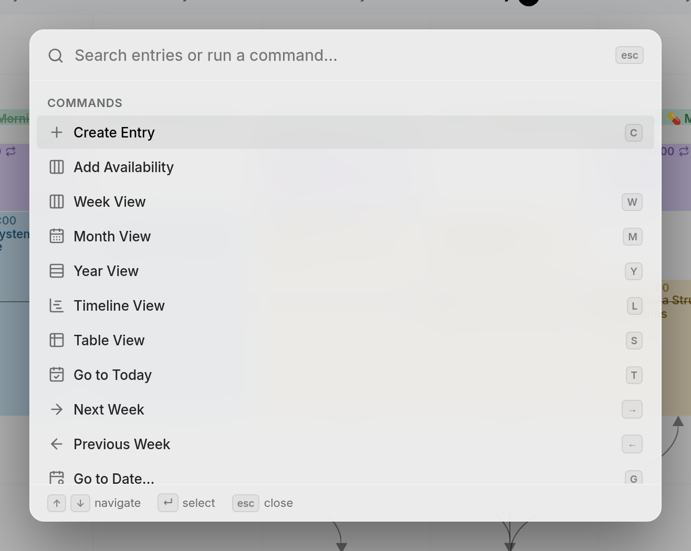

캘린더 어디서든 <kbd>?</kbd>를 누르면 단축키 목록이 열립니다. 목록은 언제나 지금 쓰고 있는 버전과 일치합니다. 키는 Google 캘린더, Notion Calendar, Proton Calendar 같은 웹 캘린더의 관례를 따르므로 이미 익숙한 키를 그대로 쓸 수 있습니다.

<picture>
  <source media="(prefers-color-scheme: dark)" srcset="../assets/screenshots/shortcuts-detail-dark.webp">
  
</picture>

## 보기

| 동작 | 키 |
| --- | --- |
| 주 보기 | <kbd>W</kbd> |
| 월 보기 | <kbd>M</kbd> |
| 연도 보기 | <kbd>Y</kbd> |
| 타임라인 보기 | <kbd>L</kbd> |
| 표 보기 | <kbd>S</kbd> |

## 이동

| 동작 | 키 |
| --- | --- |
| 오늘로 가기 | <kbd>T</kbd> |
| 한 주 / 한 달 / 한 해 앞으로 | <kbd>→</kbd> |
| 한 주 / 한 달 / 한 해 뒤로 | <kbd>←</kbd> |
| 특정 날짜로 가기 | <kbd>G</kbd> |

## 항목

| 동작 | 키 |
| --- | --- |
| 항목 만들기 | <kbd>C</kbd> |
| 열려 있는 항목 삭제 | <kbd>Delete</kbd> 또는 <kbd>Backspace</kbd> |
| 시리즈에서 이 항목만 삭제 | <kbd>Ctrl</kbd> <kbd>Delete</kbd> |
| 시리즈에서 이 항목만 옮기거나 크기 조절 | 놓을 때 <kbd>Ctrl</kbd> 누르고 있기 |
| 항목 복제 | 놓을 때 <kbd>Alt</kbd> 누르고 있기 |
| 작업 상태 고르기 | <kbd>Alt</kbd> + 체크박스 클릭, 또는 체크박스 오른쪽 클릭 |
| 보기 확대/축소 | <kbd>Ctrl</kbd> + 스크롤 |

## 일반

| 동작 | 키 |
| --- | --- |
| 항목 검색 또는 명령 실행 | <kbd>/</kbd> 또는 <kbd>Ctrl</kbd> <kbd>P</kbd> 또는 <kbd>Ctrl</kbd> <kbd>K</kbd> |
| 키보드 단축키 | <kbd>?</kbd> |
| [설정](settings.md) | <kbd>Ctrl</kbd> <kbd>,</kbd> |
| [캘린더 하나만 보기](calendars.md#show-only-one-calendar), 또는 나머지 다시 보기 | <kbd>Alt</kbd> + 사이드바에서 캘린더의 눈 아이콘 클릭 |
| 닫기 또는 뒤로 가기 | <kbd>Esc</kbd> |

> [!NOTE]
> Mac에서는 어디서나 <kbd>Ctrl</kbd>을 <kbd>⌘</kbd>로, <kbd>Alt</kbd>를 <kbd>⌥</kbd>로 읽으면 되고, <kbd>Delete</kbd> 대신 <kbd>⌫</kbd>를 씁니다(<kbd>Backspace</kbd>도 어디서나 삭제합니다).

글자 하나짜리 단축키는 텍스트 필드에 입력하는 동안에는 작동하지 않습니다.

## 명령 팔레트

<kbd>/</kbd>, <kbd>Ctrl</kbd> + <kbd>K</kbd>, <kbd>Ctrl</kbd> + <kbd>P</kbd> 중 하나를 누르면 항목을 검색하거나 명령을 실행할 수 있습니다. 세 가지 모두 같은 일을 합니다. 검색은 화면에 보이는 날짜만이 아니라 모든 캘린더의 제목, 설명, 장소를 살펴보며, 반복 항목은 한 번만 나옵니다. 숨긴 캘린더의 항목은 흐리게 표시됩니다. 항목을 고르면 그 날짜로 가서 항목을 열고, 캘린더가 숨겨져 있었다면 다시 보이게 합니다. 명령에는 보기, 이동, 새 항목, 캘린더, 설정이 있고, 명령마다 옆에 키가 표시되므로 쓰면서 자연스럽게 익힐 수 있습니다.

<picture>
  <source media="(prefers-color-scheme: dark)" srcset="../assets/screenshots/palette-detail-dark.webp">
  
</picture>
