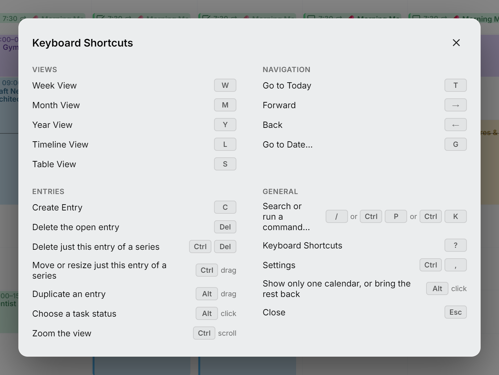
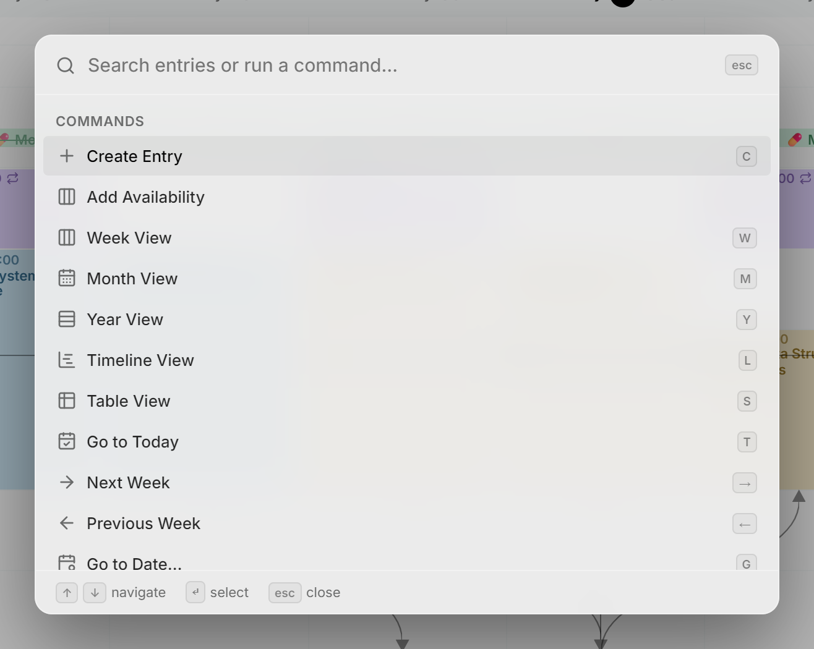

Druk ergens in de agenda op <kbd>?</kbd> om de lijst met sneltoetsen te openen. Die klopt altijd met de versie die je gebruikt. De toetsen volgen de gewoonten van webagenda's zoals Google Agenda, Notion Calendar en Proton Calendar, dus wat je daar al kent, werkt hier ook.

<picture>
  <source media="(prefers-color-scheme: dark)" srcset="../assets/screenshots/shortcuts-detail-dark.webp">
  
</picture>

## Weergaven

| Actie | Toetsen |
| --- | --- |
| Weekweergave | <kbd>W</kbd> |
| Maandweergave | <kbd>M</kbd> |
| Jaarweergave | <kbd>Y</kbd> |
| Tijdlijnweergave | <kbd>L</kbd> |
| Tabelweergave | <kbd>S</kbd> |

## Navigatie

| Actie | Toetsen |
| --- | --- |
| Naar vandaag gaan | <kbd>T</kbd> |
| Een week, maand of jaar vooruit | <kbd>→</kbd> |
| Een week, maand of jaar terug | <kbd>←</kbd> |
| Naar een bepaalde datum gaan | <kbd>G</kbd> |

## Items

| Actie | Toetsen |
| --- | --- |
| Item maken | <kbd>C</kbd> |
| Geopend item verwijderen | <kbd>Delete</kbd> of <kbd>Backspace</kbd> |
| Alleen dit item van een reeks verwijderen | <kbd>Ctrl</kbd> <kbd>Delete</kbd> |
| Alleen dit item van een reeks verplaatsen of aanpassen | <kbd>Ctrl</kbd> ingedrukt houden bij het loslaten |
| Item dupliceren | <kbd>Alt</kbd> ingedrukt houden bij het loslaten |
| Taakstatus kiezen | <kbd>Alt</kbd> + klik op het selectievakje, of klik er met rechts op |
| In- of uitzoomen | <kbd>Ctrl</kbd> + scrollen |

## Algemeen

| Actie | Toetsen |
| --- | --- |
| Items zoeken of een opdracht uitvoeren | <kbd>/</kbd> of <kbd>Ctrl</kbd> <kbd>P</kbd> of <kbd>Ctrl</kbd> <kbd>K</kbd> |
| Sneltoetsen | <kbd>?</kbd> |
| [Instellingen](settings.md) | <kbd>Ctrl</kbd> <kbd>,</kbd> |
| [Eén agenda weergeven](calendars.md#show-only-one-calendar), of de rest terughalen | <kbd>Alt</kbd> + klik op het oogje in de zijbalk |
| Sluiten of teruggaan | <kbd>Esc</kbd> |

> [!NOTE]
> Op een Mac staat overal <kbd>⌘</kbd> voor <kbd>Ctrl</kbd> en <kbd>⌥</kbd> voor <kbd>Alt</kbd>, en <kbd>⌫</kbd> vervangt <kbd>Delete</kbd> (<kbd>Backspace</kbd> verwijdert overal ook).

Sneltoetsen van één letter doen niets zolang je in een tekstveld typt.

## Opdrachtenpalet

Druk op <kbd>/</kbd>, <kbd>Ctrl</kbd> + <kbd>K</kbd> of <kbd>Ctrl</kbd> + <kbd>P</kbd> om in je items te zoeken of een opdracht uit te voeren. Alle drie doen hetzelfde. De zoekfunctie doorzoekt de titels, beschrijvingen en locaties in al je agenda's, niet alleen de dagen op het scherm, en toont een terugkerend item maar één keer. Items uit verborgen agenda's zie je gedimd. Kies je een item, dan ga je naar de datum ervan en wordt het geopend, en was de agenda verborgen, dan verschijnt die weer. Met de opdrachten bedien je de weergaven, de navigatie, nieuwe items, je agenda's en je instellingen. Naast elke opdracht staan de bijbehorende toetsen, zodat je ze gaandeweg leert.

<picture>
  <source media="(prefers-color-scheme: dark)" srcset="../assets/screenshots/palette-detail-dark.webp">
  
</picture>
