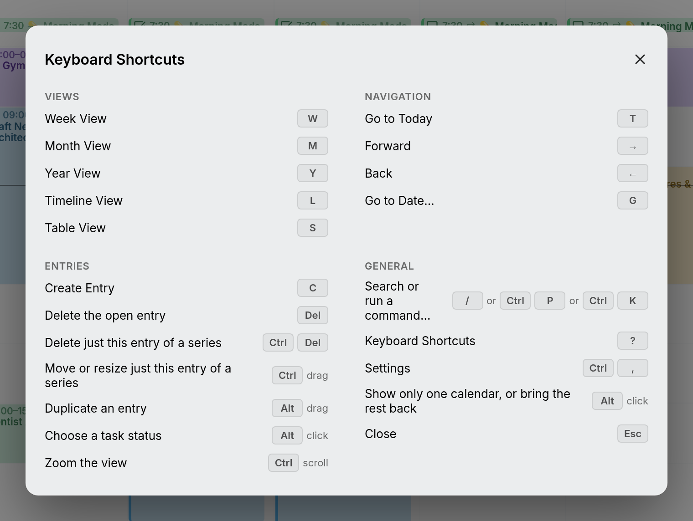
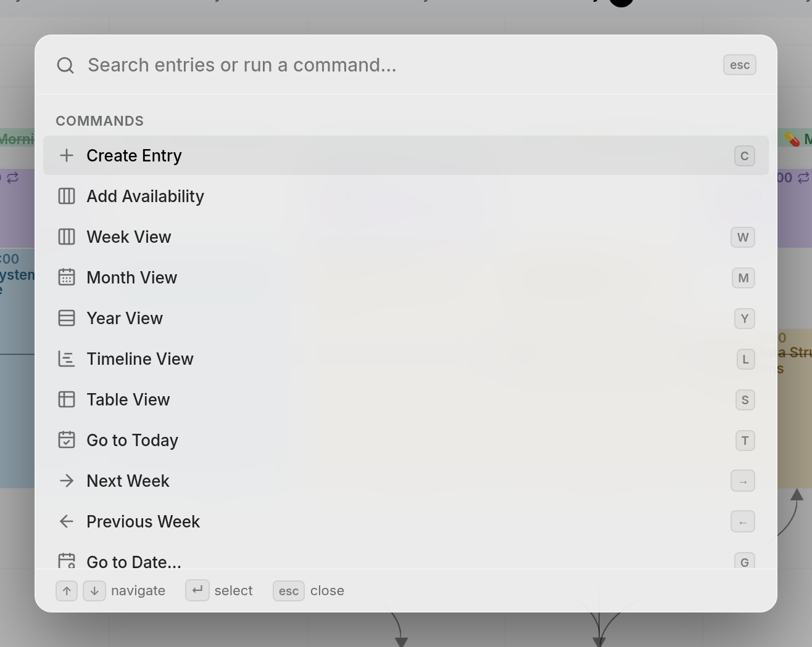

Nhấn <kbd>?</kbd> ở bất kỳ đâu trong lịch để mở danh sách phím tắt. Danh sách luôn khớp với phiên bản bạn đang chạy. Các phím theo quy ước của các lịch web như Google Lịch, Notion Calendar và Proton Calendar, nên những gì bạn đã biết vẫn dùng được.

<picture>
  <source media="(prefers-color-scheme: dark)" srcset="../assets/screenshots/shortcuts-detail-dark.webp">
  
</picture>

## Chế độ xem

| Thao tác | Phím |
| --- | --- |
| Chế độ xem tuần | <kbd>W</kbd> |
| Chế độ xem tháng | <kbd>M</kbd> |
| Chế độ xem năm | <kbd>Y</kbd> |
| Chế độ xem dòng thời gian | <kbd>L</kbd> |
| Chế độ xem bảng | <kbd>S</kbd> |

## Điều hướng

| Thao tác | Phím |
| --- | --- |
| Đi đến hôm nay | <kbd>T</kbd> |
| Tiến một tuần / tháng / năm | <kbd>→</kbd> |
| Lùi một tuần / tháng / năm | <kbd>←</kbd> |
| Đi đến một ngày cụ thể | <kbd>G</kbd> |

## Mục

| Thao tác | Phím |
| --- | --- |
| Tạo một mục | <kbd>C</kbd> |
| Xóa mục đang mở | <kbd>Delete</kbd> hoặc <kbd>Backspace</kbd> |
| Chỉ xóa lần này của một chuỗi lặp lại | <kbd>Ctrl</kbd> <kbd>Delete</kbd> |
| Chỉ di chuyển hoặc đổi kích thước lần này của một chuỗi lặp lại | giữ <kbd>Ctrl</kbd> khi thả |
| Nhân bản một mục | giữ <kbd>Alt</kbd> khi thả |
| Chọn trạng thái công việc | <kbd>Alt</kbd> + nhấp vào hộp kiểm, hoặc nhấp chuột phải vào nó |
| Thu phóng chế độ xem | <kbd>Ctrl</kbd> + cuộn |

## Chung

| Thao tác | Phím |
| --- | --- |
| Tìm các mục hoặc chạy một lệnh | <kbd>/</kbd> hoặc <kbd>Ctrl</kbd> <kbd>P</kbd> hoặc <kbd>Ctrl</kbd> <kbd>K</kbd> |
| Phím tắt | <kbd>?</kbd> |
| [Cài đặt](settings.md) | <kbd>Ctrl</kbd> <kbd>,</kbd> |
| [Chỉ hiện một lịch](calendars.md#show-only-one-calendar), hoặc hiện lại các lịch còn lại | <kbd>Alt</kbd> + nhấp vào biểu tượng con mắt của lịch đó trong thanh bên |
| Đóng hoặc quay lại | <kbd>Esc</kbd> |

> [!NOTE]
> Trên máy Mac, <kbd>Ctrl</kbd> được hiển thị là <kbd>⌘</kbd> và <kbd>Alt</kbd> là <kbd>⌥</kbd> ở mọi nơi, và <kbd>⌫</kbd> thay cho <kbd>Delete</kbd> (<kbd>Backspace</kbd> cũng xóa được ở mọi nơi).

Các phím tắt một chữ cái không bao giờ kích hoạt khi bạn đang gõ trong ô văn bản.

## Bảng lệnh

Nhấn <kbd>/</kbd>, <kbd>Ctrl</kbd> + <kbd>K</kbd> hoặc <kbd>Ctrl</kbd> + <kbd>P</kbd> để tìm các mục hoặc chạy một lệnh; cả ba đều làm cùng một việc. Tìm kiếm quét qua tiêu đề, mô tả và địa điểm trong tất cả các lịch của bạn, không chỉ các ngày đang hiện trên màn hình, và chỉ liệt kê một mục lặp lại một lần. Các mục trong lịch bị ẩn hiện mờ. Chọn một mục sẽ đi đến ngày của nó và mở nó, đồng thời hiện lại lịch của nó nếu trước đó bị ẩn. Các lệnh bao gồm chế độ xem, điều hướng, mục mới, các lịch và cài đặt của bạn, và mỗi lệnh hiện phím tắt bên cạnh, để bạn học dần khi dùng.

<picture>
  <source media="(prefers-color-scheme: dark)" srcset="../assets/screenshots/palette-detail-dark.webp">
  
</picture>
