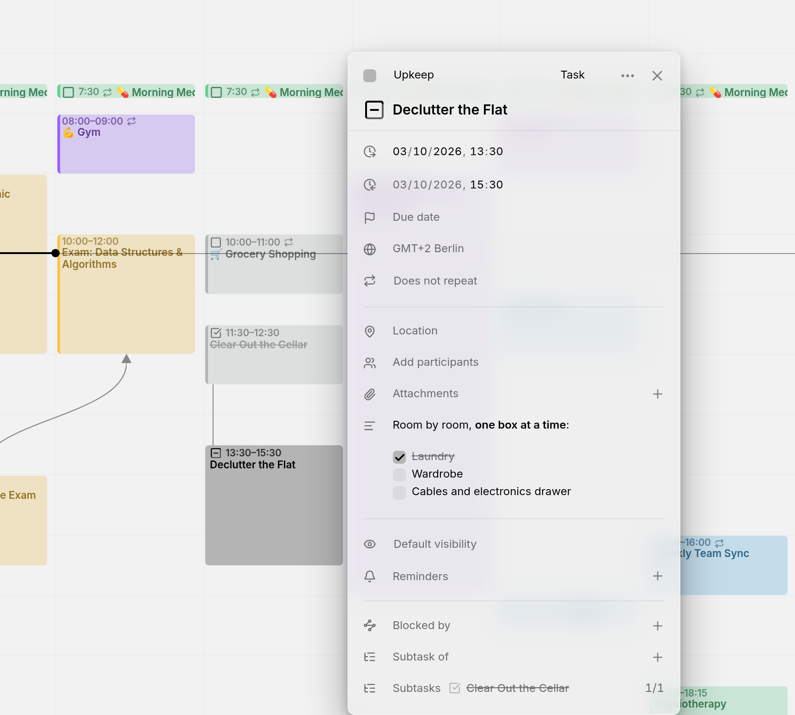

タスクには **サブタスク** を持たせられます。タスクを構成する小さなタスクです。サブタスクは別のカレンダー、さらには別のアカウントに置くこともでき、自分自身のサブタスクを持つことも、[日付未定](planning.md#the-planning-tab)にすることもできます。

<picture>
  <source media="(prefers-color-scheme: dark)" srcset="../assets/screenshots/hierarchy-detail-dark.webp">
  
</picture>

## サブタスクを追加する

小さいほうのタスクを開き、**親タスク** で **＋** を押して、大きいほうのタスクのタイトルの一部を入力します。検索はすべてのカレンダーを対象とし、非表示のカレンダーの項目は薄く表示されます。すると大きいほうのタスクの **サブタスク** に一覧表示され、1/3 のように完了数が付きます。リンクは常にサブタスク側から追加します。大きいほうのタスクの **サブタスク** の行は一覧を見せるだけです。

一覧の各サブタスクには、その[カレンダーの色](calendars.md#recolor)のチェックボックスが付くので、大きいほうのタスクを離れずにチェックを付けられます。完了とキャンセル済みのサブタスクには取り消し線が付きます。タイトルをクリックするとそのタスクが開き、隣の **✕** を押すとどちら側からでもリンクを外せます。カレンダー上では、両方が見えているとき、タスクとそのサブタスクが線で結ばれます。

タスクが自分自身のサブタスクになるような、循環するリンクは Mitra が拒否します。

## チェックリスト

タスクの説明には、Markdown で書くチェックリストも入れられます。

```markdown
- [ ] Book the venue
- [x] Send the invitations
```

説明の中でボックスを直接チェックできます。Mitra はテキスト内の `[ ]` を `[x]` に書き換えるので、そのカレンダーを使う他のアプリにも見えます。ボックスをチェックしても、それだけでタスクのステータスは変わりません。チェックリストを数えるのはタスクだけです。予定のボックスもチェックはできますが、何にも数えられません。

## 進捗

サブタスクやチェックリストのあるタスクは、進捗を表示します。各サブタスクと各ボックスが等しい重みの 1 ステップとして数えられるので、ボックス 3 つとサブタスク 2 つのタスクは 5 ステップです。

途中まで進んだサブタスクは、その分だけ数えられます。自分の進捗を持っていても、自分のサブタスクを持っていても同じです。3 つのサブタスクのうち 2 つが完了で、3 つ目が 80% なら、そのタスクは 93% です。キャンセル済みのサブタスクは数えないので、やめた作業がタスクを引きずることはありません。サブタスクとしてリンクされた予定も数えられません。

カレンダー上では、タスクのチェックボックスの輪郭が進むにつれて塗りつぶされていきます。チェックボックスにポインターを合わせると、「サブタスク 3 件中 2 件が完了」のように数が見えます。ボックスとサブタスクが一緒に数えられるときは「4 ステップ中 2 ステップが完了」となります。右クリックまたは <kbd>Alt</kbd> + クリックで、正確なパーセントのあるステータスメニューが開きます。

## 進捗を手動で設定する

サブタスクもチェックリストもないタスクには、自分で進捗を設定できます。チェックボックスを右クリックまたは <kbd>Alt</kbd> + クリックし、**進捗** を 5% 刻みでドラッグします。100% でタスクは **完了** になります。100% を下回ると、完了したタスクは **進行中** に戻り、0% では **未着手** に戻ります。値の隣の **✕** で消去できます。

カレンダーが進捗を保存できる必要があります。[カレンダーサーバー](integrations/caldav.md)、[Apple カレンダー](integrations/apple.md)、[Mitra カレンダー](integrations/mitra.md)は保存できます。Google カレンダー、Notion、Todoist、Tempo は保存できないので、それらのタスクには **進捗** スライダーがありません。

## タスクのツリーをまとめて完了にする

最後の未完了のサブタスクをチェックすると、大きいほうのタスクも完了にするか Mitra が尋ねます。それでさらに上のタスクも終わるなら、まとめて完了にすることを提案します。大きいほうのタスクのチェックリストもすべてチェック済みの場合にだけ尋ねます。

サブタスクがまだ開いたままのタスクを完了またはキャンセル済みにすると、それらをどうするか尋ねられます。**完了にする** か **キャンセル済みにする** です。質問を閉じれば開いたまま残ります。あとからでも戻れます。タスクのステータスメニューで、サブタスクの数から同じ質問にたどり着けます。

## サブタスクのあるタスクを移動・削除する

サブタスクのあるタスクを別の時刻へドラッグすると、Mitra は **サブタスクも移動しますか？** と尋ねます。**この項目のみ** を選ぶか、タスクとすべてのサブタスクを同じ時間だけ動かすかです。そのようなタスクの削除も、同じように **サブタスクも削除しますか？** と尋ねます。

> [!TIP]
> ドロップや削除のときに <kbd>Ctrl</kbd>（Mac では <kbd>⌘</kbd>）を押したままにすると、質問を飛ばしてそのタスクだけを変更できます。[キーボードショートカット](shortcuts.md)を参照してください。

## 対応するカレンダー

リンクはサブタスクと一緒に、その項目自身のカレンダーに保存されます。[カレンダーサーバー](integrations/caldav.md)、[Apple カレンダー](integrations/apple.md)、[Mitra カレンダー](integrations/mitra.md)はどんなリンクも保存でき、カレンダーサーバーでは標準のカレンダー形式で書かれるので、同じカレンダーを使う他のアプリでも読めます。

- [Notion](integrations/notion.md) では、同じデータベースのタスクへのリンクは対応するリレーションプロパティ（「親タスク」など）に入ります。それ以外へのリンクは Mitra が自分で保持します。
- [Todoist](integrations/todoist.md) では、同じ Todoist アカウントのタスクが親の場合、リンクは Todoist にも保存され、サブタスクが親のプロジェクトに入ります。それ以外へのリンクは Mitra が自分で保持します。
- [Google カレンダー](integrations/google.md)はリンクを捨てるので、Google カレンダーの項目には親を付けられません。他のカレンダーの項目からそれへリンクすることはできます。
- [カレンダー購読](integrations/subscriptions.md)は読み取り専用で、[Tempo](integrations/tempo.md)にはリンクがありません。
