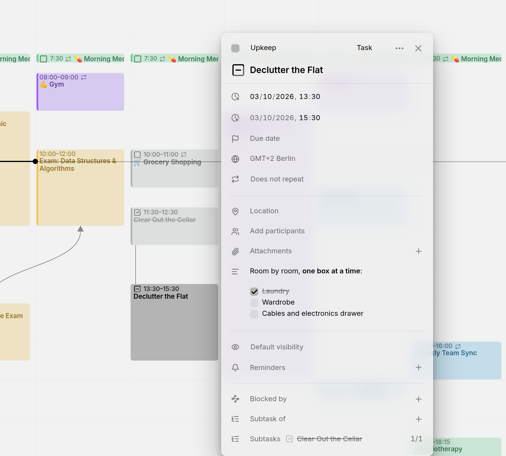

작업에는 **하위 작업**이 있을 수 있습니다. 함께 모여 하나의 작업을 이루는 더 작은 작업입니다. 하위 작업은 다른 캘린더나 다른 계정에 있어도 되고, 자기만의 하위 작업을 가질 수 있으며, [날짜 미정](planning.md#the-planning-tab)이어도 됩니다.

<picture>
  <source media="(prefers-color-scheme: dark)" srcset="../assets/screenshots/hierarchy-detail-dark.webp">
  
</picture>

## 하위 작업 추가하기

작은 작업을 열고 **상위 작업**의 **＋** 버튼을 누른 다음, 큰 작업의 제목 일부를 입력하세요. 검색은 모든 캘린더를 대상으로 하며, 숨긴 캘린더의 항목은 흐리게 표시합니다. 그러면 큰 작업의 **하위 작업** 아래에 그 작업이 나오고, 1/3처럼 몇 개가 완료되었는지 함께 보입니다. 연결은 항상 하위 작업 쪽에서 추가합니다. 큰 작업의 **하위 작업** 행은 목록만 보여 줍니다.

목록의 각 하위 작업은 [캘린더 색상](calendars.md#recolor)으로 된 체크박스를 보여 주므로, 큰 작업을 떠나지 않고도 체크할 수 있습니다. 완료되거나 취소된 하위 작업에는 취소선이 그어집니다. 제목을 클릭하면 그 작업이 열리고, 옆의 **✕** 버튼을 누르면 어느 쪽에서든 연결을 없앨 수 있습니다. 캘린더에서는 작업과 하위 작업이 모두 화면에 있을 때 선으로 이어집니다.

작업이 자기 자신의 하위 작업이 되는 것처럼 순환하는 연결은 Mitra가 거부합니다.

## 체크리스트

작업의 설명에는 Markdown으로 쓴 체크리스트도 넣을 수 있습니다.

```markdown
- [ ] Book the venue
- [x] Send the invitations
```

설명에서 바로 상자를 체크하면 완료로 표시됩니다. Mitra가 텍스트의 `[ ]`를 `[x]`로 바꾸므로, 같은 캘린더를 쓰는 다른 앱에서도 보입니다. 상자를 체크한다고 작업의 상태가 저절로 바뀌지는 않습니다. 체크리스트는 작업에서만 집계됩니다. 일정의 상자도 체크할 수는 있지만 아무것에도 집계되지 않습니다.

## 진행률

하위 작업이나 체크리스트가 있는 작업은 진행률을 보여 줍니다. 하위 작업 하나와 상자 하나가 각각 같은 비중의 한 단계로 집계되므로, 상자 세 개와 하위 작업 두 개가 있는 작업은 다섯 단계입니다.

일부만 끝난 하위 작업은 그만큼만 집계됩니다. 자체 진행률이 있든 자체 하위 작업이 있든 마찬가지입니다. 하위 작업이 세 개이고 그중 둘이 완료, 셋째가 80%라면 작업은 93%입니다. 취소된 하위 작업은 집계되지 않으므로, 그만둔 일이 작업의 발목을 잡지 않습니다. 하위 작업으로 연결된 일정도 집계되지 않습니다.

캘린더에서는 작업이 진행될수록 체크박스의 테두리가 채워집니다. 체크박스를 가리키면 "하위 작업 3개 중 2개 완료"처럼, 상자와 하위 작업을 함께 집계할 때는 "단계 4개 중 2개 완료"처럼 개수가 보입니다. 마우스 오른쪽 버튼으로 클릭하거나 <kbd>Alt</kbd>를 누른 채 클릭하면 정확한 백분율이 있는 상태 메뉴가 열립니다.

## 진행률 직접 설정하기

하위 작업도 체크리스트도 없는 작업에는 진행률을 직접 정할 수 있습니다. 체크박스를 마우스 오른쪽 버튼으로 클릭하거나 <kbd>Alt</kbd>를 누른 채 클릭하고, **진행률**을 5% 단위로 드래그하세요. 100%가 되면 작업이 **완료**가 됩니다. 100% 아래로 내리면 완료된 작업이 **진행 중**으로, 0%면 **할 일**로 돌아갑니다. 값 옆의 **✕** 버튼을 누르면 지워집니다.

캘린더가 진행률을 저장할 수 있어야 합니다. [캘린더 서버](integrations/caldav.md), [Apple 캘린더](integrations/apple.md), [Mitra 캘린더](integrations/mitra.md)는 저장할 수 있습니다. Google 캘린더, Notion, Todoist, Tempo는 저장할 수 없으므로 그 작업에는 **진행률** 슬라이더가 없습니다.

## 작업 트리 끝내기

마지막으로 남은 하위 작업을 체크하면 Mitra가 큰 작업도 완료로 표시할지 묻습니다. 그로 인해 위쪽의 작업이 더 끝나게 되면 모두 완료로 표시하자고 제안합니다. 큰 작업의 체크리스트까지 모두 체크된 경우에만 묻습니다.

하위 작업 중 일부가 아직 열려 있는데 작업을 완료나 취소로 표시하면, Mitra가 하위 작업을 어떻게 할지 묻습니다. **완료로 표시**나 **취소됨으로 표시**를 고르세요. 질문을 닫으면 하위 작업은 열린 채로 남습니다. 나중에 다시 돌아올 수도 있습니다. 작업의 상태 메뉴에서 하위 작업 개수를 누르면 같은 질문이 나옵니다.

## 하위 작업이 있는 작업 옮기기 또는 삭제하기

하위 작업이 있는 작업을 다른 시간으로 드래그하면 Mitra가 **하위 작업도 옮길까요?** 하고 묻습니다. **이 항목만**을 고르거나, 작업을 모든 하위 작업과 함께 같은 시간만큼 옮기세요. 이런 작업을 삭제할 때도 같은 방식으로 **하위 작업도 삭제할까요?** 하고 묻습니다.

> [!TIP]
> 놓거나 삭제할 때 <kbd>Ctrl</kbd>(Mac에서는 <kbd>⌘</kbd>)을 누르고 있으면 질문 없이 그 작업만 바뀝니다. [키보드 단축키](shortcuts.md)를 참고하세요.

## 지원하는 캘린더

연결은 하위 작업과 함께, 그 항목이 속한 캘린더에 저장됩니다. [캘린더 서버](integrations/caldav.md), [Apple 캘린더](integrations/apple.md), [Mitra 캘린더](integrations/mitra.md)는 어떤 연결이든 담으며, 캘린더 서버에서는 표준 캘린더 형식으로 기록되므로 같은 캘린더를 쓰는 다른 앱도 읽을 수 있습니다.

- [Notion](integrations/notion.md)에서는 같은 데이터베이스에 있는 작업으로의 연결이 "Parent task" 같은 해당 관계 속성에 들어갑니다. 그 밖의 연결은 Mitra가 직접 보관합니다.
- [Todoist](integrations/todoist.md)에서는 상위 작업이 같은 Todoist 계정의 작업이면 Todoist에도 저장되며, 하위 작업은 상위 작업의 프로젝트로 옮겨집니다. 그 밖의 연결은 Mitra가 직접 보관합니다.
- [Google 캘린더](integrations/google.md)는 연결을 버리므로, Google 캘린더의 항목에는 상위 작업을 지정할 수 없습니다. 다른 캘린더의 항목에서 그 항목으로 연결하는 것은 여전히 됩니다.
- [캘린더 구독](integrations/subscriptions.md)은 읽기 전용이고, [Tempo](integrations/tempo.md)에는 연결이 없습니다.
