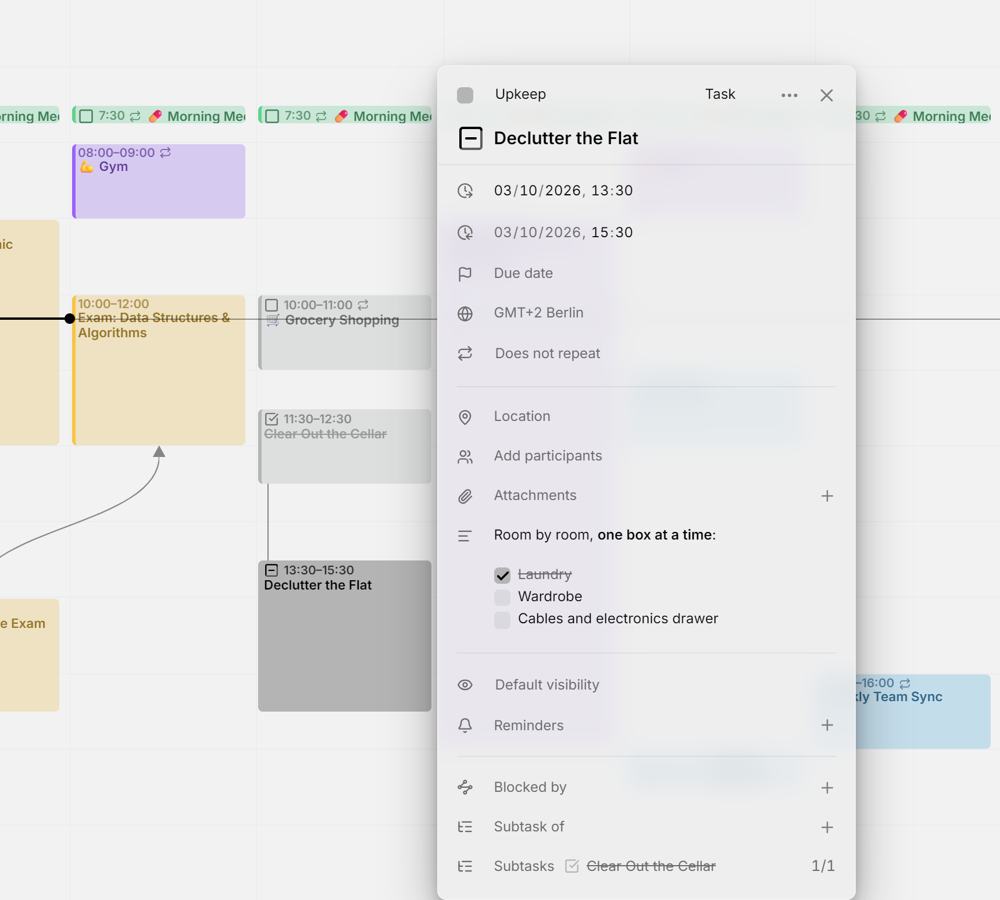

У задачи могут быть **подзадачи**: задачи поменьше, из которых она складывается. Подзадача может находиться в другом календаре и даже в другом аккаунте, иметь собственные подзадачи и быть [незапланированной](planning.md#the-planning-tab).

<picture>
  <source media="(prefers-color-scheme: dark)" srcset="../assets/screenshots/hierarchy-detail-dark.webp">
  
</picture>

## Добавление подзадачи

Откройте задачу поменьше, нажмите **＋** в строке **Родительская задача** и введите часть названия большой задачи. Поиск охватывает все ваши календари, а записи из скрытых показывает приглушёнными. После этого большая задача покажет подзадачу в разделе **Подзадачи** со счётчиком выполненных, например 1/3. Связь всегда добавляется со стороны подзадачи: строка **Подзадачи** у большой задачи только перечисляет их.

Флажок каждой подзадачи в списке окрашен в [цвет её календаря](calendars.md#recolor), так что её можно отметить, не покидая большую задачу. Выполненные и отменённые подзадачи зачёркнуты. Нажмите на название, чтобы открыть эту задачу, или на **✕** рядом с ним, чтобы удалить связь; это можно сделать с любой из сторон. В календаре задачу и её подзадачи соединяет линия, когда обе видны.

Mitra не позволит создать связь, которая замкнётся в круг, например если задача окажется подзадачей самой себя.

## Чек-листы

В описании задачи также может быть чек-лист в формате Markdown:

```markdown
- [ ] Book the venue
- [x] Send the invitations
```

Чтобы отметить пункт выполненным, поставьте флажок прямо в описании. Mitra меняет в тексте `[ ]` на `[x]`, поэтому это видят и другие приложения, работающие с календарём. Отметки в чек-листе сами по себе никогда не меняют статус задачи. Чек-листы учитываются только у задач: пункты в событии можно отмечать, но они ни на что не влияют.

## Прогресс

Задача с подзадачами или чек-листом показывает свой прогресс. Каждая подзадача и каждый пункт считаются одним шагом с одинаковым весом, поэтому у задачи с тремя пунктами и двумя подзадачами пять шагов.

Частично выполненная подзадача учитывается частично, будь у неё собственный прогресс или собственные подзадачи. Если у задачи три подзадачи, две из них выполнены, а третья выполнена на 80 %, вся задача выполнена на 93 %. Отменённые подзадачи не учитываются, так что заброшенная работа не задерживает задачу. События, связанные как подзадачи, тоже не учитываются.

В календаре контур флажка задачи заполняется по мере выполнения. Наведите указатель на флажок, чтобы увидеть счётчик, например «Выполнено подзадач: 2 из 3» или «Выполнено шагов: 2 из 4», если пункты и подзадачи считаются вместе. Нажмите на флажок правой кнопкой мыши или с клавишей <kbd>Alt</kbd>, чтобы открыть меню статуса с точным процентом.

## Ручная установка прогресса

У задачи без подзадач и чек-листа прогресс можно задать самостоятельно. Нажмите на её флажок правой кнопкой мыши или с клавишей <kbd>Alt</kbd> и перетащите ползунок **Прогресс** с шагом 5 %. При 100 % задача получает статус **Готово**. Если опустить значение ниже 100 %, выполненная задача возвращается в статус **В работе**, а при 0 % в статус **К выполнению**. Кнопка **✕** рядом со значением сбрасывает его.

Для этого календарь должен уметь хранить прогресс: [календарные серверы](integrations/caldav.md), [Календарь Apple](integrations/apple.md) и [календари Mitra](integrations/mitra.md) это умеют. Google Календарь, Notion, Todoist и Tempo не умеют, поэтому у их задач нет ползунка **Прогресс**.

## Завершение дерева задач

Когда вы отмечаете последнюю незавершённую подзадачу, Mitra спрашивает, отметить ли выполненной и большую задачу. Если от этого завершаются и задачи выше по дереву, Mitra предлагает отметить выполненными их все. Вопрос появляется, только если чек-лист большой задачи тоже полностью отмечен.

Когда вы отмечаете задачу выполненной или отменённой, а часть её подзадач ещё открыта, Mitra спрашивает, что с ними сделать: **Отметить как выполненную** или **Отметить как отменённую**. Закройте вопрос, чтобы оставить их открытыми. К нему можно вернуться позже: в меню статуса задачи счётчик подзадач ведёт к тому же вопросу.

## Перемещение или удаление задачи с подзадачами

Когда вы перетаскиваете задачу с подзадачами на другое время, Mitra спрашивает **Переместить и подзадачи?**. Выберите **Только эта запись** или сдвиньте задачу вместе со всеми подзадачами на одинаковое время. При удалении такой задачи Mitra так же спрашивает **Удалить и подзадачи?**.

> [!TIP]
> Удерживайте <kbd>Ctrl</kbd> (<kbd>⌘</kbd> на Mac), когда отпускаете или удаляете задачу, чтобы пропустить вопрос и изменить только её. См. [быстрые клавиши](shortcuts.md).

## Какие календари это поддерживают

Связь сохраняется вместе с подзадачей, в её собственном календаре. [Календарные серверы](integrations/caldav.md), [Календарь Apple](integrations/apple.md) и [календари Mitra](integrations/mitra.md) хранят любые связи, а на календарном сервере связь записывается в стандартном календарном формате, поэтому её могут прочитать и другие приложения, работающие с тем же календарём.

- В [Notion](integrations/notion.md) связь с задачей из той же базы данных попадает в соответствующее свойство-связь, например «Parent task». Связи со всем остальным Mitra хранит у себя.
- В [Todoist](integrations/todoist.md) родительская задача из того же аккаунта Todoist сохраняется и в Todoist, и тогда подзадача переходит в проект родительской задачи. Связи со всем остальным Mitra хранит у себя.
- [Google Календарь](integrations/google.md) отбрасывает связи, поэтому записи в календаре Google нельзя назначить родительскую задачу. Записи из других календарей по-прежнему могут на неё ссылаться.
- [Подписки на календари](integrations/subscriptions.md) доступны только для чтения, а в [Tempo](integrations/tempo.md) связей нет.
