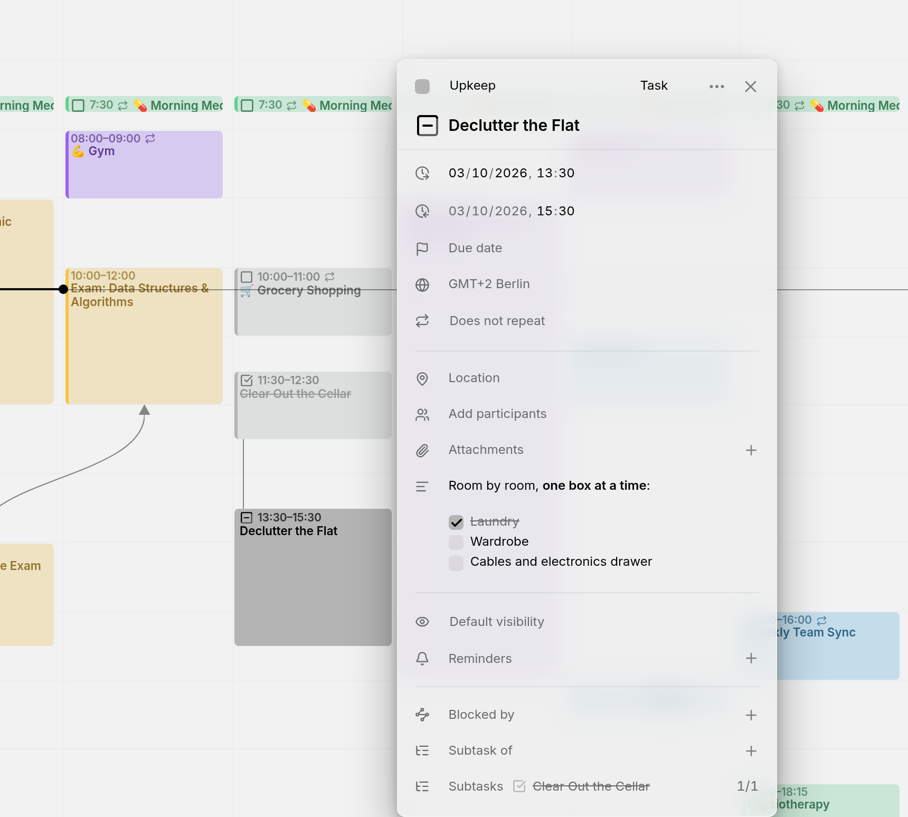

Một công việc có thể có **công việc con**: các công việc nhỏ hơn cùng tạo nên nó. Một công việc con có thể nằm ở lịch khác, thậm chí ở tài khoản khác, có thể có công việc con riêng, và có thể [chưa lên lịch](planning.md#the-planning-tab).

<picture>
  <source media="(prefers-color-scheme: dark)" srcset="../assets/screenshots/hierarchy-detail-dark.webp">
  
</picture>

## Thêm công việc con

Mở công việc nhỏ hơn, nhấn **＋** ở **Công việc con của** và gõ một phần tiêu đề của công việc lớn hơn. Việc tìm kiếm bao gồm mọi lịch của bạn, và làm mờ các mục trong lịch bị ẩn. Công việc lớn hơn sau đó liệt kê nó dưới **Công việc con**, kèm số lượng đã xong, như 1/3. Bạn luôn thêm liên kết từ công việc con: hàng **Công việc con** của công việc lớn hơn chỉ liệt kê chúng.

Mỗi công việc con trong danh sách hiện ô đánh dấu của nó theo [màu của lịch](calendars.md#recolor), nên bạn có thể đánh dấu xong mà không rời công việc lớn hơn. Các công việc con đã xong và đã hủy bị gạch ngang. Nhấp vào một tiêu đề để mở công việc đó, hoặc nhấn **✕** bên cạnh để gỡ liên kết, từ phía nào cũng được. Trên lịch, một đường nối công việc với các công việc con của nó khi cả hai đều đang hiển thị.

Mitra từ chối một liên kết tạo thành vòng tròn, chẳng hạn một công việc trở thành công việc con của chính nó.

## Danh sách kiểm tra

Phần mô tả của một công việc cũng có thể chứa một danh sách kiểm tra, viết bằng Markdown:

```markdown
- [ ] Book the venue
- [x] Send the invitations
```

Đánh dấu một ô ngay trong phần mô tả để tích nó. Mitra đổi `[ ]` thành `[x]` trong văn bản, nên các ứng dụng khác dùng lịch này cũng thấy. Việc đánh dấu ô không bao giờ tự đổi trạng thái của công việc. Chỉ công việc mới tính danh sách kiểm tra của chúng: ô trong một sự kiện có thể được đánh dấu, nhưng không được tính vào đâu cả.

## Tiến độ

Một công việc có công việc con hoặc danh sách kiểm tra sẽ hiện tiến độ. Mỗi công việc con và mỗi ô được tính là một bước, tất cả có cùng trọng số, nên một công việc có ba ô và hai công việc con có năm bước.

Một công việc con mới xong một phần được tính một phần, dù nó có tiến độ riêng hay có công việc con riêng. Nếu một công việc có ba công việc con, hai cái đã xong và cái thứ ba ở mức 80%, công việc đó ở mức 93%. Các công việc con đã hủy không được tính, nên phần việc bị bỏ không bao giờ kéo công việc lại. Các sự kiện được liên kết làm công việc con cũng không được tính.

Trên lịch, viền ô đánh dấu của một công việc đầy dần theo tiến độ. Trỏ vào ô đánh dấu để xem số lượng, như “Đã xong 2/3 công việc con”, hoặc “Đã xong 2/4 bước” khi ô và công việc con được tính cùng nhau. Nhấp chuột phải vào nó, hoặc <kbd>Alt</kbd>-nhấp, để mở menu trạng thái với phần trăm chính xác.

## Tự đặt tiến độ

Một công việc không có công việc con và không có danh sách kiểm tra có thể mang một tiến độ do bạn tự đặt. Nhấp chuột phải vào ô đánh dấu của nó, hoặc <kbd>Alt</kbd>-nhấp, rồi kéo **Tiến độ** theo bước 5%. Ở 100%, công việc chuyển thành **Xong**. Dưới 100%, một công việc đã xong quay lại **Đang làm**, hoặc **Cần làm** ở mức 0%. Nút **✕** bên cạnh giá trị sẽ xóa nó.

Lịch phải lưu trữ được tiến độ: [máy chủ lịch](integrations/caldav.md), [Lịch Apple](integrations/apple.md) và [lịch Mitra](integrations/mitra.md) làm được. Google Lịch, Notion, Todoist và Tempo thì không, nên công việc của chúng không có thanh trượt **Tiến độ**.

## Hoàn thành một cây công việc

Khi bạn đánh dấu xong công việc con cuối cùng còn mở, Mitra hỏi có nên đánh dấu cả công việc lớn hơn là đã xong không. Nếu điều đó hoàn thành thêm các công việc ở cấp trên, nó đề nghị đánh dấu tất cả là đã xong. Nó chỉ hỏi khi danh sách kiểm tra của công việc lớn hơn cũng đã được đánh dấu hết.

Khi bạn đánh dấu một công việc là đã xong hoặc đã hủy trong lúc vài công việc con của nó vẫn còn mở, Mitra hỏi nên làm gì với chúng: **Đánh dấu là đã xong** hoặc **Đánh dấu là đã hủy**. Đóng câu hỏi để để chúng ở trạng thái mở. Bạn có thể quay lại sau: trong menu trạng thái của công việc, số công việc con dẫn đến cùng câu hỏi đó.

## Di chuyển hoặc xóa một công việc có công việc con

Khi bạn kéo một công việc có công việc con sang thời điểm khác, Mitra hỏi **Di chuyển cả công việc con?**. Chọn **Chỉ mục này**, hoặc di chuyển công việc cùng mọi công việc con của nó một khoảng thời gian như nhau. Xóa một công việc như vậy sẽ hỏi **Xóa cả công việc con?** theo cách tương tự.

> [!TIP]
> Giữ <kbd>Ctrl</kbd> (<kbd>⌘</kbd> trên máy Mac) khi bạn thả hoặc xóa để bỏ qua câu hỏi và chỉ thay đổi công việc đó. Xem [phím tắt](shortcuts.md).

## Những lịch nào hỗ trợ điều này

Một liên kết được lưu cùng công việc con, trong lịch riêng của mục đó. [Máy chủ lịch](integrations/caldav.md), [Lịch Apple](integrations/apple.md) và [lịch Mitra](integrations/mitra.md) giữ được mọi liên kết, và trên máy chủ lịch nó được ghi theo định dạng lịch chuẩn, nên các ứng dụng khác dùng cùng lịch có thể đọc nó.

- Trong [Notion](integrations/notion.md), một liên kết đến công việc trong cùng cơ sở dữ liệu được ghi vào thuộc tính quan hệ tương ứng, như “Parent task”. Mitra tự giữ các liên kết đến mọi thứ khác.
- Trong [Todoist](integrations/todoist.md), một công việc cha thuộc cùng tài khoản Todoist cũng được lưu trong Todoist, điều này chuyển công việc con vào dự án của công việc cha. Mitra tự giữ các liên kết đến mọi thứ khác.
- [Google Lịch](integrations/google.md) bỏ các liên kết, nên một mục trong lịch Google không thể có mục cha. Các mục trong lịch khác vẫn có thể liên kết đến nó.
- [Lịch đăng ký](integrations/subscriptions.md) chỉ đọc, và [Tempo](integrations/tempo.md) không có liên kết.
