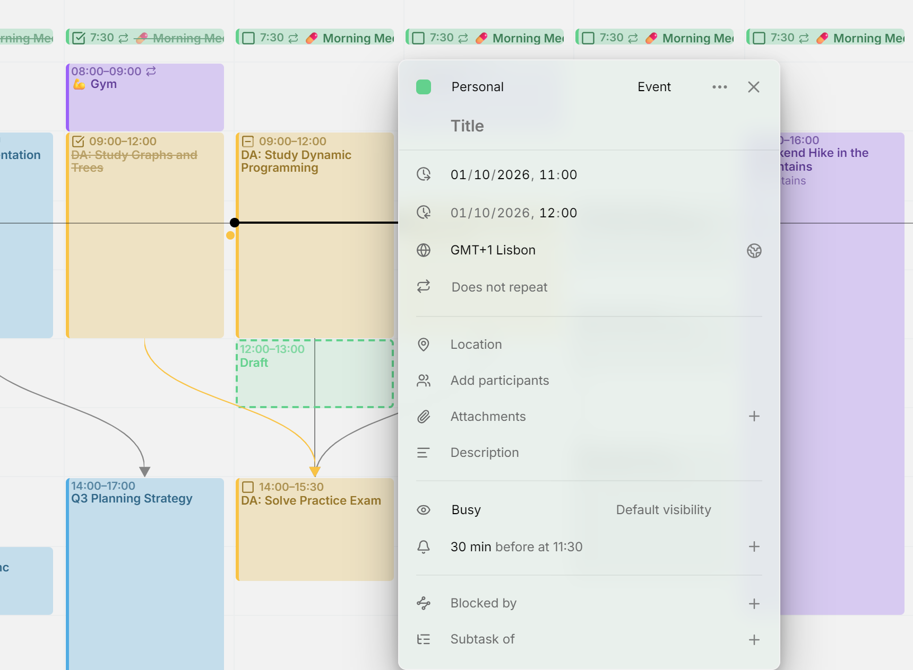
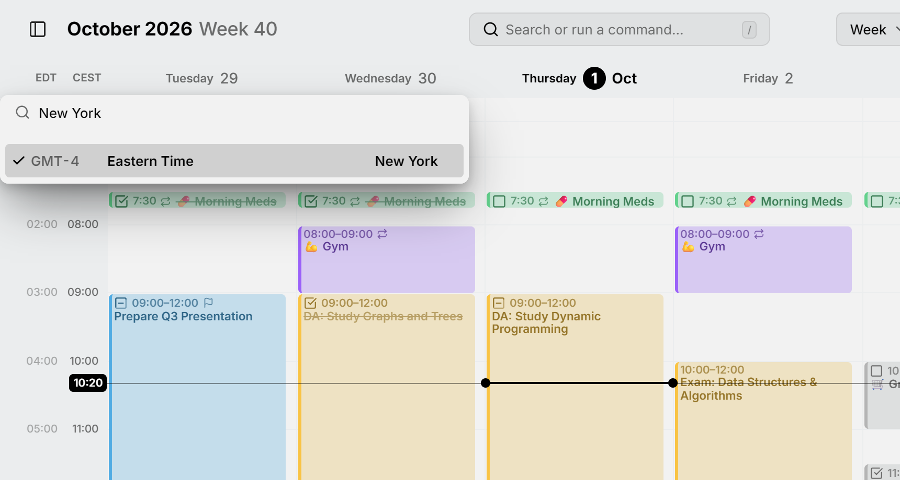

Mitra mostra gli orari nel tuo fuso orario, quello impostato sul tuo dispositivo. Quando viaggi e il dispositivo cambia fuso, Mitra lo segue. Nell'editor questo fuso si chiama fuso **attuale**. La tua **casa** è il fuso a cui appartieni, e resta accanto a quello attuale mentre viaggi.

Una voce può anche avere un fuso orario tutto suo, come un volo che parte alle 9:00 a New York. E la vista settimanale può mostrare le ore di altri fusi orari accanto alle tue.

<picture>
  <source media="(prefers-color-scheme: dark)" srcset="../assets/screenshots/time-zone-detail-dark.webp">
  
</picture>

## Il fuso orario di una voce

Ogni voce con degli orari ha un fuso orario. Le voci che crei prendono il tuo, e le voci di altre app mantengono il fuso in cui sono state create.

Apri una voce per vedere il suo fuso nella riga con il globo, sotto le sue date, scritto come uno scarto e una città, per esempio "GMT-4 New York". Le voci di tutto il giorno non hanno fuso orario né questa riga, perché coprono gli stessi giorni per tutti.

### Cambiare il fuso orario di una voce

Clicca il fuso e scegline un altro. L'elenco inizia con i fusi del paese per cui è impostata la tua [lingua](settings.md#general), poi tutti i fusi, e segna la tua casa con una casa dove si trova, e il tuo fuso attuale con una puntina mentre sei altrove. I fusi che mantengono lo stesso nome e la stessa ora tutto l'anno condividono una riga, che rappresenta una delle loro città, quella del tuo fuso o del tuo paese se ne ha una, come l'Ora dell'Europa centrale per Berlino in Germania. La freccia in fondo alla riga apre le altre città, come Parigi e Amsterdam, e una ricerca apre le righe in cui trova qualcosa. Digita una città, un paese, il nome di un fuso o una differenza di orario per trovarne uno.

La voce mantiene i suoi orari sull'orologio nel nuovo fuso: una riunione alle 9:00 a Berlino diventa una riunione alle 9:00 a New York. Se era sbagliato solo il fuso e la riunione in sé non si è spostata, cambia poi i suoi orari.

### Il tuo orario o quello della voce

Quando il fuso di una voce è diverso dal tuo, l'editor mostra i suoi orari nel tuo fuso, quindi una riunione alle 9:00 a New York risulta alle 15:00 se ti trovi a Berlino. Un pulsante accanto al fuso passa all'ora propria della voce e viceversa. Mostra una puntina mentre vedi la tua ora e un globo mentre vedi quella della voce, e puntandolo ti dice quale stai guardando.

Puoi modificare gli orari in entrambi i modi. Per cambiare il fuso stesso, passa prima all'ora della voce.

### Stessa ora ovunque

Alcune voci arrivano da altre app senza alcun fuso orario e mostrano **Stessa ora ovunque**. I loro orari non appartengono ad alcun luogo: una sveglia alle 7:00 vale per le 7:00 ovunque tu sia, e l'editor la mostra alle 7:00 in ogni fuso orario. I suoi promemoria suonano a quell'ora dell'orologio su ogni dispositivo.

Scegliere un fuso per una voce di questo tipo le dà quel fuso e mantiene i suoi orari sull'orologio. In un calendario che conserva questi orari, qualsiasi voce può averne uno: scegli **Stessa ora ovunque** in cima all'elenco, e anche così i suoi orari restano.

### Quali calendari lo supportano

- I **calendari salvati in Mitra**, i [server di calendario](integrations/caldav.md) e [Google Calendar](integrations/google.md) conservano il fuso orario di ogni voce, e le altre app lo vedono. Mitra e i server di calendario conservano anche gli orari che sono gli stessi ovunque; Google Calendar non li ha, quindi una voce così spostata lì viene fissata a un fuso.
- **[Notion](integrations/notion.md)** non ha fusi orari. I suoi orari compaiono nel tuo, e l'editor non ha la riga del fuso orario.
- **[Tempo](integrations/tempo.md)** legge i registri di lavoro nel fuso orario del tuo profilo Jira, e anche qui l'editor non ha la riga del fuso orario.
- Gli **[Abbonamenti](integrations/subscriptions.md)** sono di sola lettura: puoi vedere il fuso di una voce e passare tra i due orari, ma non cambiarlo.

## Fusi orari nella vista settimanale

La [vista settimanale](views/week.md) può mostrare le ore di altri fusi orari in colonne accanto alle tue, così vedi che ora è là a ogni ora della tua giornata.

<picture>
  <source media="(prefers-color-scheme: dark)" srcset="../assets/screenshots/time-zones-detail-dark.webp">
  
</picture>

### Aggiungere un fuso orario alla settimana

Punta la parte alta della colonna delle ore e premi **＋** (**Aggiungi fuso orario**). L'elenco spunta i fusi che hai già, con una casa sulla tua casa e una puntina sul tuo fuso attuale mentre sei altrove. Scegli un fuso per aggiungerne la colonna, o uno spuntato per toglierla. L'elenco resta aperto per altri. Il tuo fuso attuale resta la colonna accanto ai giorni, e anche la tua casa resta.

Ogni colonna ha come intestazione un nome breve: l'abbreviazione in uso per il fuso, come "PDT" o "BST", oppure, dove non ce n'è una, il suo luogo, come "Iran". L'abbreviazione segue la tua [lingua](settings.md#general): Berlino si chiama "CEST" in inglese e "MESZ" in tedesco, e dove la tua regione non ne ha una per un fuso, la regione del fuso presta la sua. Punta un nome per vedere quello completo.

### Rinominare o rimuovere un fuso orario

Clicca il nome di un fuso e scegli **Rinomina** per dargli un'etichetta tua, come "Mamma", **Imposta come casa** per farne la tua casa, oppure **Rimuovi** per eliminare la sua colonna. Per tornare al nome automatico, rinominalo lasciando il campo vuoto.

Il tuo fuso attuale e la tua casa si possono rinominare, ma non rimuovere. Per sostituire la tua casa, imposta un altro fuso come casa.

### Nascondere le colonne in più

Le colonne in più tolgono spazio ai giorni. Per nasconderle, punta la parte alta della colonna dell'ora e premi la freccia sotto il **＋**. Premila di nuovo per mostrarle. Puoi anche trascinare la colonna dell'ora verso i giorni per aprirle, e indietro per chiuderle, che è il modo da usare su uno schermo touch.

Su uno schermo stretto, le colonne partono nascoste finché non le apri o le chiudi tu stesso. Aggiungere un fuso le fa sempre comparire.

### Sui tuoi dispositivi

La tua casa, i fusi che aggiungi e ogni nome che gli dai appartengono al tuo account, quindi compaiono su ogni dispositivo che usi. Se le colonne sono nascoste resta su ciascun dispositivo.

La tua casa è il fuso del primo dispositivo su cui apri Mitra. In viaggio, il fuso in cui sei diventa la colonna accanto ai giorni e la tua casa resta accanto, senza che nulla si aggiunga al tuo elenco, quindi di ritorno a casa torna a essere una sola colonna. Dare un nome al fuso in cui sei lo tiene nel tuo elenco. Se ti trasferisci, scegli **Imposta come casa** sul fuso in cui vivi ora, e la tua vecchia casa resta come colonna finché non la rimuovi.
