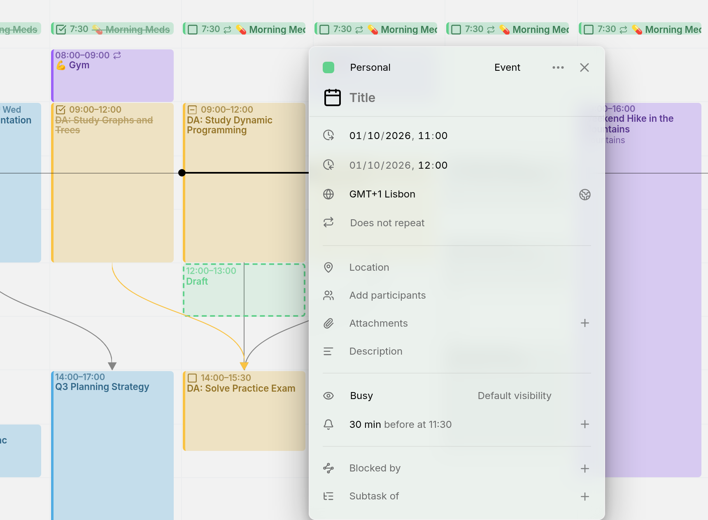
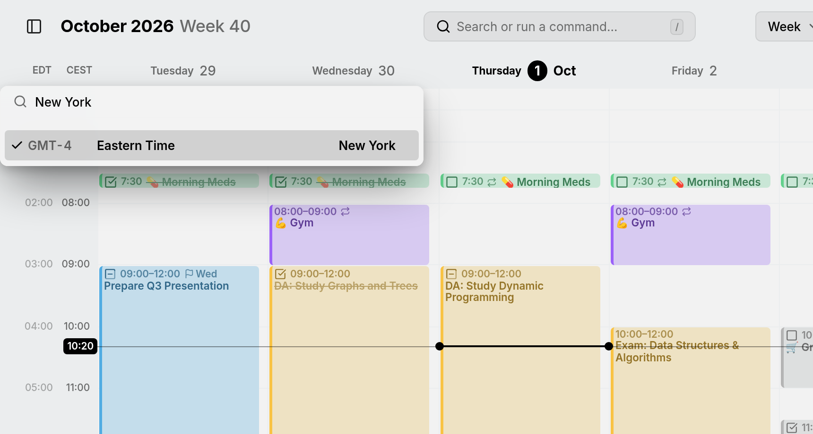

Mitra は、あなたのタイムゾーン、つまりデバイスに設定されているタイムゾーンで時刻を表示します。旅行してデバイスのタイムゾーンが変われば、Mitra も追従します。エディターでは、このタイムゾーンを **現在** のタイムゾーンと呼びます。**ホーム** はあなたの所属するタイムゾーンで、旅行中も現在のタイムゾーンの隣に残ります。

項目は自分自身のタイムゾーンを持つこともできます。ニューヨークを 9:00 に出発するフライトのようなものです。また、週ビューでは自分のタイムゾーンの隣に、他のタイムゾーンの時間を並べて表示できます。

<picture>
  <source media="(prefers-color-scheme: dark)" srcset="../assets/screenshots/time-zone-detail-dark.webp">
  
</picture>

## 項目のタイムゾーン

時刻のある項目はすべてタイムゾーンを持ちます。自分で作った項目はあなたのタイムゾーンを取り、他のアプリから来た項目は作られたときのタイムゾーンを保ちます。

項目を開くと、日付の下の地球儀アイコンがある行に、「GMT-4 ニューヨーク」のようにオフセットと都市でタイムゾーンが表示されます。終日の項目にはタイムゾーンもこの行もありません。誰にとっても同じ日を覆うからです。

### 項目のタイムゾーンを変更する

タイムゾーンをクリックして別のものを選びます。リストは、設定した[言語](settings.md#general)の国のタイムゾーンから始まり、そのあとにすべてのタイムゾーンが続きます。ホームには家の印が、離れている間は現在のタイムゾーンにピンの印が付きます。一年中同じ名前と時計を保つタイムゾーンは 1 行を共有し、そのうちの 1 つの都市（あれば自分のタイムゾーンか自分の国のもの、例えばドイツのベルリンには中央ヨーロッパ時間）を代表として表示します。行の末尾の矢印を開くとパリやアムステルダムのような他の都市が展開され、検索すると見つかった行が展開されます。都市・国・タイムゾーン名・オフセットのどれでも検索できます。

項目は新しいタイムゾーンでも同じ時刻を保ちます。ベルリンの 9:00 のミーティングは、ニューヨークの 9:00 のミーティングになります。タイムゾーンだけが間違っていてミーティング自体は動かない場合は、あとで時刻を変更してください。

### 自分の時刻か、項目の時刻か

項目のタイムゾーンが自分のものと違う場合、エディターはその時刻をあなたのタイムゾーンで表示します。ニューヨークの 9:00 のミーティングは、ベルリンにいるなら 15:00 と読めます。タイムゾーンの隣のボタンで、項目自身の時刻と切り替えられます。自分の時刻を見ている間はピン、項目の時刻を見ている間は地球儀を表示し、ポインターを合わせるとどちらを見ているか教えてくれます。

どちらの表示でも時刻を編集できます。タイムゾーン自体を変えるには、先に項目の時刻に切り替えてください。

### どこでも同じ時刻

他のアプリからタイムゾーンなしで来た項目もあり、**どこでも同じ時刻** と表示されます。それらの時刻はどの場所にも属しません。7:00 のアラームは、どこにいても 7:00 の意味です。エディターはどのタイムゾーンでも 7:00 として表示し、そのリマインダーは各デバイスでその時刻に鳴ります。

そのような項目にタイムゾーンを選ぶと、そのタイムゾーンが与えられ、時刻は保たれます。そのような時刻を保存できるカレンダーでは、どの項目にも設定できます。リストの先頭で **どこでも同じ時刻** を選べば、時刻はそのまま保たれます。

### 対応するカレンダー

- **Mitra に保存されるカレンダー**、[カレンダーサーバー](integrations/caldav.md)、[Google カレンダー](integrations/google.md)は各項目のタイムゾーンを保ち、他のアプリにも見えます。Mitra とカレンダーサーバーは、どこでも同じ時刻も保てます。Google カレンダーにはそれがないので、そのような項目をそこへ移すとタイムゾーンに固定されます。
- **[Notion](integrations/notion.md)** にはタイムゾーンがありません。時刻はあなたのタイムゾーンで表示され、エディターにタイムゾーンの行もありません。
- **[Todoist](integrations/todoist.md)** は各タスクのタイムゾーンを保つか、Todoist がフローティング時刻と呼ぶ[どこでも同じ時刻](#same-time-everywhere)になります。
- **[Tempo](integrations/tempo.md)** は、Jira プロフィールのタイムゾーンで作業ログを読みます。エディターにもタイムゾーンの行はありません。
- **[購読](integrations/subscriptions.md)** は読み取り専用です。項目のタイムゾーンを見て 2 つの時刻を切り替えることはできますが、変更はできません。

## 週ビューのタイムゾーン

[週ビュー](views/week.md)では、自分のタイムゾーンの隣に他のタイムゾーンの時間を列として表示できるので、自分の 1 日のどの時刻がそこでは何時かが分かります。

<picture>
  <source media="(prefers-color-scheme: dark)" srcset="../assets/screenshots/time-zones-detail-dark.webp">
  
</picture>

### 週にタイムゾーンを追加する

時刻列の上端にポインターを合わせて **＋**（**タイムゾーンを追加**）を押します。すでに追加済みのタイムゾーンにはチェックが付き、ホームには家の印が、離れている間は現在のタイムゾーンにピンの印が付きます。タイムゾーンを選ぶとその列が追加され、チェックの付いたものを選ぶとその列が外れます。リストは続けて選べるように開いたままです。現在のタイムゾーンは常に日付の隣の列のまま、ホームも残ります。

各列の先頭には短い名前が付きます。そのタイムゾーンで使われる「PDT」「BST」のような省略名か、使われていなければ「イラン」のような場所の名前です。省略名は[言語](settings.md#general)に従います。ベルリンは英語では「CEST」、ドイツ語では「MESZ」と読めます。自分の地域に省略名がないタイムゾーンでは、そのタイムゾーン自身の地域のものが借りられます。名前にポインターを合わせると正式名が見えます。

### タイムゾーンの名前変更と削除

タイムゾーンの名前をクリックし、**名前を変更** で「母」のような自分だけのラベルを付けるか、**ホームにする** でホームにするか、**削除** で列を外します。自動の名前に戻すには、名前を空にして変更します。

現在のタイムゾーンとホームは名前を変えられますが、削除はできません。ホームを入れ替えるには、別のタイムゾーンをホームにします。

### 追加の列をたたむ

追加の列は日の列の幅を狭くします。隠すには、時刻列の上端にポインターを合わせて **＋** の下の矢印を押します。もう一度押すと再び表示されます。時刻列を日付のほうへドラッグして開き、戻す方向へドラッグして閉じることもできます。タッチスクリーンではこちらの方法になります。

狭い画面では、自分で開閉するまで列は最初からたたまれています。タイムゾーンを追加すると必ず展開されます。

### デバイス間

ホーム、追加したタイムゾーン、付けた名前はすべてアカウントに紐づくので、使うどのデバイスにも表示されます。列をたたんでいるかどうかは、デバイスごとの状態です。

ホームは、最初に Mitra を開いたデバイスのタイムゾーンになります。旅行中は、いる場所のタイムゾーンが日付の隣の列になり、ホームはその隣に残ります。リストに何も追加されないので、帰宅すればまた 1 列に戻ります。いる場所のタイムゾーンに名前を付けると、リストに残ります。引っ越した場合は、今住んでいるタイムゾーンで **ホームにする** を選びます。古いホームは削除するまで列として残ります。
