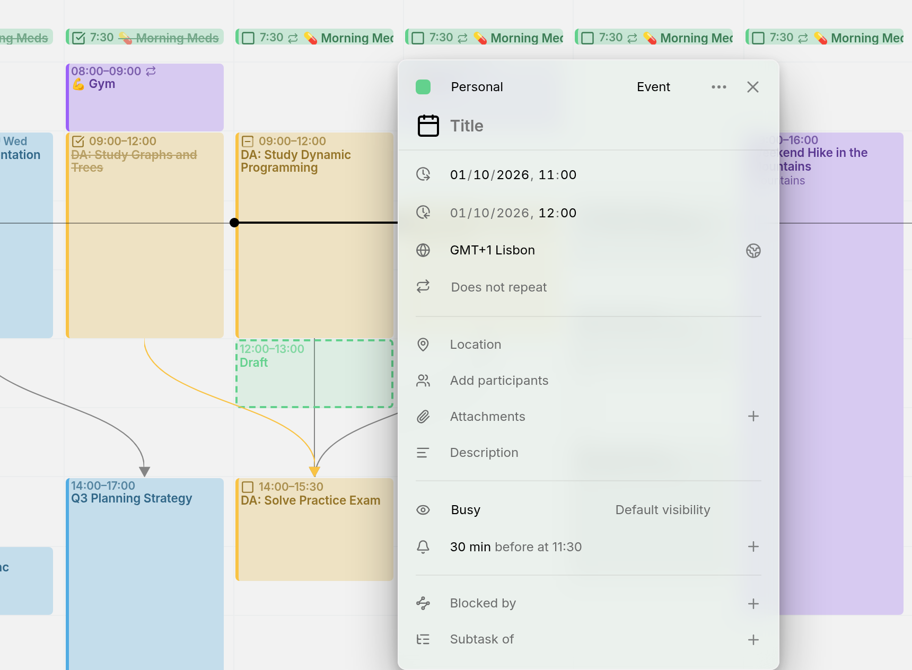
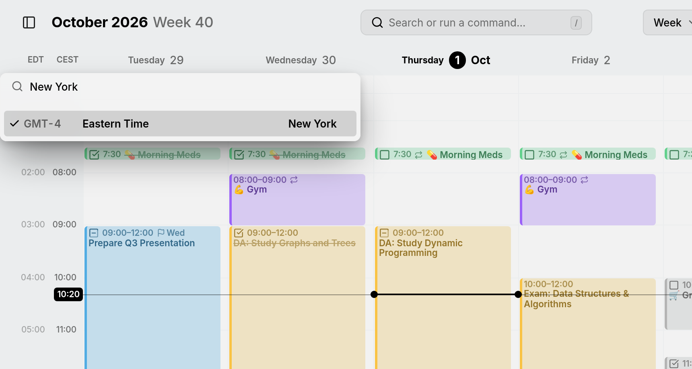

Mitra는 기기에 설정된 시간대로 시간을 보여 줍니다. 여행 중에 기기의 시간대가 바뀌면 Mitra도 따라갑니다. 편집기에서는 이 시간대를 **현재** 시간대라고 부릅니다. **기준** 시간대는 내가 속한 시간대로, 여행하는 동안 현재 시간대 옆에 함께 남아 있습니다.

항목에도 자체 시간대가 있을 수 있습니다. 예를 들어 뉴욕에서 9:00에 출발하는 항공편이 그렇습니다. 또 주 보기에서는 내 시간대 옆에 다른 시간대의 시각을 표시할 수 있습니다.

<picture>
  <source media="(prefers-color-scheme: dark)" srcset="../assets/screenshots/time-zone-detail-dark.webp">
  
</picture>

## 항목의 시간대

시간이 있는 항목에는 모두 시간대가 있습니다. 직접 만든 항목은 내 시간대를 따르고, 다른 앱에서 온 항목은 만들어진 시간대를 유지합니다.

항목을 열면 날짜 아래 지구본이 있는 행에서 시간대를 볼 수 있으며, "GMT-4 뉴욕"처럼 오프셋과 도시로 표시됩니다. 종일 항목은 누구에게나 같은 날짜에 걸치므로 시간대도, 이 행도 없습니다.

### 항목의 시간대 바꾸기

시간대를 클릭하고 다른 시간대를 고르세요. 목록은 [언어](settings.md#general)에 설정된 국가의 시간대로 시작해 모든 시간대로 이어지며, 기준 시간대에는 집 표시가, 집을 떠나 있는 동안 현재 시간대에는 핀 표시가 붙습니다. 일 년 내내 이름과 시각이 같은 시간대는 한 행에 묶이며, 그 행은 그중 한 도시를 대표로 보여 줍니다. 가능하면 내 시간대나 내 국가의 도시이며, 예를 들어 독일에서는 중부 유럽 표준시를 베를린으로 보여 줍니다. 행 끝의 화살표를 누르면 파리, 암스테르담 같은 다른 도시가 펼쳐지고, 검색하면 결과가 있는 행이 펼쳐집니다. 도시, 국가, 시간대 이름 또는 오프셋을 입력해 찾으세요.

항목은 새 시간대에서도 같은 시각을 유지합니다. 베를린 9:00 회의는 뉴욕 9:00 회의가 됩니다. 시간대만 잘못되었고 회의 자체는 옮겨지지 않았다면, 그다음에 시간을 바꾸세요.

### 내 시간 또는 항목의 시간

항목의 시간대가 내 시간대와 다르면 편집기는 시간을 내 시간대로 보여 주므로, 뉴욕 9:00 회의는 베를린에 있을 때 15:00로 표시됩니다. 시간대 옆의 버튼을 누르면 항목 자체의 시간으로 바뀌고, 다시 누르면 돌아옵니다. 내 시간을 보는 동안에는 핀이, 항목의 시간을 보는 동안에는 지구본이 표시되며, 버튼 위에 포인터를 올리면 지금 어느 쪽을 보고 있는지 알려 줍니다.

시간은 어느 쪽에서든 편집할 수 있습니다. 시간대 자체를 바꾸려면 먼저 항목의 시간으로 바꾸세요.

### 어디서나 같은 시각

다른 앱에서 시간대 없이 오는 항목도 있으며, 이런 항목에는 **어디서나 같은 시각**이 표시됩니다. 이 시간은 특정 장소에 속하지 않습니다. 7:00 알람은 어디에 있든 7:00을 뜻하며, 편집기는 어느 시간대에서든 7:00으로 보여 줍니다. 알림도 기기마다 그 시각에 울립니다.

이런 항목에 시간대를 고르면 그 시간대가 지정되고 시각은 그대로 유지됩니다. 이런 시간을 담을 수 있는 캘린더에서는 어떤 항목이든 이렇게 할 수 있습니다. 목록 맨 위의 **어디서나 같은 시각**을 고르면 시각도 그대로 유지됩니다.

### 지원하는 캘린더

- **Mitra에 저장된 캘린더**, [캘린더 서버](integrations/caldav.md), [Google 캘린더](integrations/google.md)는 항목마다 시간대를 유지하며, 다른 앱에서도 볼 수 있습니다. Mitra와 캘린더 서버는 어디서나 같은 시각도 유지합니다. Google 캘린더에는 이런 시간이 없으므로, 그런 항목을 옮기면 한 시간대로 고정됩니다.
- [**Notion**](integrations/notion.md)에는 시간대가 없습니다. 시간은 내 시간대로 표시되며, 편집기에 시간대 행이 없습니다.
- [**Todoist**](integrations/todoist.md)는 작업마다 시간대를 유지하며, Todoist에서 유동 시간이라고 부르는 것은 [어디서나 같은 시각](#same-time-everywhere)으로 유지합니다.
- [**Tempo**](integrations/tempo.md)는 Jira 프로필의 시간대로 작업 로그를 읽으며, 여기도 편집기에 시간대 행이 없습니다.
- [**구독**](integrations/subscriptions.md)은 읽기 전용입니다. 항목의 시간대를 보고 두 시간 사이를 전환할 수는 있지만, 시간대를 바꿀 수는 없습니다.

## 주 보기의 시간대

[주 보기](views/week.md)에서는 내 시간대 옆의 열에 다른 시간대의 시각을 표시할 수 있으므로, 하루의 매시간 그곳이 몇 시인지 알 수 있습니다.

<picture>
  <source media="(prefers-color-scheme: dark)" srcset="../assets/screenshots/time-zones-detail-dark.webp">
  
</picture>

### 주 보기에 시간대 추가하기

시간 열의 맨 위에 포인터를 올리고 **＋**(**시간대 추가**)를 누르세요. 목록에는 이미 추가한 시간대에 체크 표시가 있고, 기준 시간대에는 집이, 집을 떠나 있는 동안 현재 시간대에는 핀이 붙습니다. 시간대를 고르면 열이 추가되고, 체크된 시간대를 고르면 열이 사라집니다. 목록은 더 고를 수 있도록 열린 채로 있습니다. 현재 시간대는 항상 날짜 바로 옆 열에 있고, 기준 시간대도 계속 남아 있습니다.

각 열의 머리글에는 짧은 이름이 붙습니다. "PDT"나 "BST"처럼 사람들이 그 시간대에 쓰는 약어이거나, 쓰이는 약어가 없으면 "이란"처럼 장소 이름입니다. 약어는 [언어](settings.md#general)를 따릅니다. 베를린은 영어로는 "CEST", 독일어로는 "MESZ"로 표시되며, 내 지역에 어떤 시간대의 약어가 없으면 그 시간대가 속한 지역의 약어를 빌려 씁니다. 이름에 포인터를 올리면 전체 이름이 보입니다.

### 시간대 이름 바꾸기 또는 제거하기

시간대 이름을 클릭하고 **이름 변경**을 고르면 "엄마"처럼 원하는 이름을 붙일 수 있고, **기준으로 설정**을 고르면 기준 시간대가 되며, **삭제**를 고르면 열이 사라집니다. 자동 이름으로 돌아가려면 이름을 비워 두세요.

현재 시간대와 기준 시간대는 이름을 바꿀 수는 있지만 제거할 수는 없습니다. 기준 시간대를 바꾸려면 다른 시간대를 기준으로 설정하세요.

### 추가 열 접기

추가 열은 날짜의 공간을 차지합니다. 숨기려면 시간 열의 맨 위에 포인터를 올리고 **＋** 아래의 화살표를 누르세요. 다시 누르면 표시됩니다. 시간 열을 날짜 쪽으로 끌어 열고 반대로 끌어 닫을 수도 있으며, 터치 화면에서는 이렇게 하면 됩니다.

좁은 화면에서는 직접 열거나 닫기 전까지 열이 접힌 채로 시작합니다. 시간대를 추가하면 항상 다시 펼쳐집니다.

### 여러 기기에서

기준 시간대, 추가한 시간대, 붙인 이름은 모두 계정에 속하므로, 쓰는 모든 기기에 표시됩니다. 열을 접었는지 여부는 기기마다 따로 유지됩니다.

기준 시간대는 Mitra를 처음 연 기기의 시간대입니다. 여행 중에는 지금 있는 시간대가 날짜 바로 옆 열이 되고 기준 시간대는 그 옆에 남지만, 목록에는 아무것도 추가되지 않으므로 집에 돌아오면 다시 한 열이 됩니다. 지금 있는 시간대에 이름을 붙이면 목록에 남습니다. 이사했다면 지금 사는 곳의 시간대에서 **기준으로 설정**을 고르세요. 이전 기준 시간대는 제거할 때까지 열로 남아 있습니다.
