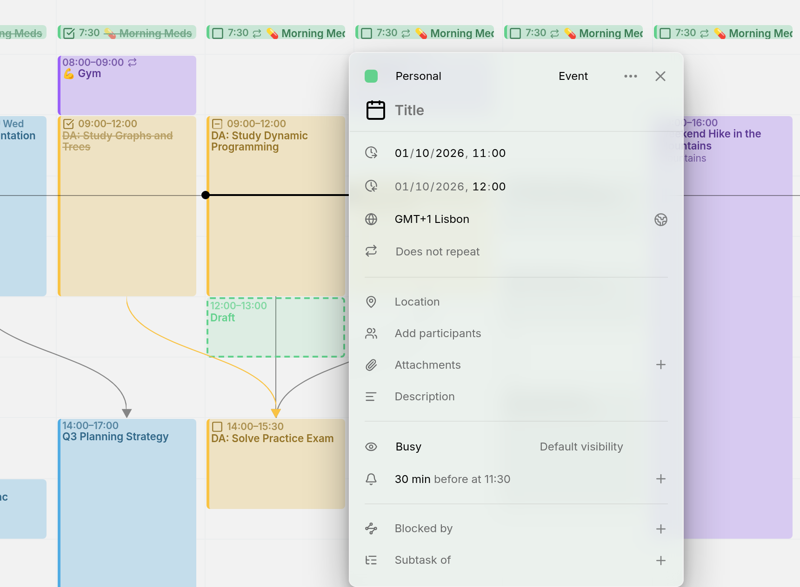
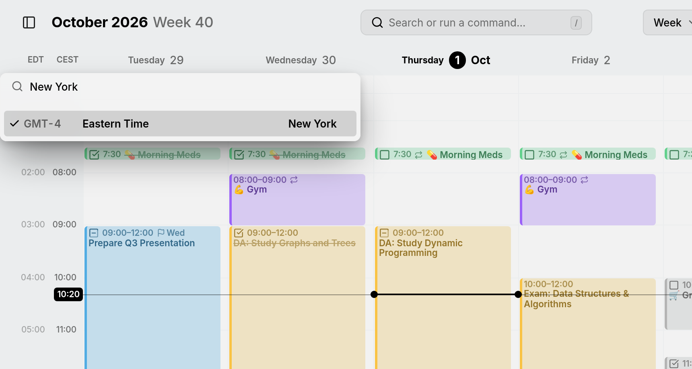

Mitra hiển thị giờ theo múi giờ của bạn, tức múi giờ thiết bị của bạn đang đặt. Khi bạn đi xa và thiết bị đổi múi giờ, Mitra đi theo. Trong trình chỉnh sửa, múi giờ này được gọi là múi giờ **hiện tại**. **Múi giờ chính** là múi giờ nơi bạn thuộc về, và nằm cạnh múi giờ hiện tại khi bạn đi xa.

Một mục cũng có thể có múi giờ riêng, chẳng hạn một chuyến bay khởi hành lúc 9:00 ở New York. Và chế độ xem tuần có thể hiển thị giờ của các múi giờ khác bên cạnh giờ của bạn.

<picture>
  <source media="(prefers-color-scheme: dark)" srcset="../assets/screenshots/time-zone-detail-dark.webp">
  
</picture>

## Múi giờ của một mục

Mọi mục có giờ đều có một múi giờ. Các mục bạn tạo dùng múi giờ của bạn, và các mục từ ứng dụng khác giữ múi giờ nơi chúng được tạo.

Hãy mở một mục để xem múi giờ của nó trong dòng có biểu tượng quả địa cầu, bên dưới các ngày, được viết dưới dạng độ lệch và một thành phố, chẳng hạn “GMT-4 New York”. Các mục cả ngày không có múi giờ và không có dòng này, vì chúng bao phủ cùng những ngày với mọi người.

### Đổi múi giờ của một mục

Nhấp vào múi giờ và chọn một múi giờ khác. Danh sách bắt đầu bằng các múi giờ của quốc gia mà [ngôn ngữ](settings.md#general) của bạn đang đặt, rồi đến mọi múi giờ, và đánh dấu múi giờ chính của bạn bằng hình ngôi nhà ở vị trí của nó, còn múi giờ hiện tại bằng một chiếc ghim khi bạn đang đi xa. Những múi giờ giữ cùng tên và cùng giờ quanh năm dùng chung một dòng, đại diện cho một trong các thành phố của chúng, thành phố của múi giờ bạn hoặc của quốc gia bạn nếu có, chẳng hạn Giờ Trung Âu cho Berlin ở Đức. Mũi tên ở cuối dòng mở ra các thành phố khác, chẳng hạn Paris và Amsterdam, và khi tìm kiếm, các dòng có kết quả sẽ tự mở ra. Gõ một thành phố, một quốc gia, tên của một múi giờ hoặc một độ lệch để tìm.

Mục giữ nguyên giờ trên đồng hồ ở múi giờ mới: một cuộc họp lúc 9:00 ở Berlin trở thành cuộc họp lúc 9:00 ở New York. Nếu chỉ múi giờ bị sai và bản thân cuộc họp không dịch chuyển, hãy đổi giờ của nó sau đó.

### Giờ của bạn hay giờ của mục

Khi múi giờ của một mục khác với của bạn, trình chỉnh sửa hiển thị giờ của nó theo múi giờ của bạn, nên một cuộc họp lúc 9:00 ở New York hiện 15:00 nếu bạn ở Berlin. Một nút bên cạnh múi giờ chuyển qua lại giữa giờ của mục và giờ của bạn. Nó hiện một chiếc ghim khi bạn xem giờ của mình và một quả địa cầu khi bạn xem giờ của mục, và trỏ vào nó sẽ cho bạn biết bạn đang xem giờ nào.

Bạn có thể sửa giờ theo cả hai cách. Để đổi chính múi giờ, hãy chuyển sang giờ của mục trước.

### Cùng một giờ ở mọi nơi

Một số mục đến từ ứng dụng khác mà không có múi giờ nào, và hiển thị **Cùng một giờ ở mọi nơi**. Giờ của chúng không thuộc về nơi nào: báo thức lúc 7:00 nghĩa là 7:00 dù bạn ở đâu, và trình chỉnh sửa hiển thị nó lúc 7:00 ở mọi múi giờ. Lời nhắc của nó kêu vào giờ trên đồng hồ đó trên từng thiết bị.

Chọn một múi giờ cho một mục như vậy sẽ gán múi giờ đó cho nó và giữ nguyên giờ trên đồng hồ. Trên một lịch giữ được các giờ như vậy, mục nào cũng có thể có: chọn **Cùng một giờ ở mọi nơi** ở đầu danh sách, và giờ trên đồng hồ của nó cũng được giữ nguyên.

### Những lịch nào hỗ trợ

- **Các lịch lưu trong Mitra**, [máy chủ lịch](integrations/caldav.md) và [Google Lịch](integrations/google.md) giữ múi giờ của từng mục, và các ứng dụng khác nhìn thấy nó. Mitra và máy chủ lịch cũng giữ các giờ giống nhau ở mọi nơi; Google Lịch thì không có, nên chuyển một mục như vậy sang đó sẽ cố định nó vào một múi giờ.
- **[Notion](integrations/notion.md)** không có múi giờ. Giờ của nó hiển thị theo múi giờ của bạn, và trình chỉnh sửa không có dòng múi giờ.
- **[Todoist](integrations/todoist.md)** giữ múi giờ của từng công việc, hoặc [cùng một giờ ở mọi nơi](#same-time-everywhere) cho thứ Todoist gọi là giờ thả nổi.
- **[Tempo](integrations/tempo.md)** đọc worklog theo múi giờ trong hồ sơ Jira của bạn, và trình chỉnh sửa cũng không có dòng múi giờ.
- **[Lịch đăng ký](integrations/subscriptions.md)** chỉ đọc: bạn có thể xem múi giờ của một mục và chuyển qua lại giữa hai loại giờ, nhưng không thể đổi nó.

## Múi giờ trong chế độ xem tuần

[Chế độ xem tuần](views/week.md) có thể hiển thị giờ của các múi giờ khác trong các cột bên cạnh giờ của bạn, để bạn biết ở đó là mấy giờ vào mỗi giờ trong ngày của bạn.

<picture>
  <source media="(prefers-color-scheme: dark)" srcset="../assets/screenshots/time-zones-detail-dark.webp">
  
</picture>

### Thêm một múi giờ vào tuần

Trỏ vào đầu cột giờ và nhấn **＋** (**Thêm múi giờ**). Danh sách đánh dấu các múi giờ bạn đã có, với ngôi nhà ở múi giờ chính và chiếc ghim ở múi giờ hiện tại khi bạn đang đi xa. Chọn một múi giờ để thêm cột của nó, hoặc chọn một múi giờ đã đánh dấu để bỏ cột của nó. Danh sách vẫn mở để thêm tiếp. Múi giờ hiện tại của bạn luôn là cột cạnh các ngày, và múi giờ chính của bạn cũng vậy.

Mỗi cột có một tên ngắn ở đầu: chữ viết tắt mà mọi người dùng cho múi giờ, chẳng hạn “PDT” hoặc “BST”, hoặc nếu không có chữ nào đang dùng thì là địa danh của nó, chẳng hạn “Iran”. Chữ viết tắt theo [ngôn ngữ](settings.md#general) của bạn: Berlin hiện “CEST” trong tiếng Anh và “MESZ” trong tiếng Đức, và nếu khu vực của bạn không có chữ nào cho một múi giờ, khu vực riêng của múi giờ đó sẽ cho mượn. Trỏ vào một tên để xem tên đầy đủ.

### Đổi tên hoặc xóa một múi giờ

Nhấp vào tên một múi giờ và chọn **Đổi tên** để đặt nhãn riêng, chẳng hạn “Mẹ”, **Đặt làm múi giờ chính** để biến nó thành múi giờ chính của bạn, hoặc **Xóa** để bỏ cột của nó. Để quay lại tên tự động, hãy đổi tên nó thành trống.

Múi giờ hiện tại và múi giờ chính của bạn có thể đổi tên, nhưng không thể xóa. Để thay múi giờ chính, hãy đặt một múi giờ khác làm múi giờ chính.

### Thu gọn các cột phụ

Các cột phụ lấy chỗ của các ngày. Để ẩn chúng, hãy trỏ vào đầu cột giờ và nhấn mũi tên bên dưới dấu **＋**. Nhấn lại để hiện chúng. Bạn cũng có thể kéo cột giờ về phía các ngày để mở chúng, và kéo ngược lại để đóng, đây là cách làm trên màn hình cảm ứng.

Trên màn hình hẹp, các cột bắt đầu ở trạng thái thu gọn cho đến khi bạn tự mở hoặc đóng chúng. Thêm một múi giờ luôn đưa chúng ra.

### Trên các thiết bị của bạn

Múi giờ chính, các múi giờ bạn thêm và mọi tên bạn đặt cho chúng thuộc về tài khoản của bạn, nên chúng hiện trên mọi thiết bị bạn dùng. Việc các cột có thu gọn hay không thì được giữ riêng trên từng thiết bị.

Múi giờ chính của bạn là múi giờ của thiết bị đầu tiên bạn mở Mitra. Khi đi công tác, múi giờ nơi bạn đang ở trở thành cột cạnh các ngày và múi giờ chính vẫn ở bên cạnh, mà không có gì được thêm vào danh sách của bạn, nên khi về nhà chỉ còn một cột. Đặt tên cho múi giờ bạn đang ở sẽ giữ nó trong danh sách. Nếu bạn chuyển chỗ ở, hãy chọn **Đặt làm múi giờ chính** trên múi giờ nơi bạn sống hiện nay, và múi giờ chính cũ vẫn là một cột cho đến khi bạn xóa nó.
