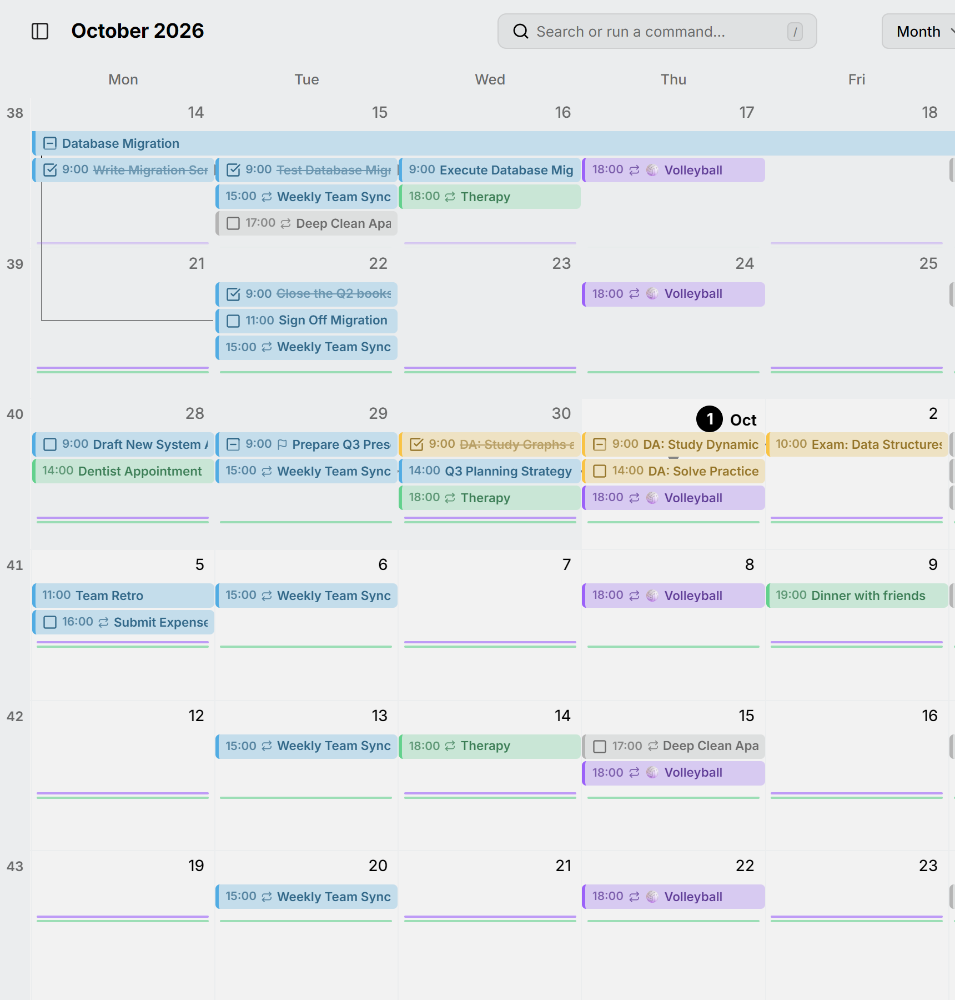

يُظهر عرض الشهر الأسابيع صفوفًا، وكل عنصر شريطًا يمتد عبر الأيام التي يغطيها. افتحه بالمفتاح <kbd>M</kbd>.

<picture>
  <source media="(prefers-color-scheme: dark)" srcset="../../assets/screenshots/month-detail-dark.webp">
  
</picture>

الأشياء التي تتكرر كثيرًا جدًا، مثل تمرين يومي، لا يحصل كل منها على شريط خاص. بل تظهر علامات صغيرة تحت الأيام؛ راجع [الروتين](../routines.md).

عندما يحتوي يوم على عناصر أكثر مما يتسع له، يتلاشى الباقي أسفل صفه. كبّر بالضغط على <kbd>Ctrl</kbd> مع التمرير لتمنح كل أسبوع مساحة أكبر، أو صغّر لترى ما يصل إلى تسعة أسابيع دفعة واحدة.

تظهر أرقام الأسابيع على الجانب. انقر على أحدها لفتح ذلك الأسبوع في [عرض الأسبوع](week.md).

اسحب عبر الأيام لإنشاء عنصر يستمر طوال اليوم، واسحب عنصرًا إلى يوم آخر لنقله، أو اسحب نهايته لإطالته أو تقصيره.
