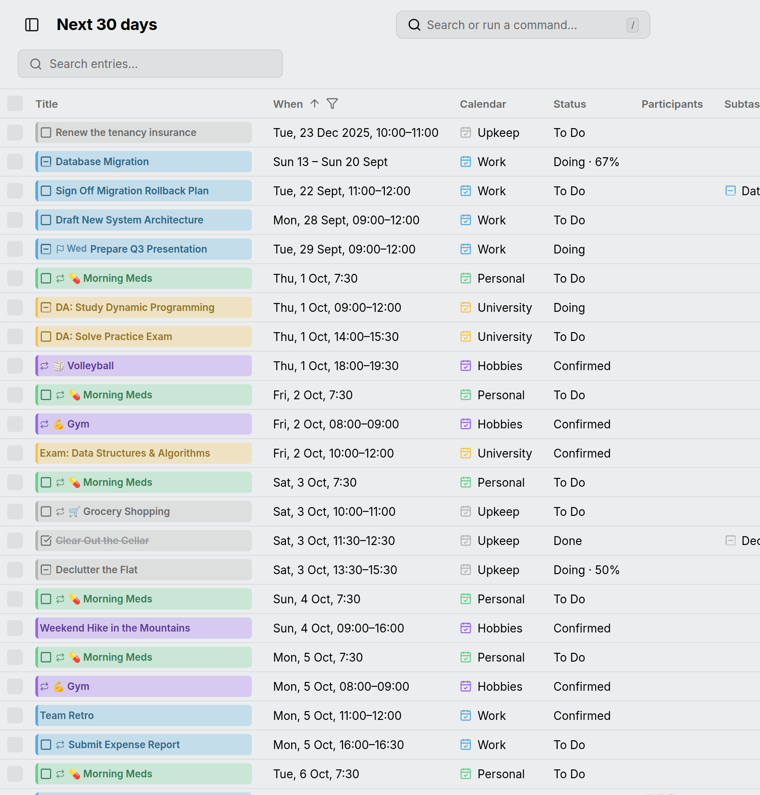

**テーブル**ビューは、項目をグリッド上に描くのではなく、行として一覧します。<kbd>S</kbd>を押すか、ビュー切り替えから開きます。

1行が1つの項目で、繰り返し項目の各回もそれぞれ1行になります。行のタイトルはカレンダーに表示されるのと同じチップで、クリックするとその項目のエディターが開きます。

<picture>
  <source media="(prefers-color-scheme: dark)" srcset="../../assets/screenshots/table-detail-dark.webp">
  
</picture>

## 表示される項目

テーブルには、今日から数えた日付の範囲にある項目が一覧され、その範囲名がページ見出しに表示されます。**過去30日間**、**今日**、**今後7日間**、**今後30日間**(デフォルト)、**今後12か月**、**すべての項目**、または2つの日付で決める **期間を指定** です。**日時** 列のメニューで選びます。検索フィールドの横の数は、一覧されている行数です。

日付のないタスクと、期限切れの未完了タスクは、どの範囲を選んでも一覧されます。そのためデフォルトでは、積み残しのタスクとこれからの1か月が一緒に表示されます。

**すべての項目** は整理に向いています。そこでは繰り返し項目が1行で、シリーズ全体を表します。**日時** には開始日が示され、移動や削除を行うとすべての回が移動・削除されます。ステータスは各回に付属しているため、ステータスのボタンはその行をスキップします。

ページヘッダーの **今日** や、別の日付へ移動する <kbd>G</kbd> は、範囲を変えずにその日の最初の行までスクロールします。

## 検索・並べ替え・絞り込み

**検索**フィールドは、入力したすべての語をタイトル・場所・説明・カレンダーと照合します。

列の見出しをクリックすると、その列のメニューが開きます。

- **昇順に並べ替え** または **降順に並べ替え**。有効になっている方をもう一度選ぶと解除されます。<kbd>Shift</kbd>を押しながら選ぶと、複数の列で並べ替えられます。
- 列に **フィルター** がある場合は、除外したい値のチェックを外します。<kbd>Alt</kbd>を押しながらクリックすると、クリックした値だけを残せます。
- **列を非表示**。その列のフィルターも一緒に解除されます。

**ステータス**・**カレンダー**・**種類**・**繰り返し** の列は絞り込みができ、**日時** は日付の範囲を持っています。見出しの横に漏斗アイコンがある列は、行を除外しています。**タイトル** と **日時** は非表示にできません。

## 列

テーブルの初期状態の列は **タイトル**・**日時**・**カレンダー**・**ステータス**・**場所**・**参加者**・**親タスク**・**ブロック元** です。見出し行の端にあるボタンで残りの列(**期日**・**所要時間**・**種類**・**繰り返し**・**リマインダー**・**説明**)を表示でき、**列をリセット** で初期状態に戻せます。

各列は内容に合わせた幅になっています。見出しをドラッグすると列を移動でき、端をドラッグすると幅を変えられます。端をダブルクリックすると、再び内容に合わせた幅に戻ります。

## まとめて変更する

行をクリックすると選択されます。<kbd>Ctrl</kbd>(<kbd>⌘</kbd>)を押しながらクリックすると選択に行を追加、<kbd>Shift</kbd>で範囲選択でき、チェックボックスも使えます。選択すると行の上にバーが表示され、次の操作ができます。

- 選択したタスクを **未着手**・**完了**・**キャンセル済み** にする。
- **移動先…** で別のカレンダーに移動する。
- **削除**。実行前に確認されます。

繰り返し項目では、これらの操作は選択した回だけに適用されます。例外は **すべての項目** で、そこでは行がシリーズ全体を表します。それ以外の範囲でシリーズを変更するには、エディターを開いてください。

キーボードでは、<kbd>Space</kbd>でいまいる行を選択し、<kbd>Enter</kbd>で開きます。<kbd>Escape</kbd>で選択を解除し、<kbd>Delete</kbd>で削除します。

## 新しい項目

ページヘッダーの **作成** または <kbd>C</kbd> で、今日の項目を作成し、テーブルの1行として開きます。
