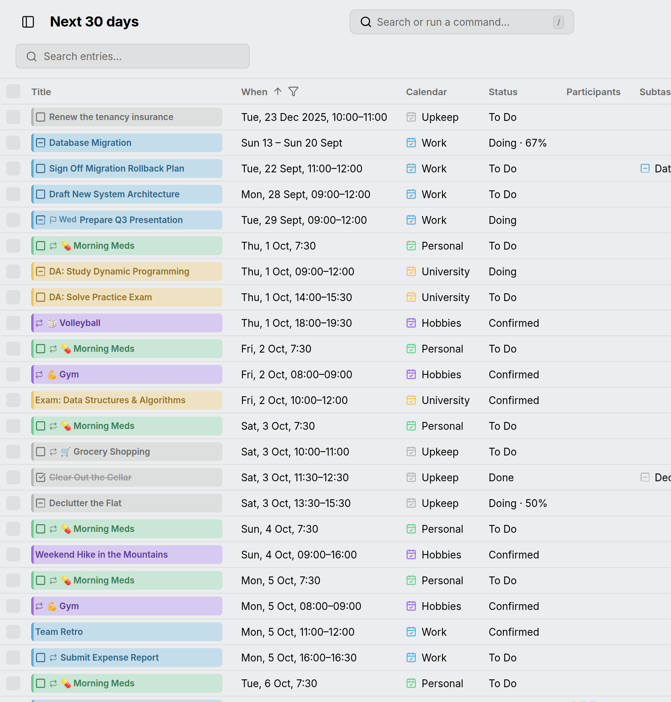

**표** 보기는 항목을 격자에 그리는 대신 행으로 나열합니다. <kbd>S</kbd>를 누르거나 보기 선택기에서 여세요.

행 하나가 항목 하나이며, 반복 항목은 회차마다 행이 따로 있습니다. 제목은 캘린더에 그려지는 것과 같은 칩이며, 클릭하면 항목의 편집기가 열립니다.

<picture>
  <source media="(prefers-color-scheme: dark)" srcset="../../assets/screenshots/table-detail-dark.webp">
  
</picture>

## 어떤 항목이 나오는지

표는 오늘부터 센 기간의 항목을 나열하며, 그 기간은 페이지 제목에 표시됩니다. **지난 30일**, **오늘**, **앞으로 7일**, **앞으로 30일**(처음 열 때의 기간), **앞으로 12개월**, **모든 항목**, 또는 두 날짜로 정하는 **사용자 지정 기간** 중에서 고를 수 있습니다. **일시** 열의 메뉴에서 고르세요. 검색 필드 옆의 숫자는 나열된 행의 수입니다.

날짜가 없는 작업과 기한이 지난 미완료 작업은 어떤 기간을 고르든 나열되므로, 기본 설정에서는 밀린 작업과 앞으로 한 달이 함께 보입니다.

**모든 항목**은 정리할 때 쓰는 기간입니다. 여기서는 반복 항목이 시리즈 전체를 나타내는 한 행으로 나옵니다. **일시**는 시리즈가 시작하는 때를 보여 주며, 이 행을 옮기거나 삭제하면 모든 회차가 옮겨지거나 삭제됩니다. 상태는 회차마다 따로 있으므로 상태 버튼은 이 행을 건너뜁니다.

페이지 머리글의 **오늘**과 다른 날짜로 가는 <kbd>G</kbd>는 기간을 바꾸지 않고 그날의 첫 행으로 스크롤합니다.

## 검색, 정렬, 필터

**검색** 필드는 입력한 단어 하나하나를 제목, 위치, 설명, 캘린더와 대조합니다.

열 머리글을 클릭하면 메뉴가 열립니다.

- **오름차순 정렬** 또는 **내림차순 정렬**. 적용 중인 정렬을 다시 고르면 해제됩니다. <kbd>Shift</kbd>를 누른 채 고르면 여러 열로 정렬할 수 있습니다.
- 열에 **필터**가 있으면 필터. 제외할 값의 체크를 해제하세요. <kbd>Alt</kbd>를 누른 채 클릭하면 클릭한 값만 남깁니다.
- **열 숨기기**. 그 열의 필터도 함께 해제됩니다.

**상태**, **캘린더**, **유형**, **반복** 열은 필터를 쓸 수 있고, **일시** 열에는 기간이 들어 있습니다. 머리글 옆에 깔때기가 있으면 그 열이 행을 걸러 내고 있다는 뜻입니다. **제목**과 **일시**는 숨길 수 없습니다.

## 열

표는 처음에 **제목**, **일시**, **캘린더**, **상태**, **위치**, **참석자**, **상위 작업**, **선행 항목** 열로 시작합니다. 머리글 행 끝의 버튼을 누르면 나머지 열(**마감일**, **길이**, **유형**, **반복**, **알림**, **설명**)이 보이며, **열 재설정**을 누르면 기본 열로 돌아갑니다.

모든 열은 내용만큼 넓습니다. 머리글을 끌면 열이 옮겨지고, 가장자리를 끌면 너비가 바뀝니다. 가장자리를 두 번 클릭하면 열이 다시 내용에 맞춰집니다.

## 여러 항목을 한 번에 바꾸기

행을 클릭하면 선택되고, <kbd>Ctrl</kbd>(<kbd>⌘</kbd>)을 누른 채 클릭하면 행이 추가되며, <kbd>Shift</kbd>를 누르면 범위가 선택됩니다. 체크박스를 써도 됩니다. 그러면 행 위에 막대가 나타나 다음 기능을 제공합니다.

- 선택한 작업에 대한 **할 일**, **완료**, **취소됨**
- **다른 캘린더로 옮기기…**
- 확인 후 **삭제**

반복 항목에서는 선택한 회차만 바뀝니다. 단, **모든 항목**에서는 행이 시리즈 전체이므로 예외입니다. 다른 기간에서 시리즈를 바꾸려면 편집기를 여세요.

키보드로는 <kbd>Space</kbd>를 누르면 현재 행이 선택되고 <kbd>Enter</kbd>를 누르면 열립니다. <kbd>Escape</kbd>는 선택을 해제하고 <kbd>Delete</kbd>는 선택한 항목을 삭제합니다.

## 새 항목

페이지 머리글의 **만들기** 또는 <kbd>C</kbd>를 누르면 오늘 날짜로 항목이 시작되고 표의 행으로 열립니다.
