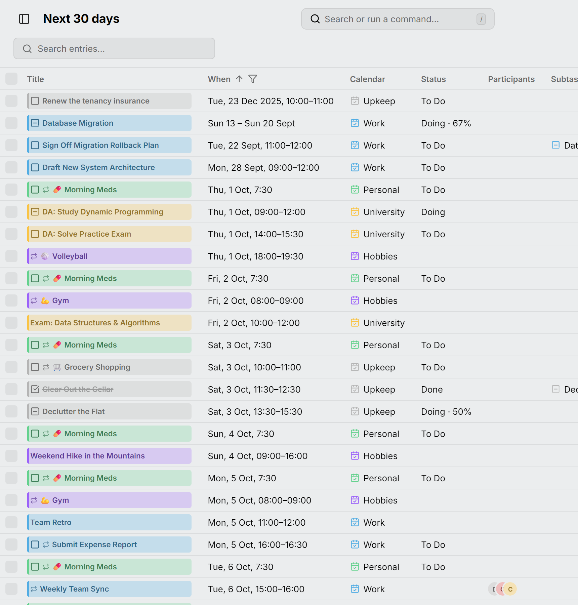

Widok **Tabela** wyświetla wpisy jako wiersze, zamiast rysować je w siatce. Otwórz go klawiszem <kbd>S</kbd> albo w przełączniku widoków.

Każdy wiersz to jeden wpis, a każde wystąpienie wpisu cyklicznego ma własny wiersz. Tytuł wygląda tak samo jak w kalendarzu: kliknij go, aby otworzyć edytor wpisu.

<picture>
  <source media="(prefers-color-scheme: dark)" srcset="../../assets/screenshots/table-detail-dark.webp">
  
</picture>

## Które wpisy

Tabela wyświetla wpisy z zakresu dni liczonego od dzisiaj, którego nazwa widnieje w nagłówku strony: **Ostatnie 30 dni**, **Dzisiaj**, **Następne 7 dni**, **Następne 30 dni** (zakres początkowy), **Następne 12 miesięcy**, **Wszystkie wpisy** albo **Własny zakres** między dwiema datami. Zakres wybierasz w menu kolumny **Kiedy**. Liczba obok pola wyszukiwania pokazuje, ile wierszy jest na liście.

Zadania bez daty oraz otwarte zadania zaległe pojawiają się niezależnie od wybranego zakresu, więc domyślny widok pokazuje razem wszystko, co czeka na zrobienie, i nadchodzący miesiąc.

Zakres **Wszystkie wpisy** służy do porządkowania. Wpis cykliczny zajmuje w nim jeden wiersz, który reprezentuje całą serię: kolumna **Kiedy** pokazuje, kiedy seria się zaczyna, a przeniesienie lub usunięcie wiersza przenosi lub usuwa wszystkie wystąpienia. Status należy do poszczególnych wystąpień, więc przyciski statusu pomijają taki wiersz.

Przycisk **Dzisiaj** w nagłówku strony oraz klawisz <kbd>G</kbd>, który przechodzi do innej daty, przewijają do pierwszego wiersza danego dnia bez zmiany zakresu.

## Wyszukiwanie, sortowanie i filtrowanie

Pole **wyszukiwania** porównuje każde wpisane słowo z tytułem, lokalizacją, opisem i kalendarzem.

Kliknij nagłówek kolumny, aby otworzyć jej menu:

- **Sortuj rosnąco** lub **Sortuj malejąco**. Wybierz aktywną opcję jeszcze raz, aby wyłączyć sortowanie. Przytrzymaj <kbd>Shift</kbd>, aby sortować według kilku kolumn.
- **Filtr** kolumny, jeśli kolumna go ma: odznacz wartości, które chcesz pominąć. Przytrzymaj <kbd>Alt</kbd>, aby zostawić tylko klikniętą wartość. Opcja **Bez statusu** w filtrze kolumny **Status** oznacza wydarzenia, więc jej odznaczenie pozostawia same zadania.
- **Ukryj kolumnę**, co usuwa też filtr tej kolumny.

Filtrować można kolumny **Status**, **Kalendarz**, **Typ** i **Powtarza się**, a kolumna **Kiedy** określa zakres dni. Lejek obok nagłówka oznacza, że kolumna ukrywa część wierszy. Kolumn **Tytuł** i **Kiedy** nie można ukryć.

## Kolumny

Na początku tabela ma kolumny **Tytuł**, **Kiedy**, **Kalendarz**, **Status**, **Lokalizacja**, **Uczestnicy**, **Zadanie nadrzędne** i **Blokowany przez**. Przycisk na końcu wiersza nagłówków pokazuje pozostałe (**Czas trwania**, **Typ**, **Powtarza się**, **Przypomnienia** i **Opis**), a **Przywróć kolumny** przywraca układ domyślny.

Każda kolumna jest tak szeroka jak jej zawartość. Przeciągnij nagłówek, aby przenieść kolumnę, albo jego krawędź, aby zmienić jej szerokość. Kliknij krawędź dwukrotnie, aby z powrotem dopasować kolumnę do zawartości.

## Zmiana wielu wpisów naraz

Kliknij wiersz, aby go zaznaczyć. Przytrzymaj <kbd>Ctrl</kbd> (<kbd>⌘</kbd>), aby dodać kolejne wiersze, lub <kbd>Shift</kbd>, aby zaznaczyć zakres, albo użyj pól wyboru. Nad wierszami pojawi się wtedy pasek z opcjami:

- **Do zrobienia**, **Gotowe** i **Anulowane** dla zaznaczonych zadań;
- **Przenieś do…** innego kalendarza;
- **Usuń**, po potwierdzeniu.

W przypadku wpisu cyklicznego zmieniają one tylko zaznaczone wystąpienie, z wyjątkiem zakresu **Wszystkie wpisy**, w którym wiersz to cała seria. Aby zmienić całą serię w innym zakresie, otwórz jej edytor.

Na klawiaturze <kbd>Space</kbd> zaznacza bieżący wiersz, a <kbd>Enter</kbd> go otwiera. <kbd>Escape</kbd> czyści zaznaczenie, a <kbd>Delete</kbd> usuwa zaznaczone wpisy.

## Nowe wpisy

Przycisk **Utwórz** w nagłówku strony albo klawisz <kbd>C</kbd> tworzy wpis na dzisiaj i otwiera go jako wiersz tabeli.
