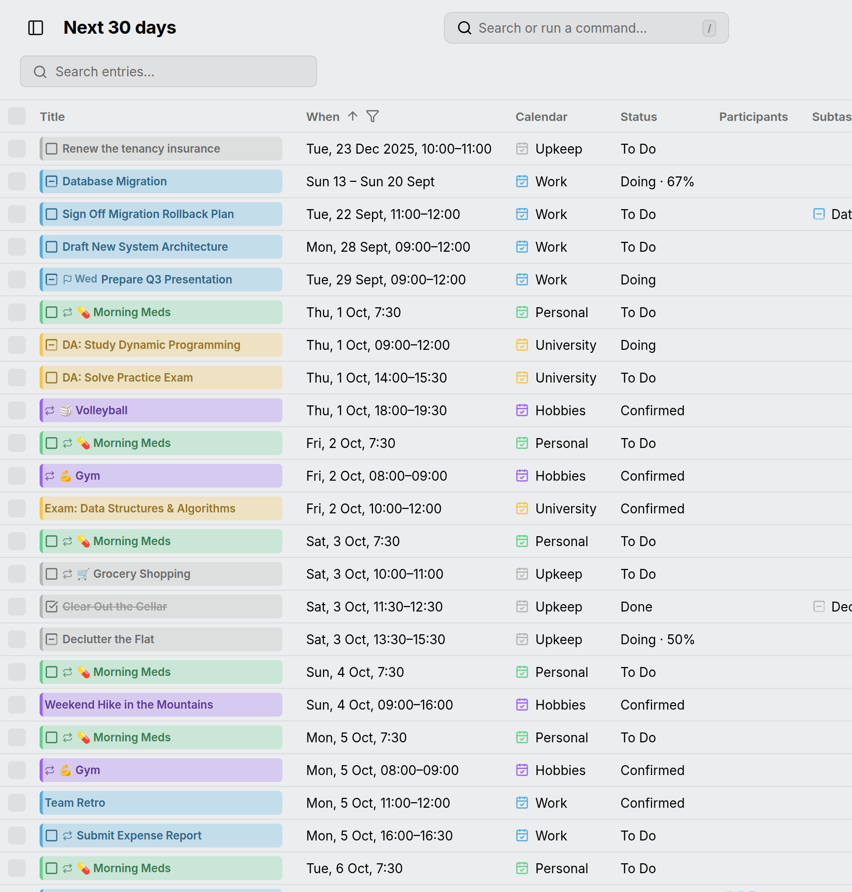

Chế độ xem **Bảng** liệt kê các mục của bạn thành từng hàng thay vì vẽ chúng trên lưới. Mở nó bằng <kbd>S</kbd> hoặc từ bộ chọn chế độ xem.

Mỗi hàng là một mục, và mỗi lần lặp của một mục lặp lại có một hàng riêng. Tiêu đề của nó là cùng một thẻ mà lịch vẽ: nhấp vào đó để mở trình chỉnh sửa của mục.

<picture>
  <source media="(prefers-color-scheme: dark)" srcset="../../assets/screenshots/table-detail-dark.webp">
  
</picture>

## Những mục nào

Bảng liệt kê các mục trong một khoảng ngày tính từ hôm nay, được nêu trong tiêu đề trang: **30 ngày qua**, **Hôm nay**, **7 ngày tới**, **30 ngày tới** (nơi nó bắt đầu), **12 tháng tới**, **Tất cả các mục**, hoặc một **Khoảng tùy chỉnh** gồm hai ngày. Chọn nó trong menu của cột **Thời gian**. Con số bên cạnh ô tìm kiếm là số hàng đang được liệt kê.

Các công việc không có ngày, và các công việc đang mở đã quá hạn, được liệt kê dù bạn chọn khoảng nào, nên mặc định hiển thị cả phần tồn đọng lẫn tháng sắp tới.

**Tất cả các mục** dùng để dọn dẹp. Một mục lặp lại là một hàng ở đó, đại diện cho cả chuỗi lặp lại: **Thời gian** của nó cho biết nơi nó bắt đầu, và di chuyển hay xóa nó là di chuyển hay xóa mọi lần lặp. Trạng thái của nó vẫn thuộc về từng lần lặp, nên các nút trạng thái bỏ qua nó.

**Hôm nay** trong đầu trang, và <kbd>G</kbd> để đến ngày khác, cuộn đến hàng đầu tiên của ngày đó mà không đổi khoảng ngày.

## Tìm kiếm, sắp xếp và lọc

Ô **tìm kiếm** khớp từng từ bạn gõ với tiêu đề, địa điểm, mô tả và lịch.

Nhấp vào tiêu đề một cột để mở menu của nó:

- **Sắp xếp tăng dần** hoặc **Sắp xếp giảm dần**. Chọn lại mục đang dùng để bỏ nó. Giữ <kbd>Shift</kbd> để sắp xếp theo nhiều cột.
- **Bộ lọc** của cột, nếu có: bỏ chọn các giá trị cần loại ra. Giữ <kbd>Alt</kbd> để chỉ giữ giá trị bạn nhấp.
- **Ẩn cột**, cũng gỡ bộ lọc của cột.

Các cột **Trạng thái**, **Lịch**, **Loại** và **Lặp lại** có thể lọc, còn **Thời gian** giữ khoảng ngày. Một hình phễu bên cạnh tiêu đề cho biết cột đang loại bớt hàng. **Tiêu đề** và **Thời gian** không thể ẩn.

## Cột

Bảng bắt đầu với **Tiêu đề**, **Thời gian**, **Lịch**, **Trạng thái**, **Địa điểm**, **Người tham gia**, **Công việc con của** và **Bị chặn bởi**. Nút ở cuối hàng tiêu đề hiện các cột còn lại (**Hạn chót**, **Thời lượng**, **Loại**, **Lặp lại**, **Lời nhắc** và **Mô tả**), và **Đặt lại cột** đưa các mặc định trở lại.

Mỗi cột rộng vừa với nội dung của nó. Kéo một tiêu đề để di chuyển cột của nó, và kéo cạnh của nó để đổi kích thước; nhấp đúp vào cạnh để cột vừa với nội dung của nó trở lại.

## Thay đổi nhiều mục cùng lúc

Nhấp vào một hàng để chọn nó, giữ <kbd>Ctrl</kbd> (<kbd>⌘</kbd>) để thêm hàng, <kbd>Shift</kbd> để chọn một dải, hoặc dùng các hộp kiểm. Một thanh phía trên các hàng khi đó đưa ra:

- **Cần làm**, **Xong** và **Đã hủy** cho các công việc đã chọn;
- **Di chuyển đến…** một lịch khác;
- **Xóa**, sau khi hỏi.

Với một mục lặp lại, những thao tác này chỉ thay đổi lần lặp đã chọn, trừ trong **Tất cả các mục**, nơi hàng là cả chuỗi lặp lại. Để thay đổi một chuỗi từ khoảng ngày khác, hãy mở trình chỉnh sửa của nó.

Với bàn phím, <kbd>Space</kbd> chọn hàng bạn đang đứng và <kbd>Enter</kbd> mở nó. <kbd>Escape</kbd> bỏ chọn và <kbd>Delete</kbd> xóa phần đã chọn.

## Mục mới

**Tạo** trong đầu trang, hoặc <kbd>C</kbd>, bắt đầu một mục cho hôm nay và mở nó như một hàng của bảng.
