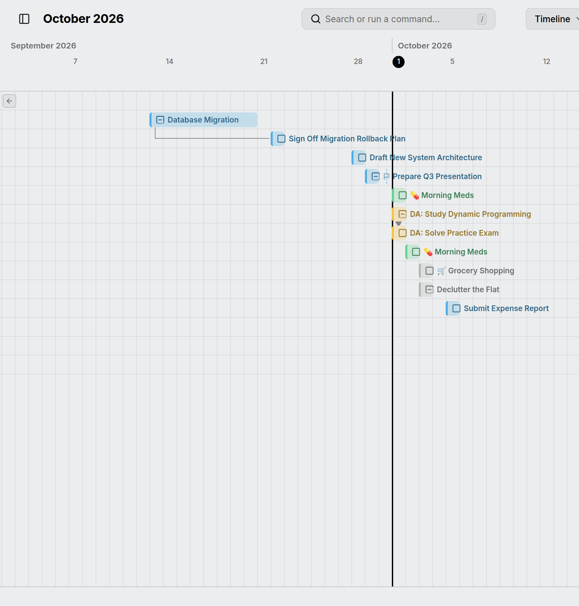

タイムラインには、日付のある未完了のタスクが日付順に1行ずつ表示されます。各バーはタスクの[スケジュール](../planning.md)をカバーしているので、どのタスクが並行して進み、どのタスクが前後に続くのかが一目でわかります。<kbd>L</kbd>で開きます。

<picture>
  <source media="(prefers-color-scheme: dark)" srcset="../../assets/screenshots/timeline-detail-dark.webp">
  
</picture>

タスクのタイトルはバーの横に表示されます。バーが画面外にスクロールされると、ビューの端にボタンが現れ、それを押すとバーの場所に戻れます。

繰り返しタスクは期日の来た回だけが表示されるので、毎日のタスクがタイムラインを埋め尽くすことはありません。[依存関係にあるタスク](../dependencies.md)同士を結ぶ接続線もここに表示されます。[設定](../settings.md)でオフにすることもできます。

バーをドラッグするとタスクを移動でき、端をドラッグすると日付を変更できます。タスクを追加するには、一番下の空の行にドラッグして描きます。

旅行や休日のような終日の予定は上端に表示され、その日々は予定の色で淡く塗られるので、どのタスクがその期間に入るかがわかります。
