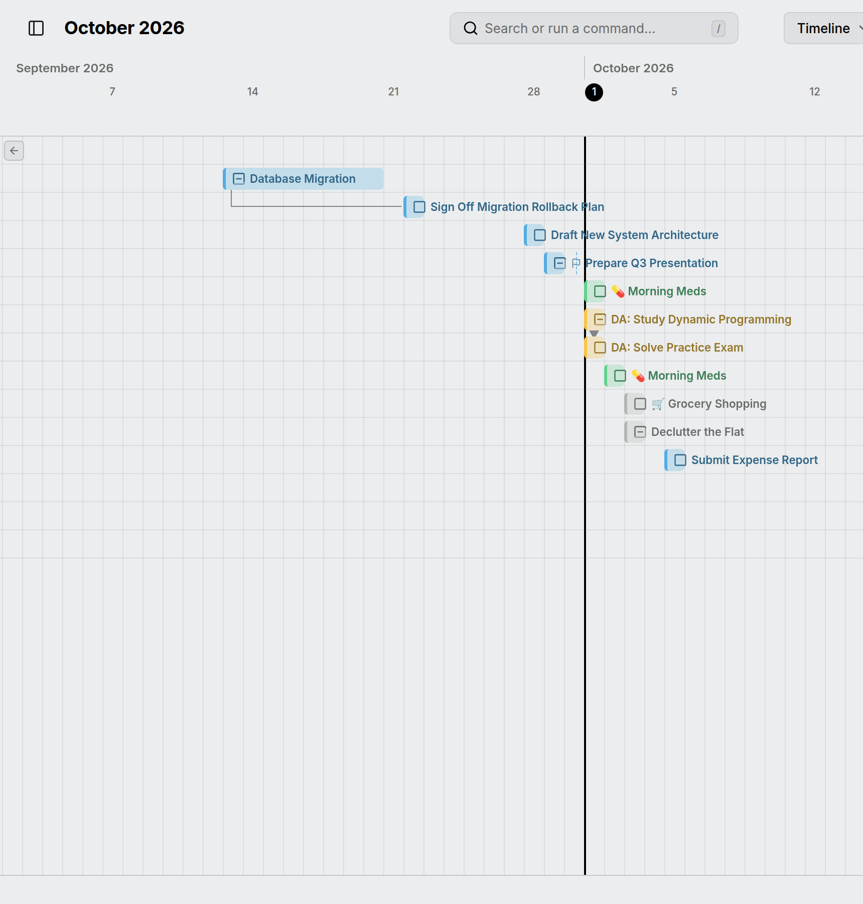

타임라인은 날짜가 있는 미완료 작업을 한 줄에 하나씩 날짜순으로 보여 줍니다. 각 막대는 작업의 [일정](../planning.md)만큼 이어지므로, 어떤 작업이 나란히 진행되고 어떤 작업이 차례로 이어지는지 바로 알 수 있습니다. <kbd>L</kbd>을 눌러 여세요.

<picture>
  <source media="(prefers-color-scheme: dark)" srcset="../../assets/screenshots/timeline-detail-dark.webp">
  
</picture>

작업 제목은 막대 옆에 표시됩니다. 막대가 스크롤되어 보이지 않으면, 보기 가장자리에 있는 버튼으로 다시 돌아갈 수 있습니다.

반복 작업은 마감이 된 회차만 보여 주므로, 매일 반복하는 작업이 타임라인을 가득 채우지 않습니다. [종속 관계가 있는 작업](../dependencies.md) 사이의 연결선도 여기에 표시되며, [설정](../settings.md)에서 끌 수 있습니다.

막대를 끌어 작업을 옮기거나, 막대의 양 끝을 끌어 날짜를 바꾸세요. 작업을 추가하려면 맨 아래의 빈 줄에 그리면 됩니다.

여행이나 휴일 같은 종일 일정은 맨 위에 표시되고, 해당 날짜는 일정의 색으로 칠해지므로 어떤 작업이 그 기간에 들어가는지 알 수 있습니다.
