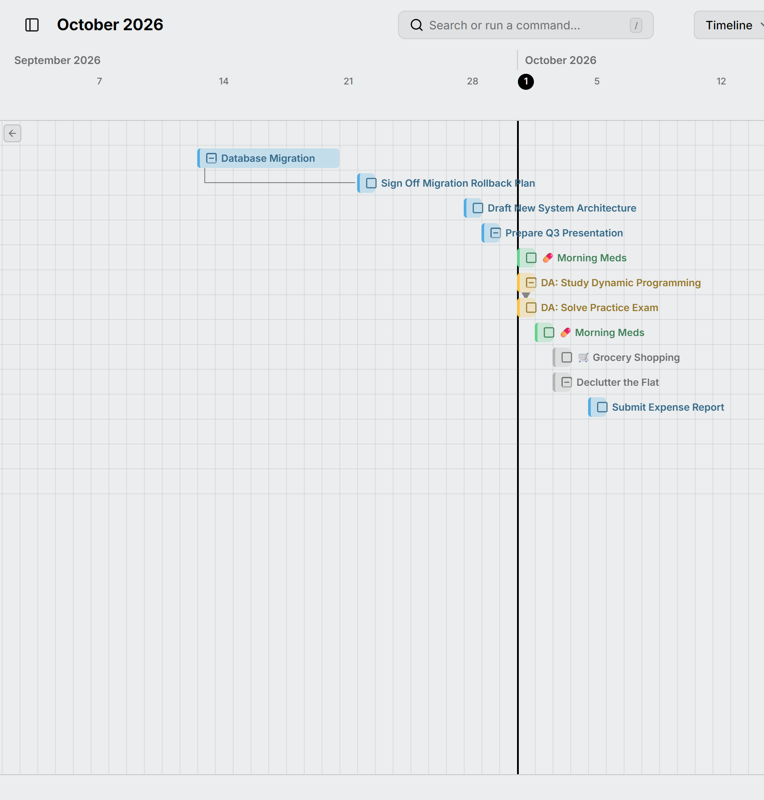

Oś czasu pokazuje otwarte zadania, które mają datę, po jednym w wierszu, w kolejności dat. Każdy pasek obejmuje [zaplanowany czas](../planning.md) zadania, więc od razu widzisz, które zadania biegną równolegle, a które następują po sobie. Otwórz ją klawiszem <kbd>L</kbd>.

<picture>
  <source media="(prefers-color-scheme: dark)" srcset="../../assets/screenshots/timeline-detail-dark.webp">
  
</picture>

Tytuł zadania jest wyświetlany obok jego paska. Gdy pasek zniknie z widoku podczas przewijania, przycisk przy krawędzi widoku pozwala do niego wrócić.

Zadanie cykliczne pokazuje tylko wystąpienia, które są właśnie do zrobienia, więc codzienne zadanie nie zapełnia osi czasu. Linie między [zadaniami zależnymi](../dependencies.md) też są tu widoczne, chyba że wyłączysz je w [ustawieniach](../settings.md).

Przeciągnij pasek, aby przenieść zadanie, albo przeciągnij jego końce, aby zmienić daty. Aby dodać zadanie, narysuj je w pustym wierszu na dole.

Wydarzenia całodniowe, takie jak wyjazd czy urlop, są wyświetlane u góry, a ich dni są zacienione w kolorze wydarzenia, więc widzisz, które zadania na nie przypadają.
