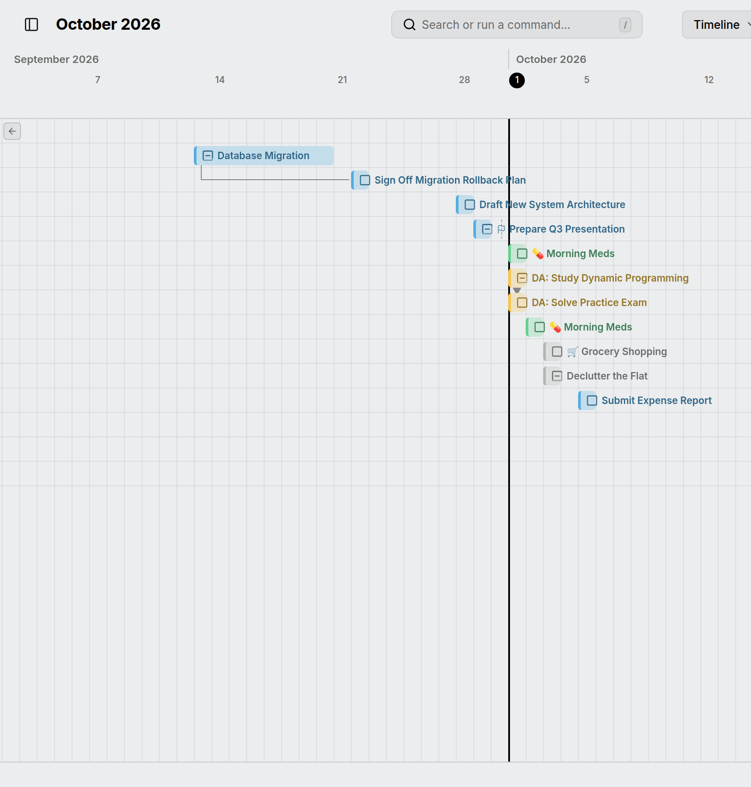

Dòng thời gian hiển thị các công việc đang mở của bạn có ngày, mỗi việc một hàng, theo thứ tự ngày. Mỗi thanh trải qua [lịch trình](../planning.md) của công việc, nên bạn thấy ngay những công việc nào chạy song song và những công việc nào nối tiếp nhau. Mở nó bằng <kbd>L</kbd>.

<picture>
  <source media="(prefers-color-scheme: dark)" srcset="../../assets/screenshots/timeline-detail-dark.webp">
  
</picture>

Tiêu đề của công việc nằm bên cạnh thanh của nó. Khi một thanh bị cuộn ra khỏi tầm nhìn, một nút ở mép chế độ xem đưa bạn quay lại đó.

Một công việc lặp lại chỉ hiển thị các lần lặp đã đến hạn, nên công việc hằng ngày không làm đầy dòng thời gian. Các đường nối giữa [các công việc phụ thuộc](../dependencies.md) cũng hiện ở đây, trừ khi bạn tắt chúng trong [Cài đặt](../settings.md).

Kéo một thanh để di chuyển công việc, hoặc kéo hai đầu của nó để đổi ngày. Để thêm một công việc, vẽ nó trên hàng trống ở cuối.

Các sự kiện cả ngày, như một chuyến đi hoặc một kỳ nghỉ, hiện dọc phía trên, và các ngày của chúng được tô bóng bằng màu của sự kiện, nên bạn thấy những công việc nào rơi vào đó.
