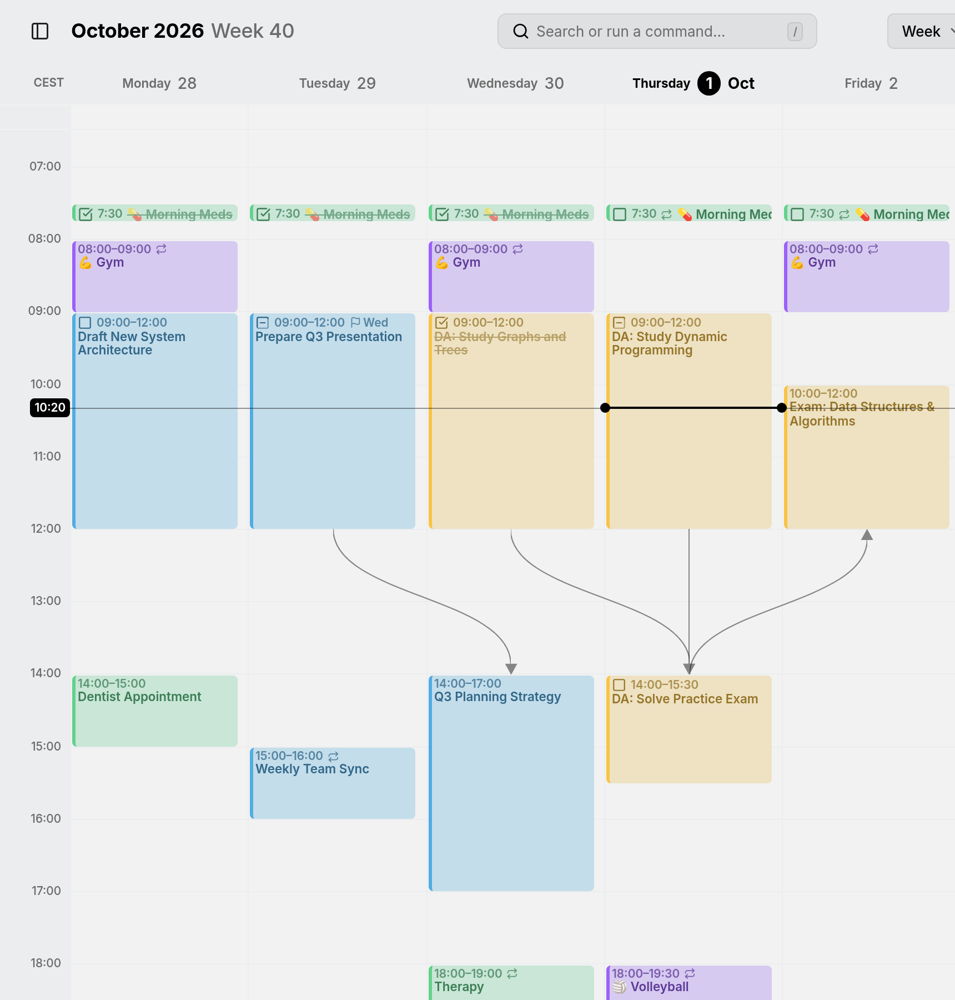

週ビューでは、1日が時間ごとの1列として表示されます。予定とタスクは同じ列の中に並ぶので、タスクに使える時間がどれくらい残っているかがわかります。<kbd>W</kbd>で開きます。

<picture>
  <source media="(prefers-color-scheme: dark)" srcset="../../assets/screenshots/week-detail-dark.webp">
  
</picture>

終日の項目は上端のレーンに表示されます。時間が重なる項目は、同じ列の中で横に並びます。

## 作成・移動・サイズ変更

何もない時間帯をドラッグすると項目を作成でき、項目をドラッグすると移動、端をドラッグするとサイズを変更できます。終日レーンで作成した項目は終日になり、その下で作成した項目には時刻が付きます。あとから切り替えるには、項目を開いて日付の行の端にある **終日** を押します。このボタンはその行にいる間だけ表示されます。

移動とサイズ変更は、[設定](../settings.md)の **スナップ** で選んだ間隔に吸着します。ドロップするときに <kbd>Alt</kbd> を押していると、移動ではなく項目の複製になります。

## その他の表示

- [依存関係にある項目](../dependencies.md)同士を結ぶ接続線と、タスクからその[サブタスク](../subtasks.md)への接続線。
- あなたの[対応可能時間](../availability.md)。そのカレンダーの色で淡く塗られます。
- 今日の列を横切る、現在時刻を示す線。

## 他のタイムゾーン

週ビューには、あなたのタイムゾーンの横に他のタイムゾーンの時間を表示できます。時間の列の上部にポインターを合わせ、**＋**(**タイムゾーンを追加**)を押すと追加できます。タイムゾーン名をクリックすると、名前の変更や削除ができます。追加した列を畳む方法や、各項目が持つタイムゾーンについては[タイムゾーン](../time-zones.md)を参照してください。
