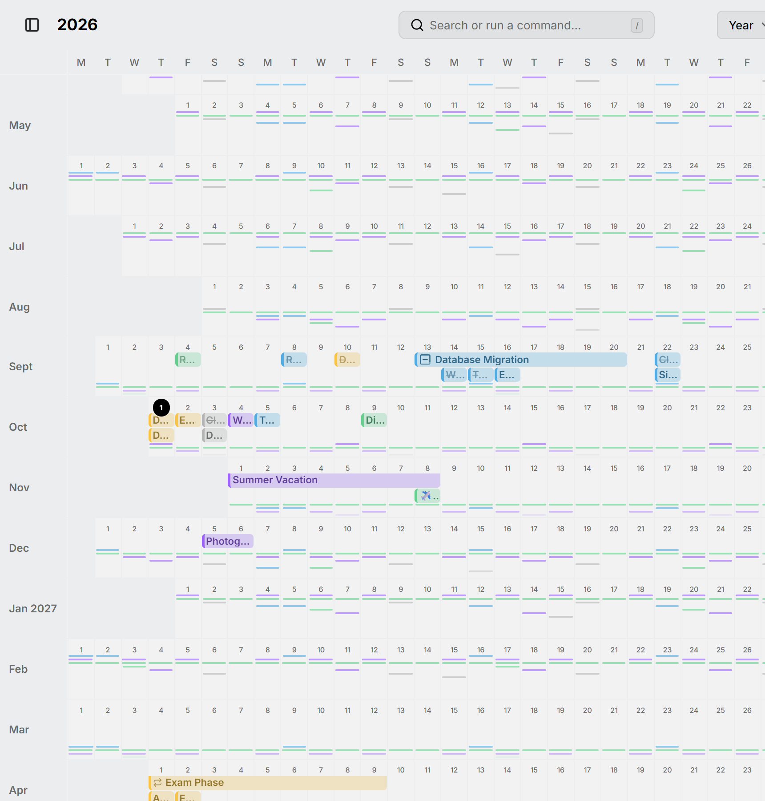

يُظهر عرض السنة كل شهر صفًا واحدًا من الأيام، فتتسع السنة كلها في شاشة واحدة. إنه المكان المناسب للعثور على أسبوع فارغ، أو لترى كيف تتوافق رحلة مع كل ما حولها. افتحه بالمفتاح <kbd>Y</kbd>.

<picture>
  <source media="(prefers-color-scheme: dark)" srcset="../../assets/screenshots/year-detail-dark.webp">
  
</picture>

تظهر العناصر أشرطةً تمتد عبر أيامها. أما ما يتكرر كثيرًا، ولو شهريًا، فيظهر علامات صغيرة بدلًا من ذلك؛ راجع [الروتين](../routines.md).

اسحب عبر الأيام لإنشاء عنصر يستمر طوال اليوم، واسحب عنصرًا لنقله أو اسحب نهايته لتغيير أيامه. انقر على اسم شهر لفتحه في [عرض الشهر](month.md).

كبّر بالضغط على <kbd>Ctrl</kbd> مع التمرير لتمنح الصفوف مساحة أكبر.
