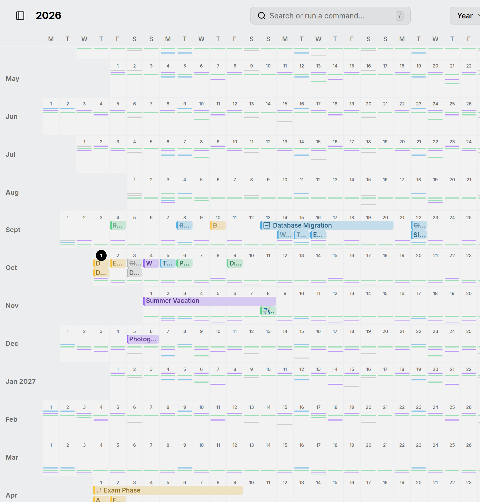

Chế độ xem năm hiển thị mỗi tháng là một hàng ngày, nên cả năm vừa trên một màn hình. Đây là nơi để tìm một tuần rảnh, hoặc xem một chuyến đi khớp với mọi thứ xung quanh ra sao. Mở nó bằng <kbd>Y</kbd>.

<picture>
  <source media="(prefers-color-scheme: dark)" srcset="../../assets/screenshots/year-detail-dark.webp">
  
</picture>

Các mục hiện dưới dạng thanh trải qua những ngày của chúng. Những việc quay lại thường xuyên, dù hằng tháng, thì hiện dưới dạng các dấu nhỏ; xem [Thói quen](../routines.md).

Kéo qua các ngày để tạo một mục cả ngày, và kéo một mục để di chuyển nó hoặc kéo phần cuối của nó để đổi các ngày. Nhấp vào tên một tháng để mở nó trong [chế độ xem tháng](month.md).

Thu phóng bằng <kbd>Ctrl</kbd> và cuộn để các hàng có thêm chỗ.
