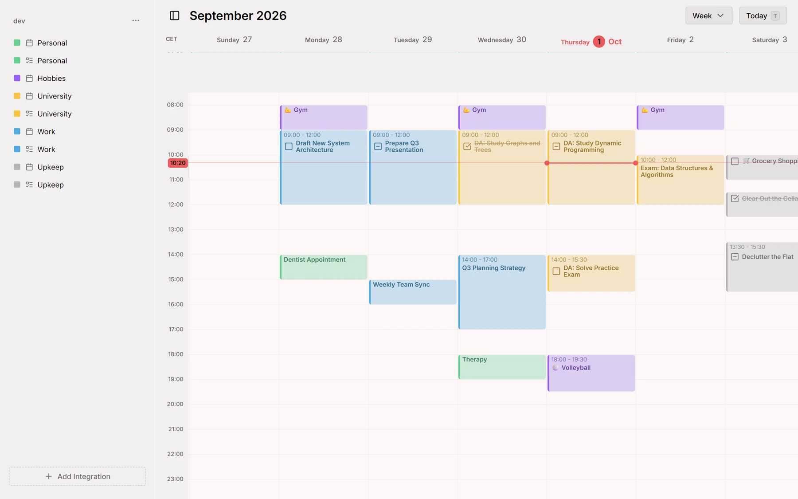
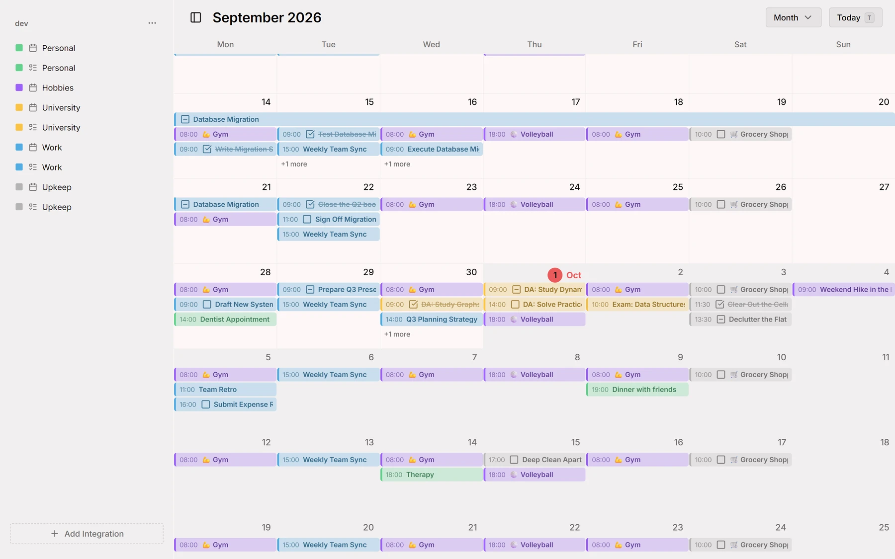
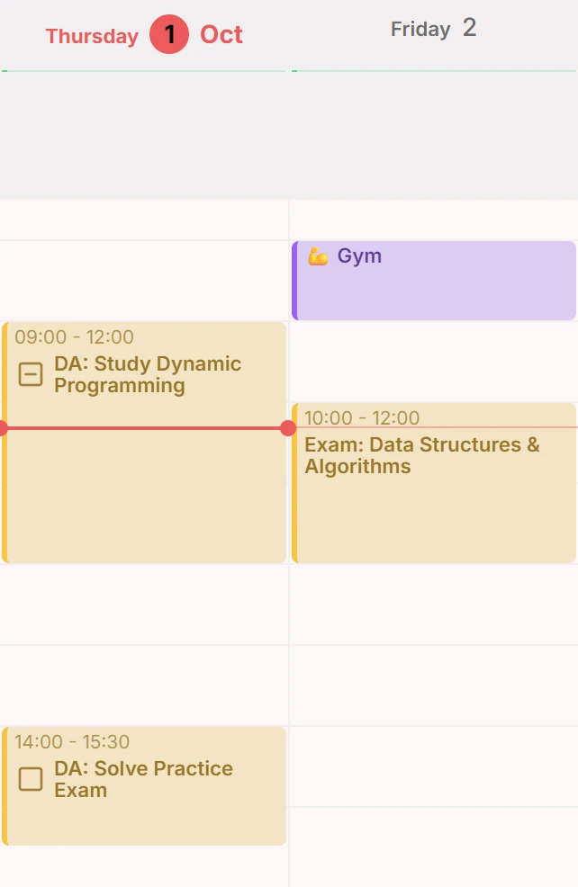
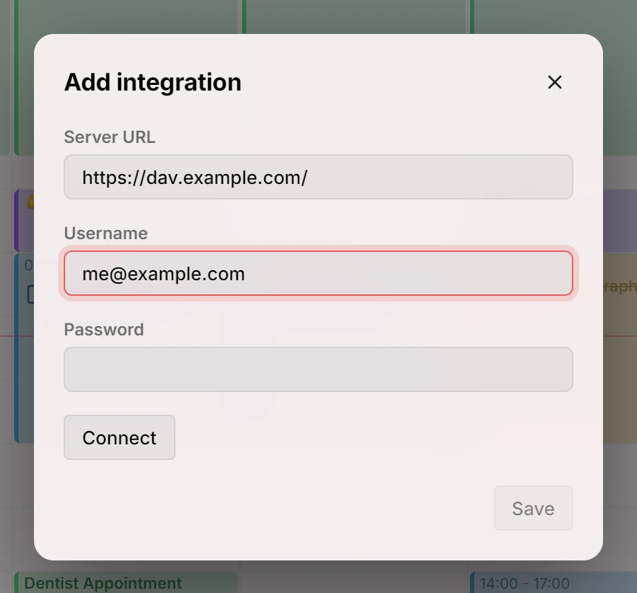
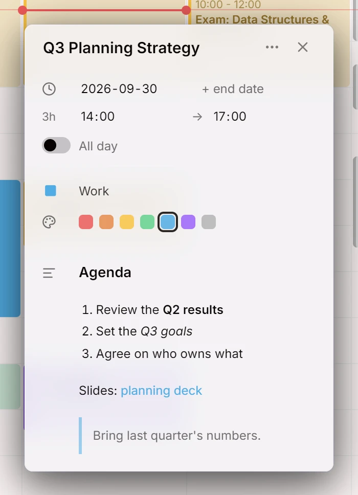

Mitra初のリリースです。タスクを予定と同じタイムラインに載せ、あなたがすでに使っているカレンダーと双方向に同期するカレンダーです。

## なぜMitraか
よくできたカレンダーアプリはあります。自分でホストできるカレンダーもあります。でも長い間、その2つは同じものではありませんでした。

洗練されたアプリは誰かのサーバー上で動き、入力したものすべてを読まれます。自宅で動かせるものは、ほとんどがサーバーそのものです。カレンダーは忠実に保存してくれますが、それをどんなアプリで見るかは自分で探すしかありません。Mitraは、その両方を一度に実現したいという思いから始まりました。一日中開いていて気持ちのよいカレンダーが、あなた自身のマシンで動き、誰にも従わないようにするために。

引っ越しを求められることもありません。Mitraは、いまあるカレンダーの上に重なるレイヤーであって、もう一つの置き場所ではありません。あなたの時間のそれぞれの源は、ほかと並んでつながる連携です。最初はCalDAVサーバーで、その後も多くの連携が加わりました。すべてが1つのタイムラインに集まりながら、データはそれぞれが本来いる場所に残ります。予定とタスクもそのタイムラインを共有するので、片方にもう片方をはめ込む作業を頭の中でやる必要はなくなります。

また、10年前ではなく現在のWebへの賭けでもあります。Mitraは現在のブラウザーに向けて書かれ、ブラウザーがネイティブでできることに依存しています。自らの表示域に合わせて変形するレイアウト、所定の場所にアンカーされたポップオーバー、ビュー間のトランジション、そして日付とタイムゾーンの本物のモデルです。互換レイヤーも重いフレームワークも持たないことが、Mitraを小さく速く保ち、アプリとしてインストールできるようにし、デスクトップと同じようにスマートフォンでも自然に使えるようにしています。その代償として、新しいブラウザーが必要です。そしてそれは今後も変わりません。

根底にあるのはシンプルな信念です。あなたの時間は、あなたが記録するものの中で最もプライベートなものだということです。それがどこにあるか、誰が読めるか、そして見たときにどれだけ穏やかな気持ちでいられるかは、あなたが決めるべきことです。Mitraは、それを簡単にするための試みです。

[@a11delavar](https://github.com/a11delavar)

## 週ビュー
1日は24時間の列で、現在時刻には線が引かれています。1週間は、それが7列並んだものです。ボタン1つで今日に戻れます。

<picture>
	<source media="(prefers-color-scheme: dark)" srcset="week-dark.webp">
	
</picture>

ドキュメント：[週ビュー](../../docs/views/week.md)

## 月ビュー
月ビューは終わりなくスクロールし、週ごとに1行、各項目はその日をまたぐバーです。ヘッダーから週ビューと切り替えられます。

<picture>
	<source media="(prefers-color-scheme: dark)" srcset="month-dark.webp">
	
</picture>

ドキュメント：[月ビュー](../../docs/views/month.md)

## 予定とタスク
タスクは予定と同じようにその日の中に置かれ、終わったらチェックボックスにチェックを入れます。グリッド上をドラッグすると項目を作成でき、ドラッグして移動します。カレンダーごとに色を付けられます。

<picture>
	<source media="(prefers-color-scheme: dark)" srcset="entries-dark.webp">
	
</picture>

ドキュメント：[項目](../../docs/entries.md)

## CalDAV
CalDAVサーバーに接続し、その中のどのカレンダーを表示するか選ぶと、Mitraが双方向に同期を保ちます。ほかの場所で行われた変更も、起きたそばから表示されます。

<picture>
	<source media="(prefers-color-scheme: dark)" srcset="caldav-dark.webp">
	
</picture>

ドキュメント：[CalDAV](../../docs/integrations/caldav.md)

## Markdownノート
項目の説明はMarkdownです。見出し・リスト・リンクはそのままの形で読め、ほかのアプリからはプレーンテキストのままです。

<picture>
	<source media="(prefers-color-scheme: dark)" srcset="markdown-dark.webp">
	
</picture>

## コントリビューター
- [@a11delavar](https://github.com/a11delavar)
