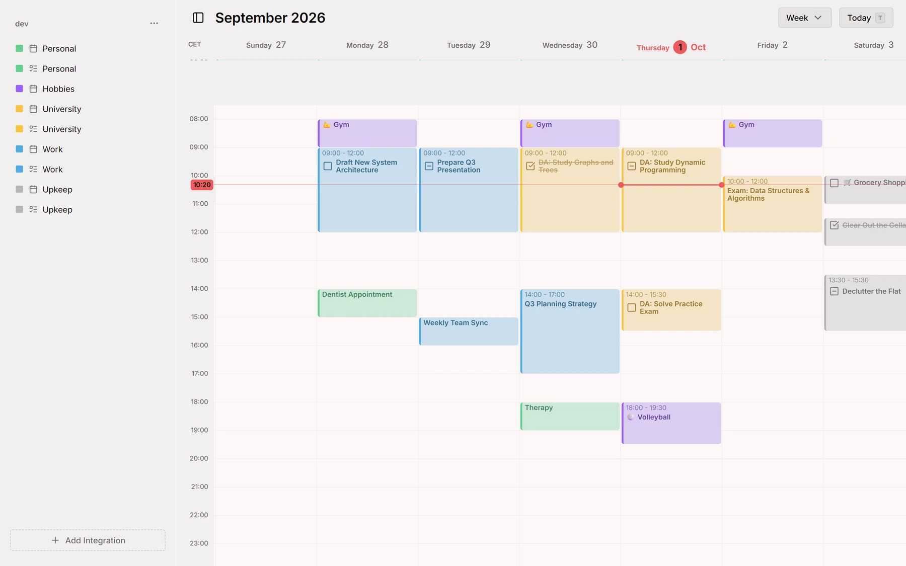
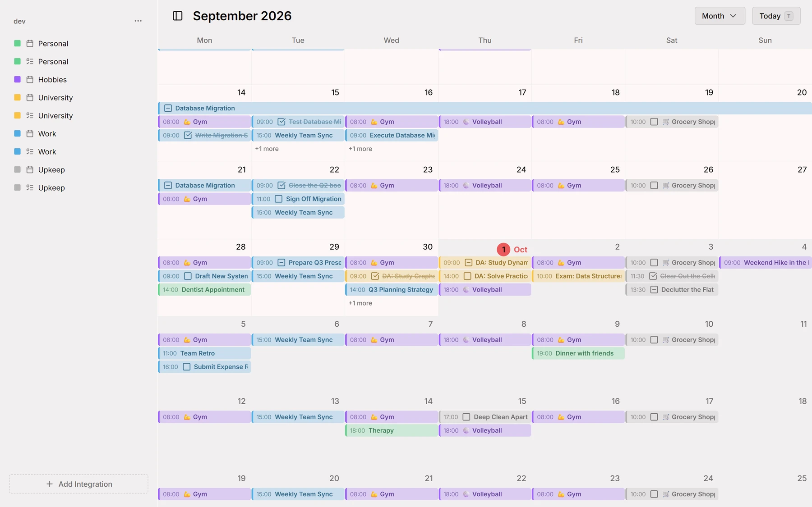
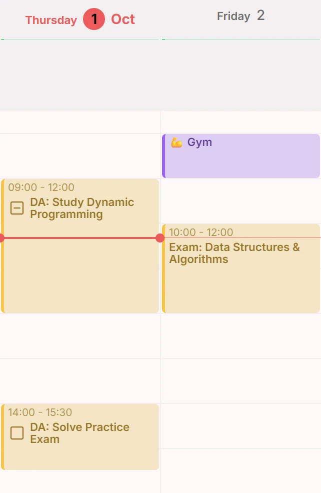
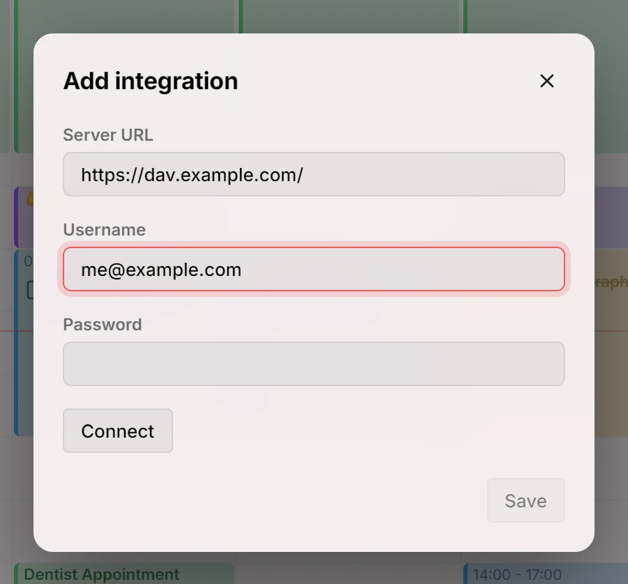
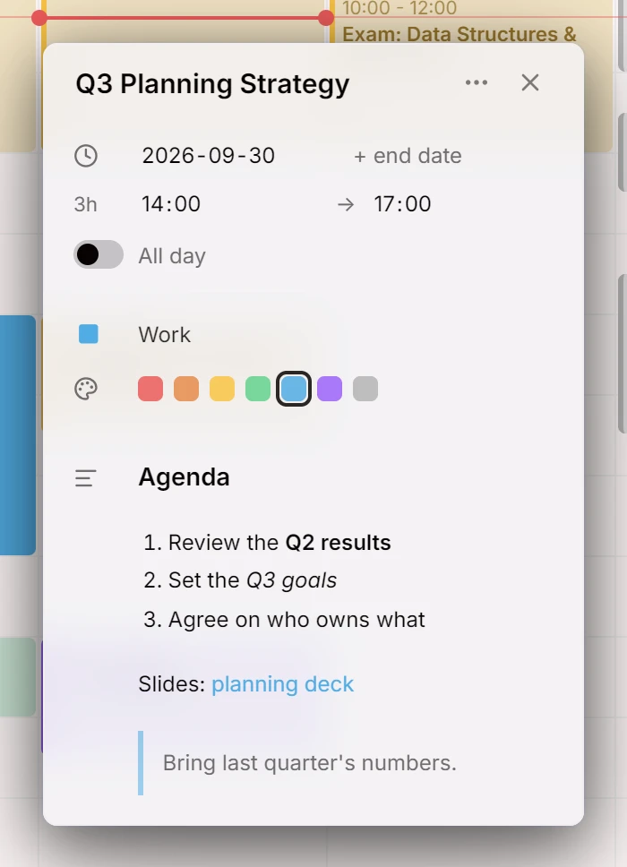

Mitra의 첫 릴리스입니다. 작업을 일정과 같은 타임라인에 올려 주고, 이미 쓰고 있는 캘린더와 양방향으로 동기화되는 캘린더입니다.

## 왜 Mitra인가
좋은 캘린더 앱도 있고 직접 호스팅할 수 있는 캘린더도 있지만, 오랫동안 둘은 서로 다른 것이었습니다.

잘 다듬어진 앱은 남의 서버에 있고, 그 안에 넣은 모든 것을 읽습니다. 집에서 돌릴 수 있는 것은 대부분 서버입니다. 캘린더를 충실히 보관해 주지만, 보는 일은 어떤 앱이든 찾아서 알아서 하라고 맡깁니다. Mitra는 둘을 한꺼번에 갖고 싶다는 마음에서 시작했습니다. 하루를 보내기에 편안하면서, 내 기기에서 돌아가고 누구에게도 매이지 않는 캘린더입니다.

옮겨 오라고 하지도 않습니다. Mitra는 이미 쓰고 있는 캘린더 위에 얹는 층이지, 캘린더를 보관할 또 하나의 장소가 아닙니다. 내 시간의 각 출처는 다른 것들 옆에 꽂히는 연동이며, 처음에는 CalDAV 서버였고 그 뒤로 훨씬 많아졌습니다. 모두가 하나의 타임라인에서 만나고, 각자의 데이터는 원래 있던 곳에 그대로 둡니다. 일정과 작업도 그 타임라인을 함께 쓰므로, 하나를 다른 하나에 끼워 맞추는 일을 더 이상 머릿속에서 하지 않아도 됩니다.

또한 10년 전의 웹이 아니라 지금의 웹에 거는 내기이기도 합니다. Mitra는 최신 브라우저를 위해 만들어졌고, 브라우저가 기본으로 할 수 있는 것에 기댑니다. 자기 공간에 맞춰 바뀌는 레이아웃, 제자리에 고정되는 팝오버, 보기 사이의 전환, 날짜와 시간대의 제대로 된 모델이 그렇습니다. 호환성 계층도 무거운 프레임워크도 싣지 않기에 작고 빠르며, 앱으로 설치할 수 있고, 데스크톱에서처럼 휴대폰에서도 자연스럽게 느껴집니다. 그 대가로 최신 브라우저가 필요하며, 앞으로도 계속 그럴 것입니다.

그 밑에는 단순한 믿음이 있습니다. 시간은 내가 남기는 가장 개인적인 기록이라는 것입니다. 그 기록이 어디에 있는지, 누가 읽을 수 있는지, 들여다볼 때 얼마나 차분한지는 내가 정할 수 있어야 합니다. Mitra는 그것을 쉽게 만들려는 시도입니다.

[@a11delavar](https://github.com/a11delavar)

## 주 보기
하루는 24시간짜리 열이고 현재 시각에 선이 그어지며, 한 주는 그런 열 일곱 개가 나란히 놓인 것입니다. 버튼 하나로 오늘로 돌아옵니다.

<picture>
	<source media="(prefers-color-scheme: dark)" srcset="week-dark.webp">
	
</picture>

문서: [주 보기](../../docs/views/week.md)

## 월 보기
월은 끝없이 이어서 스크롤되며, 주마다 한 줄, 항목마다 그 날짜에 걸친 막대가 있습니다. 머리글에서 월과 주 사이를 전환합니다.

<picture>
	<source media="(prefers-color-scheme: dark)" srcset="month-dark.webp">
	
</picture>

문서: [월 보기](../../docs/views/month.md)

## 일정과 작업
작업은 일정처럼 하루 안에 자리 잡고, 끝나면 체크할 상자가 있습니다. 그리드에서 드래그해 항목을 만들고, 항목을 드래그해 옮기고, 캘린더마다 색상을 정하세요.

<picture>
	<source media="(prefers-color-scheme: dark)" srcset="entries-dark.webp">
	
</picture>

문서: [항목](../../docs/entries.md)

## CalDAV
CalDAV 서버를 연결하고 보여 줄 캘린더를 고르면, Mitra가 양방향으로 맞춰 두며 다른 곳에서 바뀐 내용도 바로바로 나타납니다.

<picture>
	<source media="(prefers-color-scheme: dark)" srcset="caldav-dark.webp">
	
</picture>

문서: [CalDAV](../../docs/integrations/caldav.md)

## Markdown 메모
항목의 설명은 Markdown입니다. 제목, 목록, 링크가 그대로 표시되고, 다른 모든 앱에서는 일반 텍스트로 남습니다.

<picture>
	<source media="(prefers-color-scheme: dark)" srcset="markdown-dark.webp">
	
</picture>

## 기여자
- [@a11delavar](https://github.com/a11delavar)
