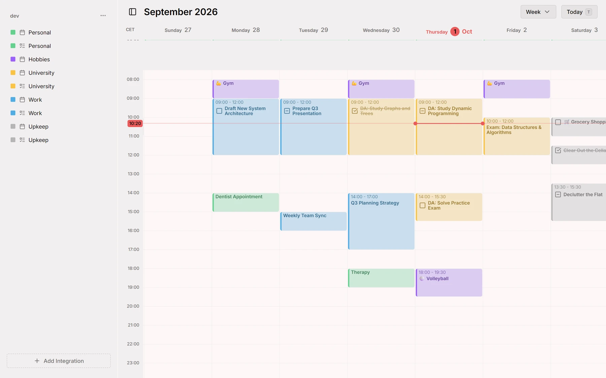
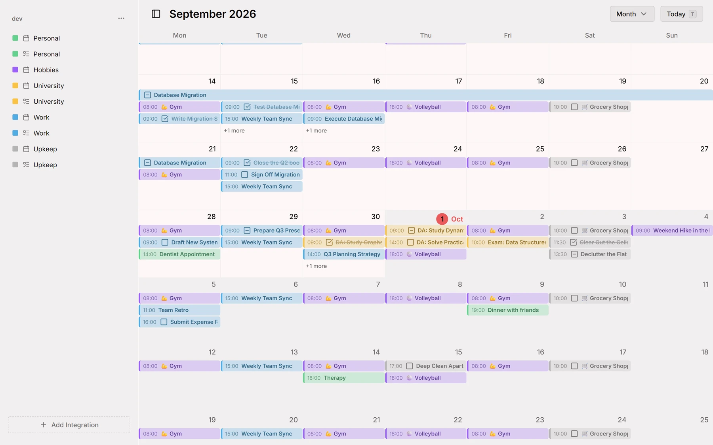
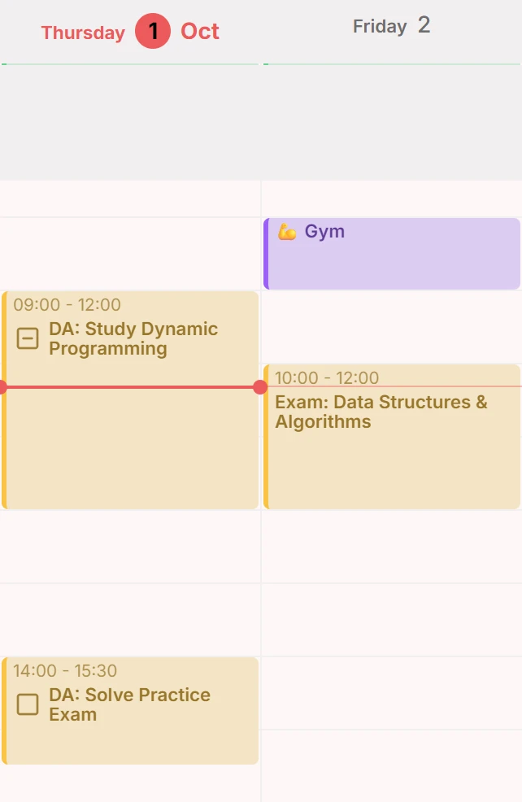
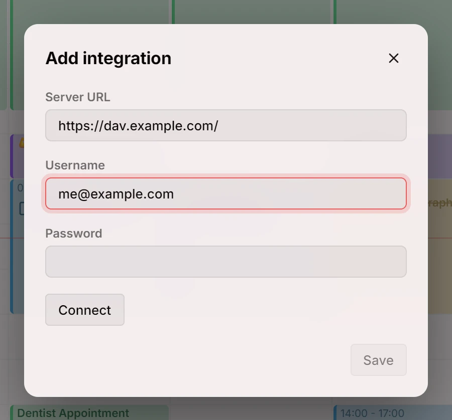
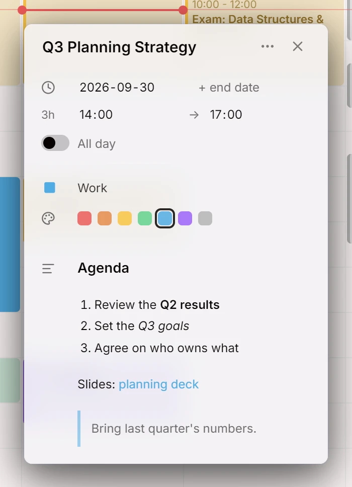

Первый выпуск Mitra: календарь, в котором задачи стоят на одной временной оси с событиями и который синхронизируется в обе стороны с календарями, которые вы уже ведёте.

## Почему Mitra
Есть хорошие приложения-календари, и есть календари, которые можно разместить на собственном сервере. Долгое время это были совсем разные программы.

Отточенные приложения работают на чужих серверах и читают всё, что вы в них записываете. А те, что можно запустить дома, по большей части просто серверы: они исправно хранят ваши календари, а смотреть на них приходится через то приложение, какое удастся найти. Работа над Mitra началась с желания получить и то и другое сразу: календарь, в котором приятно проводить день, который работает на вашем собственном компьютере и не подчиняется никому, кроме вас.

Переезжать никуда не нужно. Mitra работает поверх календарей, которые вы уже ведёте, а не становится ещё одним местом для их хранения. Каждый источник вашего времени подключается как интеграция рядом с остальными: сначала это был сервер CalDAV, с тех пор добавилось много других. Все они сходятся на одной временной оси, и каждый хранит свои данные там, где они и были. На этой же оси встречаются ваши события и задачи, так что совмещать одно с другим больше не приходится в уме.

А ещё Mitra делает ставку на веб, каким он стал сегодня, а не каким был десять лет назад. Mitra создаётся для современных браузеров и опирается на то, что они умеют сами: макеты, которые подстраиваются под доступное им место, всплывающие окна, привязанные к своему элементу, переходы между видами, полноценную модель дат и часовых поясов. Без слоёв совместимости и тяжёлого фреймворка Mitra весит немного и работает быстро, устанавливается как приложение и чувствует себя как дома и на телефоне, и на компьютере. Цена этого в том, что нужен свежий браузер, и так будет и дальше.

В основе всего лежит простое убеждение: самое личное из того, что вы о себе записываете, это ваше время. Где оно хранится, кто может его читать и насколько спокойно на него смотреть, решать должны вы. С Mitra это должно быть просто.

[@a11delavar](https://github.com/a11delavar)

## Вид недели
Каждый день показан столбцом из 24 часов с линией текущего времени, а неделя складывается из семи таких столбцов. К сегодняшнему дню можно вернуться одной кнопкой.

<picture>
	<source media="(prefers-color-scheme: dark)" srcset="week-dark.webp">
	
</picture>

Документация: [Вид недели](../../docs/views/week.md)

## Вид месяца
Месяц прокручивается бесконечно: по строке на каждую неделю и по полосе на каждую запись через все её дни. Переключаться между месяцем и неделей можно в верхней панели.

<picture>
	<source media="(prefers-color-scheme: dark)" srcset="month-dark.webp">
	
</picture>

Документация: [Вид месяца](../../docs/views/month.md)

## События и задачи
Задача занимает место в дне так же, как событие, но у неё есть флажок, который можно отметить, когда она выполнена. Чтобы создать запись, проведите по сетке, а чтобы переместить, перетащите её. Каждому календарю можно задать свой цвет.

<picture>
	<source media="(prefers-color-scheme: dark)" srcset="entries-dark.webp">
	
</picture>

Документация: [Записи](../../docs/entries.md)

## CalDAV
Подключите сервер CalDAV, выберите, какие из его календарей показывать, и Mitra будет синхронизировать их в обе стороны, а изменения, сделанные в других местах, будут появляться сразу.

<picture>
	<source media="(prefers-color-scheme: dark)" srcset="caldav-dark.webp">
	
</picture>

Документация: [CalDAV](../../docs/integrations/caldav.md)

## Заметки в Markdown
Описание записи пишется в Markdown: заголовки, списки и ссылки выглядят как заголовки, списки и ссылки, а для любого другого приложения остаются обычным текстом.

<picture>
	<source media="(prefers-color-scheme: dark)" srcset="markdown-dark.webp">
	
</picture>

## Авторы
- [@a11delavar](https://github.com/a11delavar)
