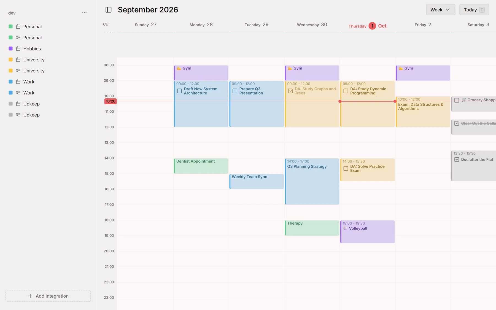
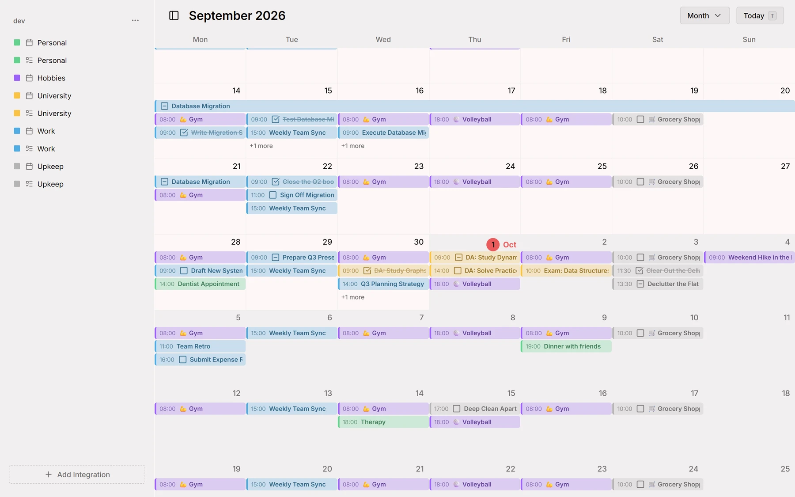
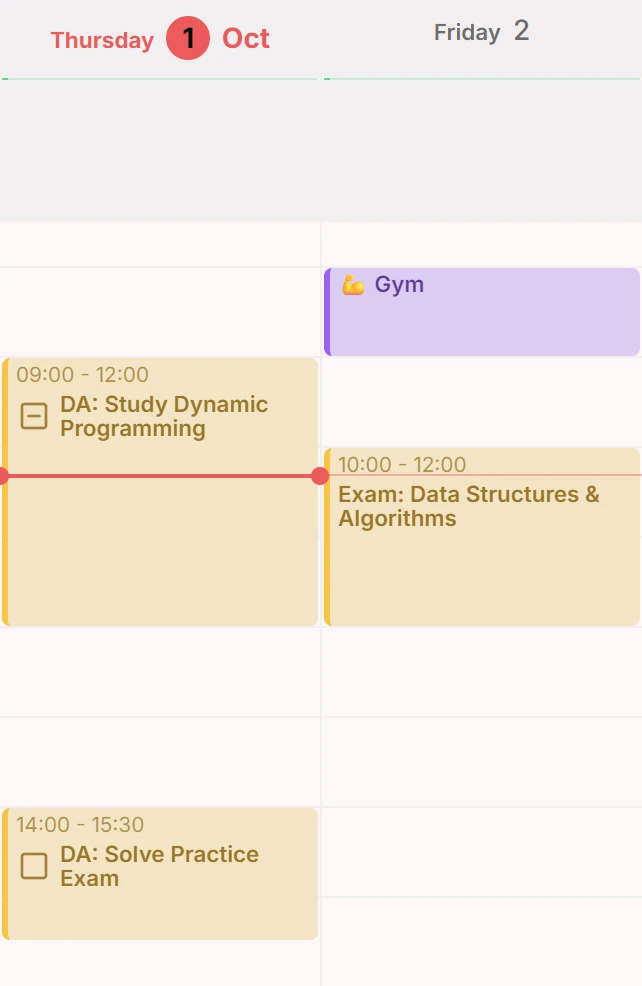
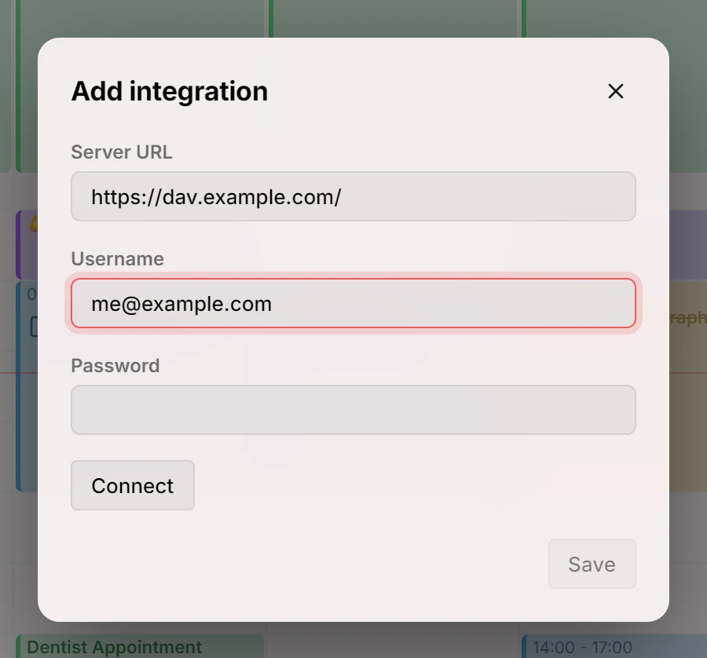
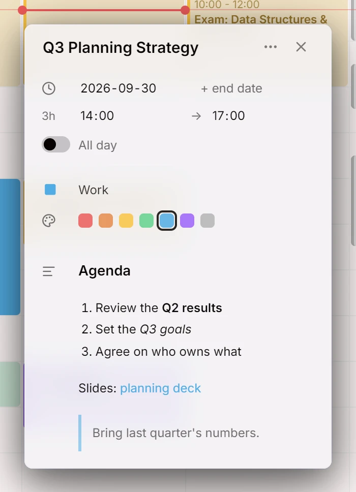

Phiên bản đầu tiên của Mitra: một cuốn lịch đặt công việc của bạn lên cùng dòng thời gian với các sự kiện, đồng bộ hai chiều với những cuốn lịch bạn đang dùng.

## Vì sao có Mitra
Có những ứng dụng lịch tốt, và có những cuốn lịch bạn có thể tự lưu trữ, nhưng suốt một thời gian dài chúng không phải là một.

Những ứng dụng bóng bẩy nằm trên máy chủ của người khác và đọc mọi thứ bạn nhập vào. Những cái bạn có thể chạy tại nhà thì phần lớn chỉ là máy chủ: chúng giữ lịch của bạn đầy đủ và để bạn tự xem chúng qua bất kỳ ứng dụng nào bạn tìm được. Mitra ra đời từ mong muốn có cả hai cùng lúc: một cuốn lịch dễ chịu để sống cùng cả ngày, chạy trên máy của riêng bạn và không phải trả lời trước ai khác.

Mitra không yêu cầu bạn chuyển nhà. Mitra là một lớp đặt lên các cuốn lịch bạn đang dùng, không phải một nơi nữa để cất chúng. Mỗi nguồn thời gian của bạn là một tích hợp cắm bên cạnh các tích hợp khác, lúc đầu là máy chủ CalDAV và từ đó đến nay là nhiều thứ nữa. Tất cả gặp nhau trên một dòng thời gian, còn dữ liệu vẫn nằm nơi nó vốn ở. Các sự kiện và công việc của bạn cũng dùng chung dòng thời gian đó, nên việc xếp cái này vào cái kia không còn diễn ra trong đầu bạn nữa.

Đây cũng là một canh bạc đặt vào web của hôm nay, không phải web của mười năm trước. Mitra được viết cho các trình duyệt hiện đại và dựa vào những gì chúng làm được sẵn: bố cục tự thích ứng với không gian của chính nó, cửa sổ nổi neo đúng chỗ, hiệu ứng chuyển giữa các chế độ xem, một mô hình ngày giờ và múi giờ đúng nghĩa. Không mang theo lớp tương thích hay framework nặng nề nào chính là điều giữ cho Mitra nhỏ và nhanh, cho phép cài thành ứng dụng, và khiến nó tự nhiên trên điện thoại cũng như trên máy tính. Cái giá phải trả là Mitra đòi hỏi một trình duyệt mới, và sẽ tiếp tục đòi như vậy.

Bên dưới là một niềm tin giản dị: thời gian là bản ghi cá nhân nhất mà bạn lưu giữ. Nó nằm ở đâu, ai đọc được, và nhìn vào nó yên bình đến mức nào, những điều đó phải do bạn quyết định. Mitra là một nỗ lực để việc này trở nên dễ dàng.

[@a11delavar](https://github.com/a11delavar)

## Chế độ xem tuần
Một ngày là một cột 24 giờ với một đường kẻ ở thời điểm hiện tại, và một tuần là bảy cột như vậy đặt cạnh nhau. Quay về hôm nay chỉ bằng một nút.

<picture>
	<source media="(prefers-color-scheme: dark)" srcset="week-dark.webp">
	
</picture>

Tài liệu: [Chế độ xem tuần](../../docs/views/week.md)

## Chế độ xem tháng
Tháng cuộn tiếp không dừng, mỗi tuần một hàng và mỗi mục một thanh trải qua các ngày của nó. Chuyển giữa chế độ xem này và chế độ xem tuần từ phần đầu trang.

<picture>
	<source media="(prefers-color-scheme: dark)" srcset="month-dark.webp">
	
</picture>

Tài liệu: [Chế độ xem tháng](../../docs/views/month.md)

## Sự kiện và công việc
Một công việc nằm trong ngày như một sự kiện, với một ô để đánh dấu khi xong. Kéo trong lưới để tạo một mục, kéo mục đó để di chuyển, và cho mỗi lịch một màu riêng.

<picture>
	<source media="(prefers-color-scheme: dark)" srcset="entries-dark.webp">
	
</picture>

Tài liệu: [Các mục](../../docs/entries.md)

## CalDAV
Kết nối một máy chủ CalDAV, chọn những lịch của nó cần hiển thị, và Mitra giữ chúng đồng bộ hai chiều, các thay đổi từ nơi khác xuất hiện ngay khi chúng xảy ra.

<picture>
	<source media="(prefers-color-scheme: dark)" srcset="caldav-dark.webp">
	
</picture>

Tài liệu: [CalDAV](../../docs/integrations/caldav.md)

## Ghi chú Markdown
Mô tả của một mục viết bằng Markdown: tiêu đề, danh sách và liên kết hiển thị đúng như vậy, và vẫn là văn bản thuần với mọi ứng dụng khác.

<picture>
	<source media="(prefers-color-scheme: dark)" srcset="markdown-dark.webp">
	
</picture>

## Người đóng góp
- [@a11delavar](https://github.com/a11delavar)
