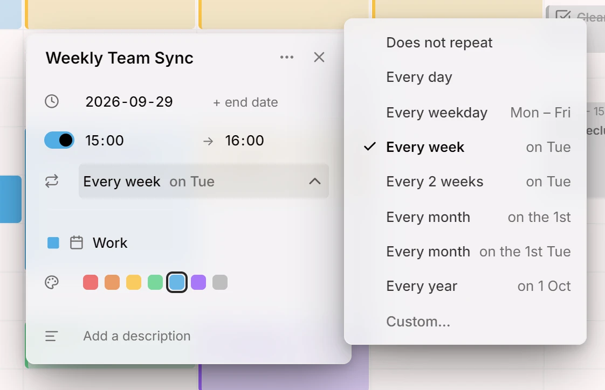
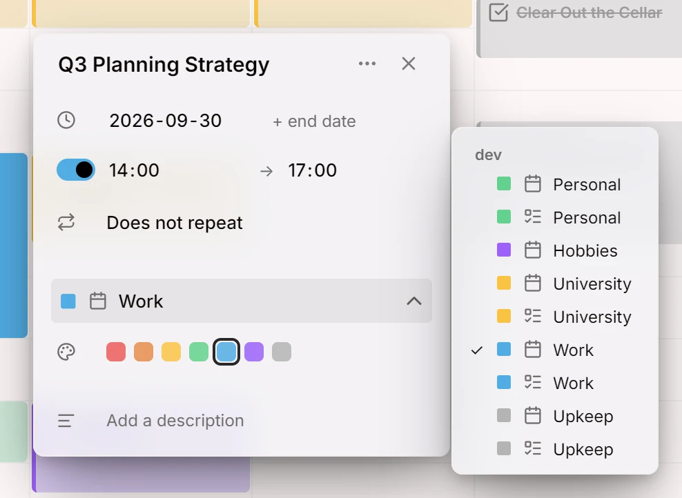

このリリースでは、繰り返す項目と、項目をあるカレンダーから別のカレンダーへ移動する機能が追加されました。

## 繰り返し項目
項目は、毎日・毎週・毎月・毎年の繰り返しにできるほか、独自のルールでも繰り返せます。たとえば隔週の月曜と木曜、毎月最終金曜日などです。指定した回数で終わらせたり、日付で終わらせたりでき、1回だけスキップすることもできます。ある1回を変更すると、Mitraがこの1回だけか、この回とそれ以降か、それとも全部かを尋ねます。ルールはCalDAVカレンダーと双方向に同期されるので、すでに使っているカレンダーでも同じように繰り返されます。

<picture>
	<source media="(prefers-color-scheme: dark)" srcset="repeats-dark.webp">
	
</picture>

ドキュメント：[繰り返し](../../docs/repeats.md)

## カレンダー間で項目を移動
エディターから項目を別のカレンダーへ移動できます。アカウントをまたぐこともできます。

<picture>
	<source media="(prefers-color-scheme: dark)" srcset="move-dark.webp">
	
</picture>

ドキュメント：[カレンダー](../../docs/calendars.md)

## コントリビューター
- [@a11delavar](https://github.com/a11delavar)
