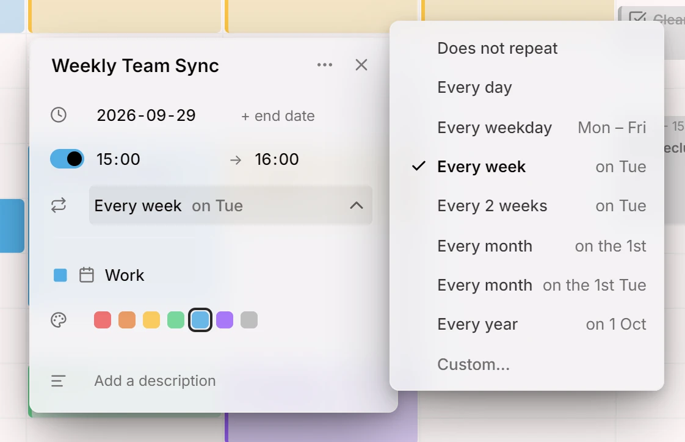
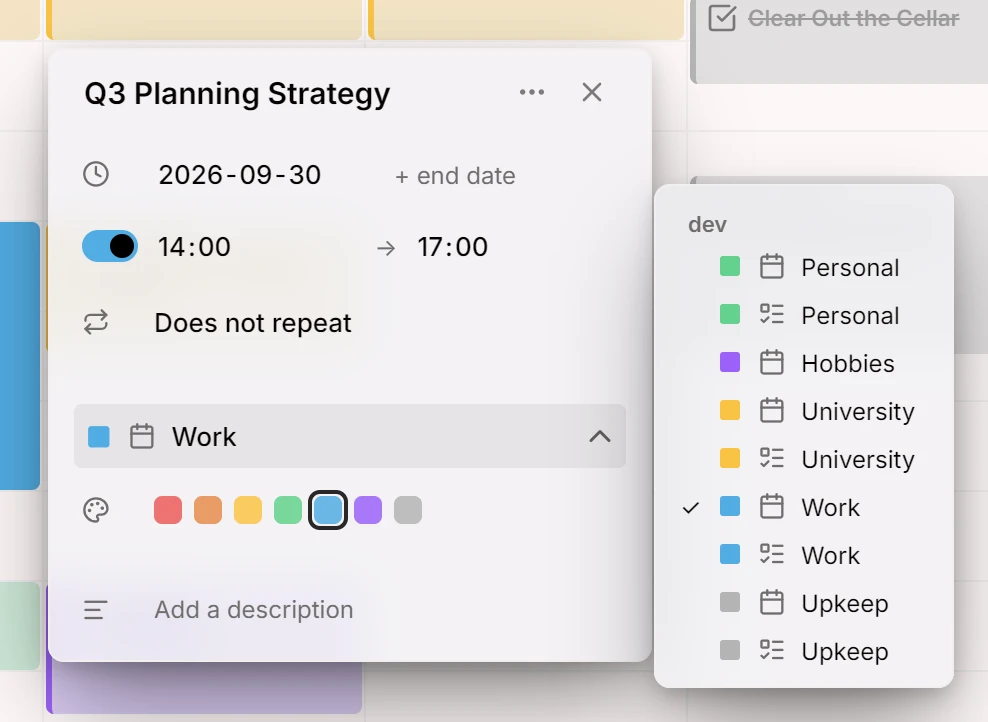

이번 릴리스에서는 반복되는 항목이 추가되었고, 항목을 한 캘린더에서 다른 캘린더로 옮길 수 있게 되었습니다.

## 반복 항목
항목을 매일, 매주, 매월, 매년 반복하거나 직접 정한 규칙에 따라 반복할 수 있습니다. 예를 들어 격주 월요일과 목요일, 또는 매달 마지막 금요일처럼요. 정해진 횟수가 지나거나 특정 날짜가 되면 반복을 끝낼 수 있고, 회차 하나만 건너뛸 수도 있습니다. 회차 하나를 바꾸면 Mitra가 이 회차만 바꿀지, 이 회차와 이후 회차를 바꿀지, 전체를 바꿀지 묻습니다. 반복 규칙은 CalDAV 캘린더와 양방향으로 오가므로, 이미 쓰고 있는 캘린더에서도 똑같이 반복됩니다.

<picture>
	<source media="(prefers-color-scheme: dark)" srcset="repeats-dark.webp">
	
</picture>

문서: [반복](../../docs/repeats.md)

## 캘린더 간 항목 이동
편집기에서 항목을 다른 캘린더로 옮길 수 있습니다. 원한다면 다른 계정의 캘린더로도 옮길 수 있습니다.

<picture>
	<source media="(prefers-color-scheme: dark)" srcset="move-dark.webp">
	
</picture>

문서: [캘린더](../../docs/calendars.md)

## 기여자
- [@a11delavar](https://github.com/a11delavar)
