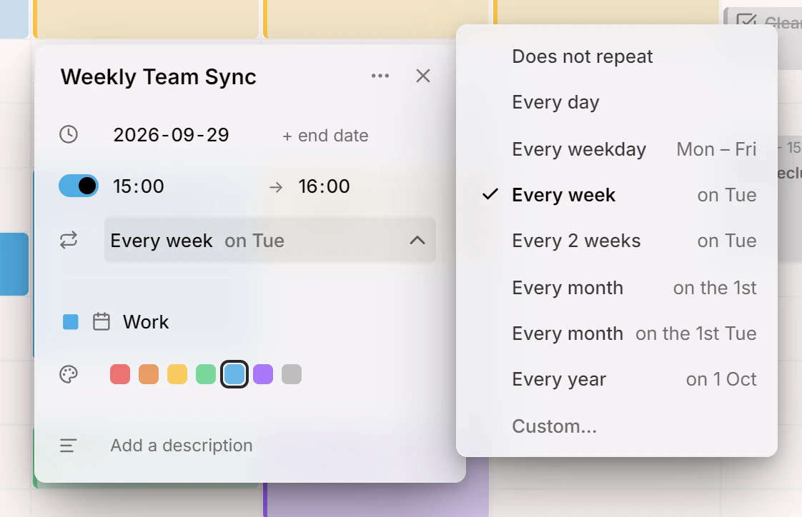
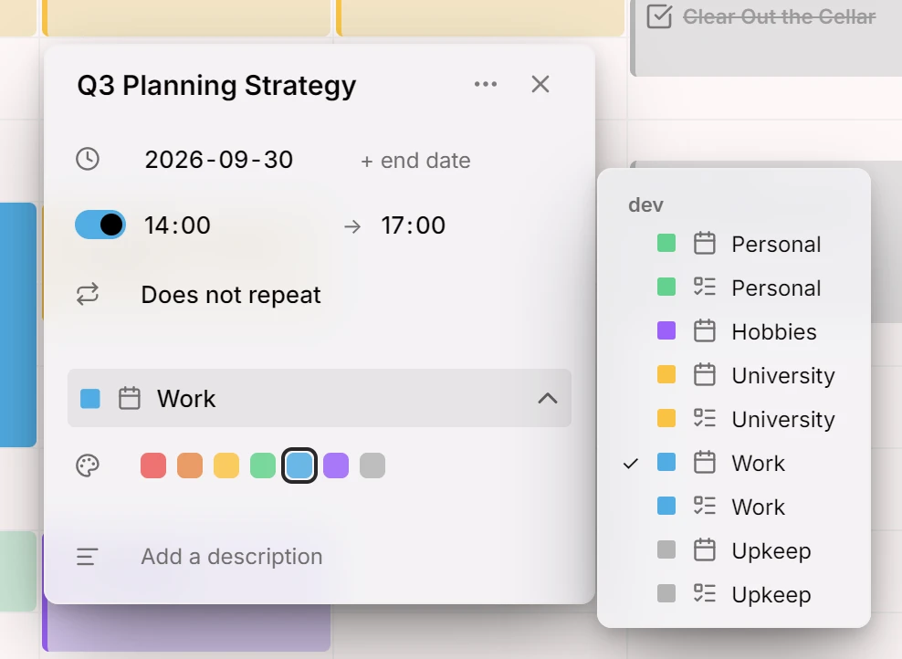

В этом выпуске появились повторяющиеся записи, а запись теперь можно перенести из одного календаря в другой.

## Повторяющиеся записи
Запись может повторяться каждый день, неделю, месяц или год либо по вашему собственному правилу: каждую вторую неделю по понедельникам и четвергам или в последнюю пятницу каждого месяца. Повторы можно ограничить числом раз или датой, а отдельное повторение можно пропустить. Если вы меняете одно повторение, Mitra спросит, что вы имеете в виду: только его, его и все последующие или все сразу. Правила синхронизируются с вашим календарём CalDAV в обе стороны, поэтому в календарях, которыми вы уже пользуетесь, записи повторяются точно так же.

<picture>
	<source media="(prefers-color-scheme: dark)" srcset="repeats-dark.webp">
	
</picture>

Документация: [Повтор](../../docs/repeats.md)

## Перемещение записей между календарями
Переносите запись в другой календарь прямо из её редактора, при желании даже в календарь другого аккаунта.

<picture>
	<source media="(prefers-color-scheme: dark)" srcset="move-dark.webp">
	
</picture>

Документация: [Календари](../../docs/calendars.md)

## Авторы
- [@a11delavar](https://github.com/a11delavar)
