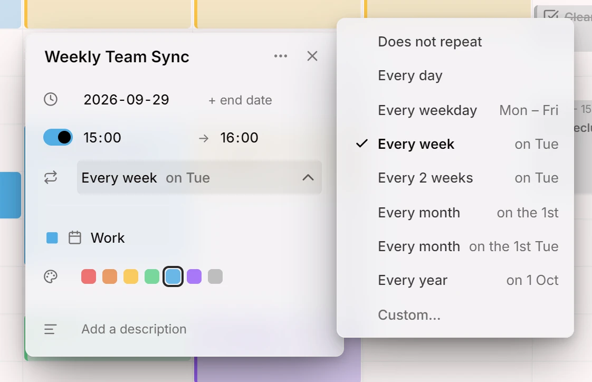
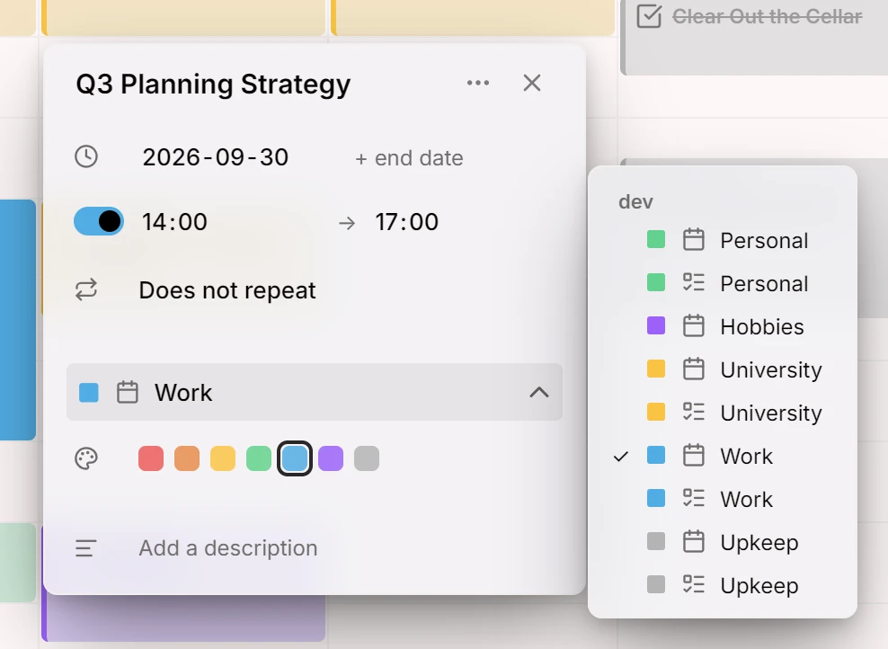

Phiên bản này mang đến các mục lặp lại, và cho phép chuyển một mục từ lịch này sang lịch khác.

## Mục lặp lại
Một mục có thể lặp lại mỗi ngày, tuần, tháng hoặc năm, hoặc theo quy tắc riêng của bạn: hai tuần một lần vào thứ Hai và thứ Năm, hay thứ Sáu cuối cùng của mỗi tháng. Nó có thể dừng sau một số lần hoặc vào một ngày nhất định, và một lần lặp riêng lẻ có thể được bỏ qua. Khi bạn thay đổi một lần lặp, Mitra hỏi bạn muốn áp dụng cho riêng lần này, lần này và các lần sau, hay tất cả. Các quy tắc đi theo lịch CalDAV của bạn theo cả hai chiều, nên các lịch bạn đang dùng cũng lặp lại giống hệt.

<picture>
	<source media="(prefers-color-scheme: dark)" srcset="repeats-dark.webp">
	
</picture>

Tài liệu: [Lặp lại](../../docs/repeats.md)

## Chuyển mục giữa các lịch
Chuyển một mục sang lịch khác ngay từ trình chỉnh sửa của nó, kể cả giữa các tài khoản nếu bạn muốn.

<picture>
	<source media="(prefers-color-scheme: dark)" srcset="move-dark.webp">
	
</picture>

Tài liệu: [Lịch](../../docs/calendars.md)

## Người đóng góp
- [@a11delavar](https://github.com/a11delavar)
