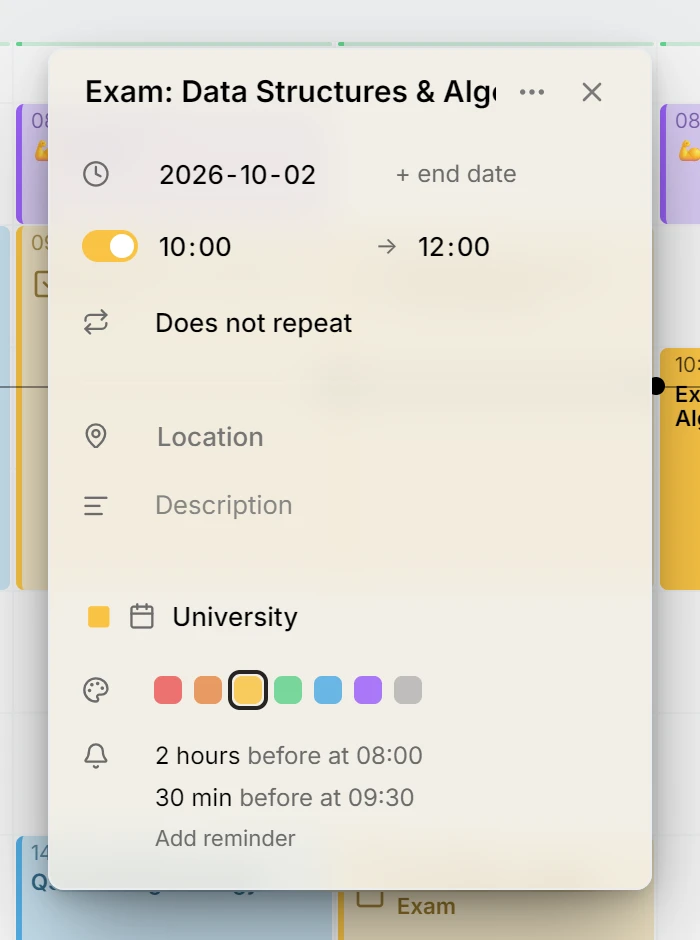
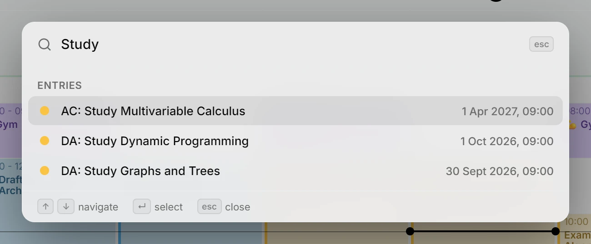
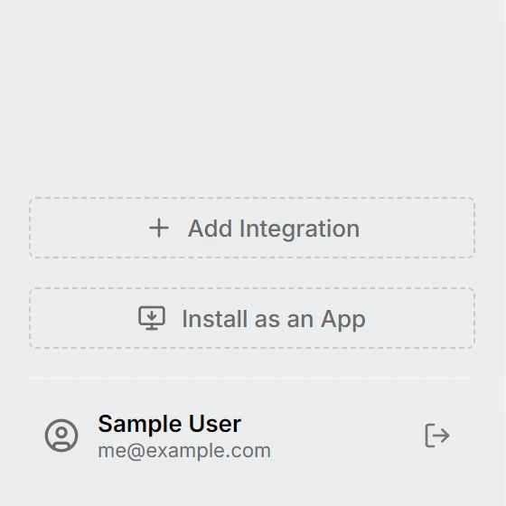
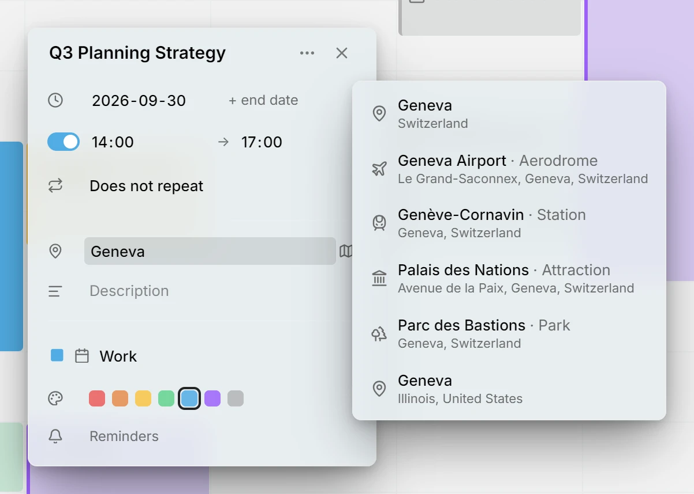
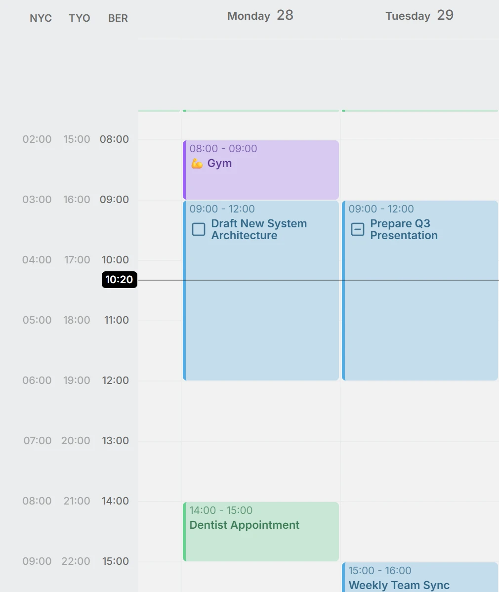
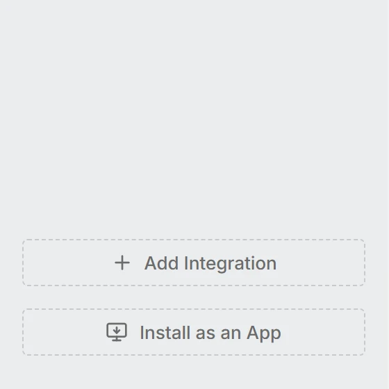
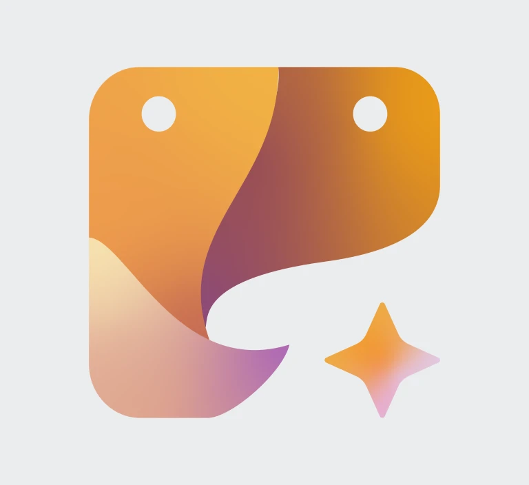
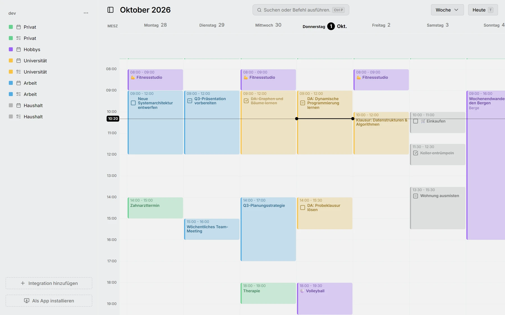

このリリースは、予定が始まる前にリマインドし、すべての操作をキーひとつで実行できるようにし、家族やチームが1台のMitraを共有して、一人ひとりが自分のカレンダーを持てるようにします。また、どんな言語にも対応できるようになった最初のリリースでもあります。

## リマインダー
項目が始まる前に、スマートフォンやデスクトップにプッシュ通知でMitraがリマインドします。新しい項目には30分前のリマインダーが付いていて、変更も削除もできます。

<picture>
	<source media="(prefers-color-scheme: dark)" srcset="reminders-dark.webp">
	
</picture>

ドキュメント：[リマインダー](../../docs/reminders.md)

## コマンドパレット
Ctrl+P（Macでは⌘P）を押して入力します。コマンド、移動したい日付、開きたい項目のタイトルなどです。

<picture>
	<source media="(prefers-color-scheme: dark)" srcset="palette-dark.webp">
	
</picture>

ドキュメント：[ショートカット](../../docs/shortcuts.md)

## 複数ユーザーとOIDC
自分のIDプロバイダーでサインインすると、1台のMitraで一人ひとりが自分のカレンダーを持てます。

<picture>
	<source media="(prefers-color-scheme: dark)" srcset="users-dark.webp">
	
</picture>

ドキュメント：[シングルサインオン](../../docs/sso.md)

## 場所
場所を入力して候補から選びます。最近使った場所が先に出て、正確な住所がいらないときはおおまかな場所も選べます。

<picture>
	<source media="(prefers-color-scheme: dark)" srcset="locations-dark.webp">
	
</picture>

ドキュメント：[場所](../../docs/location.md)

## グリッドのタイムゾーン
一緒に働く人のタイムゾーンを、時間軸の横に追加の列として表示できます。

<picture>
	<source media="(prefers-color-scheme: dark)" srcset="time-zones-dark.webp">
	
</picture>

ドキュメント：[タイムゾーン](../../docs/time-zones.md)

## アプリとしてインストール
ブラウザーからMitraをインストールすると、専用のアイコンを持つ独立したウィンドウで開きます。

<picture>
	<source media="(prefers-color-scheme: dark)" srcset="install-dark.webp">
	
</picture>

ドキュメント：[アプリとしてインストール](../../docs/install-app.md)

## 新しいロゴ
Mitraに独自のロゴができました。デザインは[@corruptedlotus](https://github.com/corruptedlotus)さんです。インストールしたアプリと通知のアイコンになります。

<picture>
	<source media="(prefers-color-scheme: dark)" srcset="logo-dark.webp">
	
</picture>

## 多言語対応
Mitraのすべての言葉が翻訳できるようになり、言語の切り替えは再読み込みなしですぐに反映されます。ドイツ語が英語以外で最初の言語です。

<picture>
	<source media="(prefers-color-scheme: dark)" srcset="german-dark.webp">
	
</picture>

ドキュメント：[設定](../../docs/settings.md)

## コントリビューター
- [@a11delavar](https://github.com/a11delavar)
- [@corruptedlotus](https://github.com/corruptedlotus)
