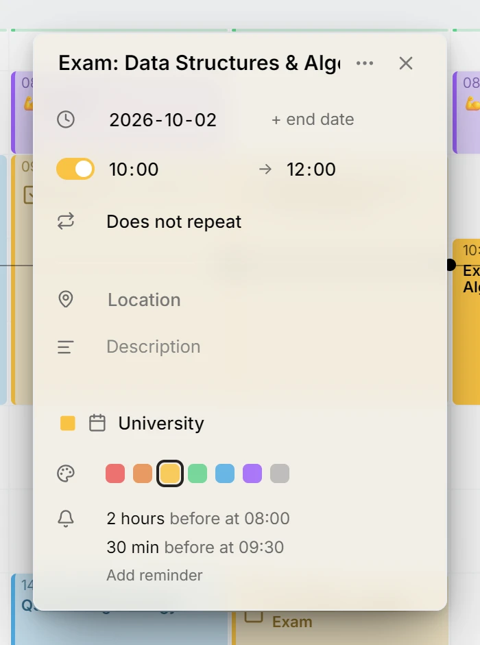
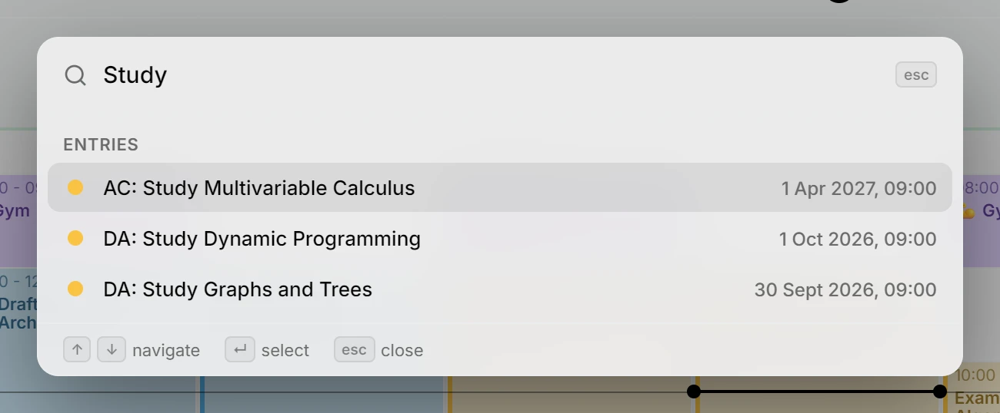
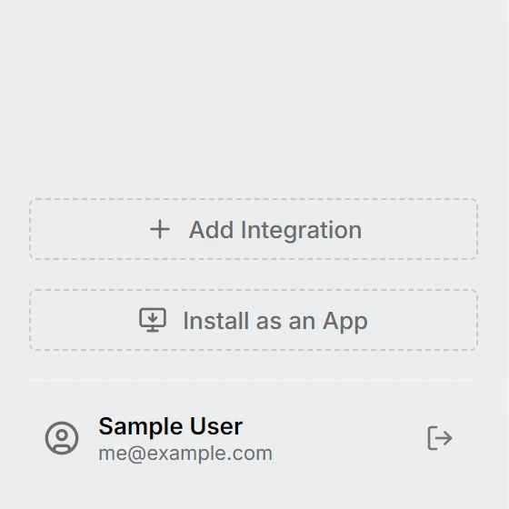
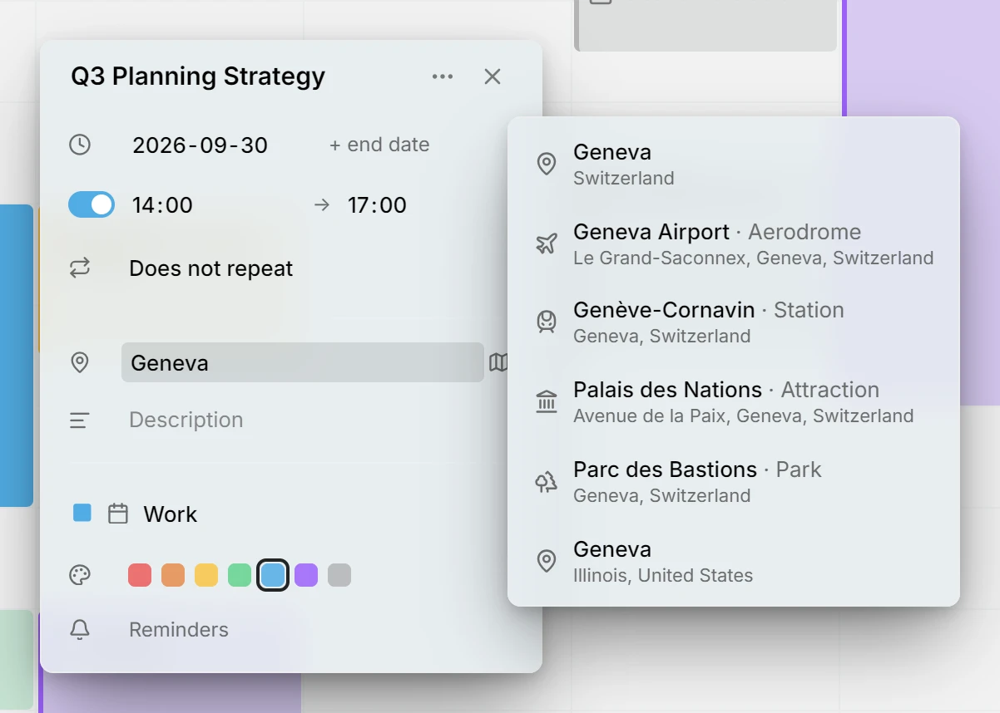
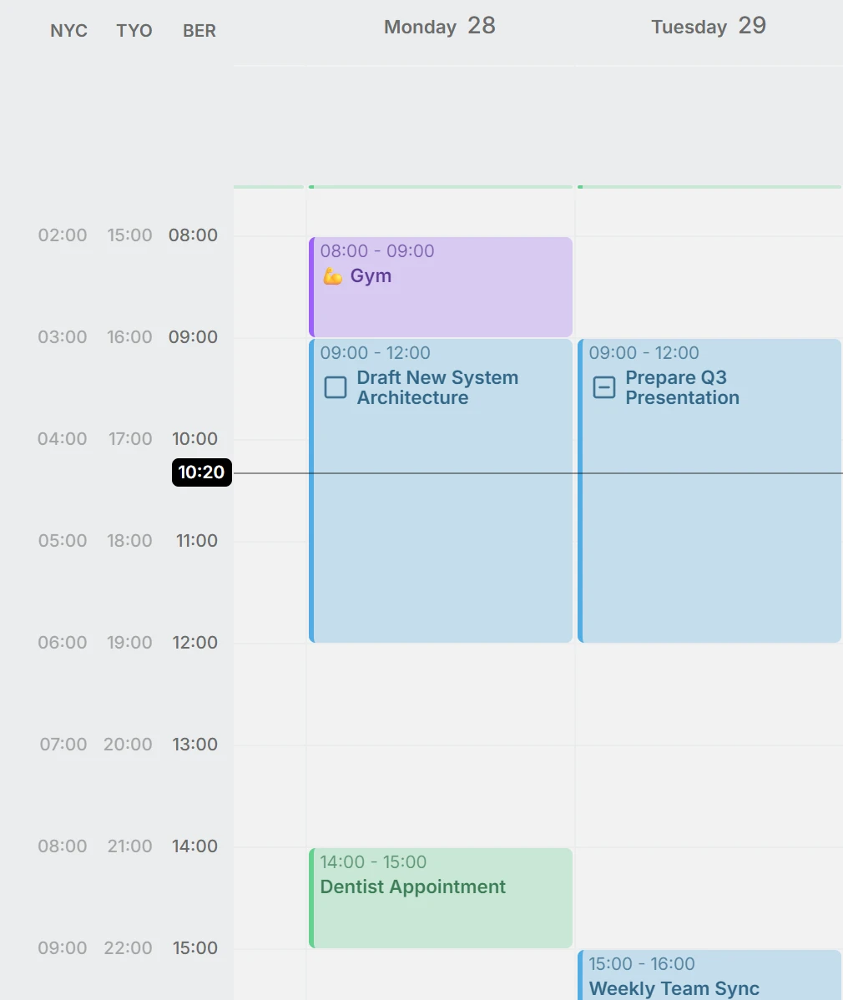
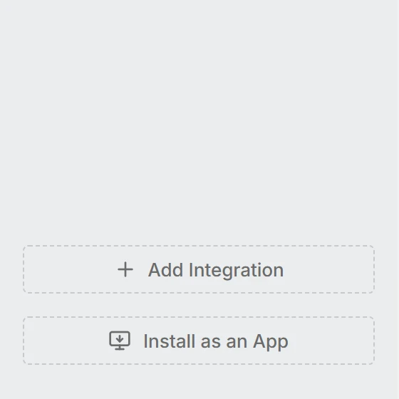
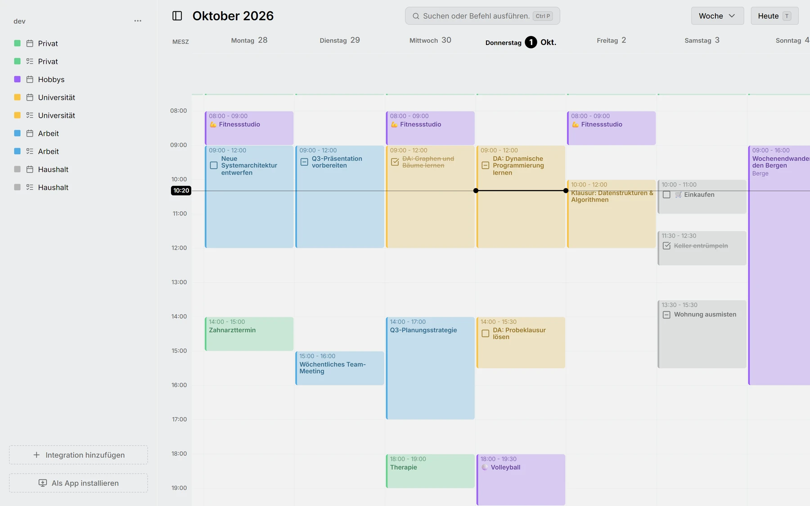

이번 릴리스는 일이 시작되기 전에 알려 주고, 모든 동작을 키 하나로 실행할 수 있게 하며, 가족이나 팀이 Mitra 하나를 함께 쓰면서 각자 자기 캘린더를 가질 수 있게 합니다. 어떤 언어든 배울 수 있는 첫 릴리스이기도 합니다.

## 알림
Mitra는 항목이 시작되기 전에 휴대폰이나 데스크톱으로 푸시 알림을 보냅니다. 새 항목에는 30분 전 알림이 기본으로 들어가며, 바꾸거나 지울 수 있습니다.

<picture>
	<source media="(prefers-color-scheme: dark)" srcset="reminders-dark.webp">
	
</picture>

문서: [알림](../../docs/reminders.md)

## 명령 팔레트
Ctrl+P(Mac에서는 ⌘P)를 누르고 명령, 이동할 날짜, 열고 싶은 항목의 제목을 입력하세요.

<picture>
	<source media="(prefers-color-scheme: dark)" srcset="palette-dark.webp">
	
</picture>

문서: [단축키](../../docs/shortcuts.md)

## 여러 사용자와 OIDC
직접 운영하는 ID 공급자로 로그인하면, 한 Mitra에서 사람마다 자기 캘린더를 갖습니다.

<picture>
	<source media="(prefers-color-scheme: dark)" srcset="users-dark.webp">
	
</picture>

문서: [통합 로그인](../../docs/sso.md)

## 위치
장소를 입력하고 추천 목록에서 고르세요. 최근에 쓴 장소가 먼저 나오고, 정확한 주소까지 필요 없다면 대략적인 위치를 고를 수도 있습니다.

<picture>
	<source media="(prefers-color-scheme: dark)" srcset="locations-dark.webp">
	
</picture>

문서: [위치](../../docs/location.md)

## 그리드의 시간대
함께 일하는 사람들의 시간대를 시간 옆에 추가 열로 넣을 수 있습니다.

<picture>
	<source media="(prefers-color-scheme: dark)" srcset="time-zones-dark.webp">
	
</picture>

문서: [시간대](../../docs/time-zones.md)

## 앱으로 설치
브라우저에서 Mitra를 설치하면 자체 아이콘을 가진 별도의 창으로 열립니다.

<picture>
	<source media="(prefers-color-scheme: dark)" srcset="install-dark.webp">
	
</picture>

문서: [앱으로 설치](../../docs/install-app.md)

## 새 로고
Mitra에 [@corruptedlotus](https://github.com/corruptedlotus)가 디자인한 고유한 로고가 생겼습니다. 설치한 앱과 그 알림의 아이콘으로 쓰입니다.

<picture>
	<source media="(prefers-color-scheme: dark)" srcset="logo-dark.webp">
	
</picture>

## 국제화
이제 Mitra의 모든 단어를 번역할 수 있고, 언어를 바꾸면 새로고침 없이 바로 적용됩니다. 영어 다음의 첫 언어는 독일어입니다.

<picture>
	<source media="(prefers-color-scheme: dark)" srcset="german-dark.webp">
	
</picture>

문서: [설정](../../docs/settings.md)

## 기여자
- [@a11delavar](https://github.com/a11delavar)
- [@corruptedlotus](https://github.com/corruptedlotus)
