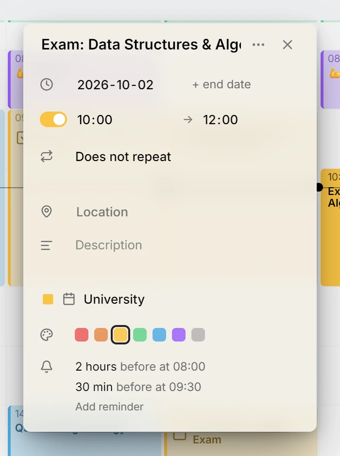
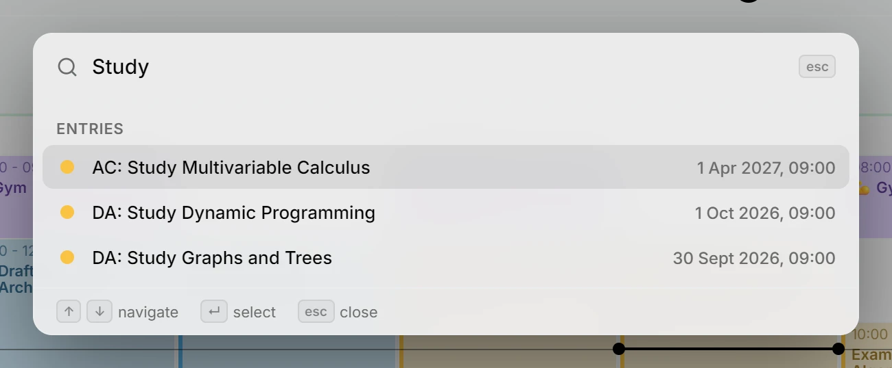
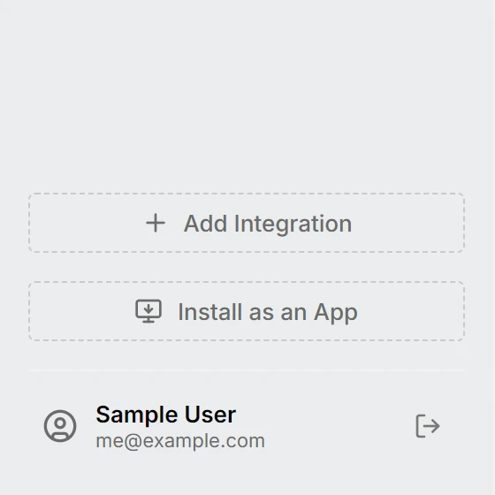
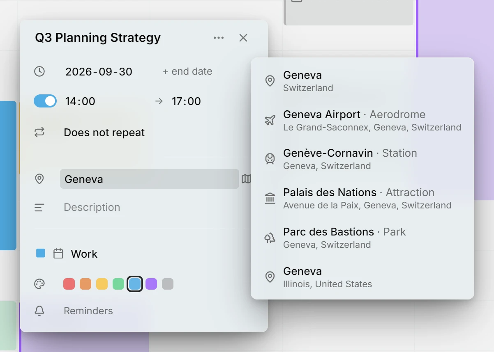
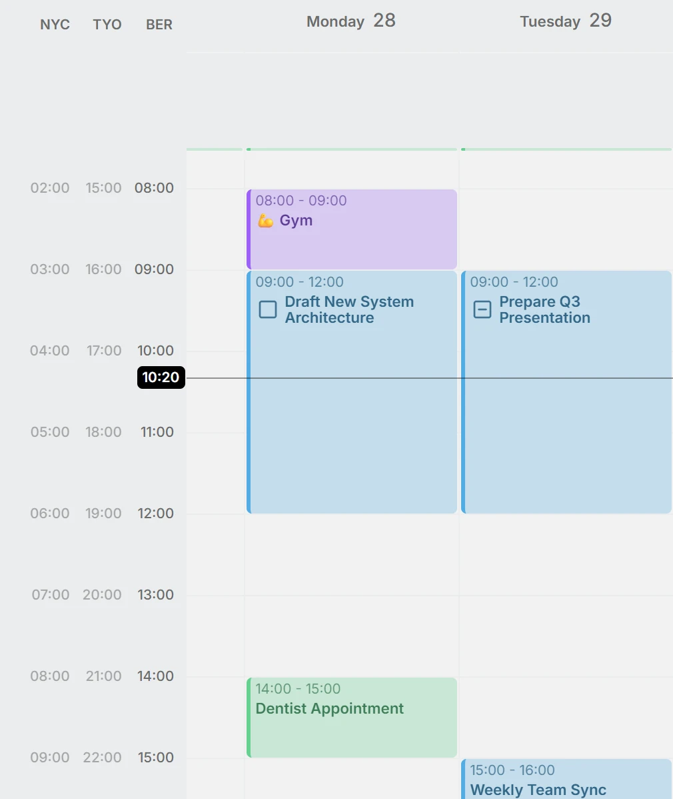
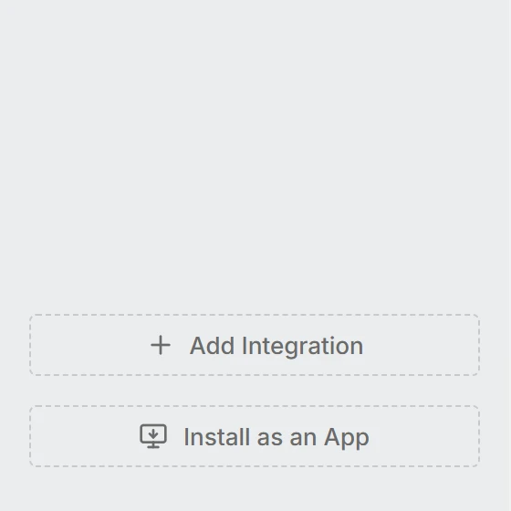
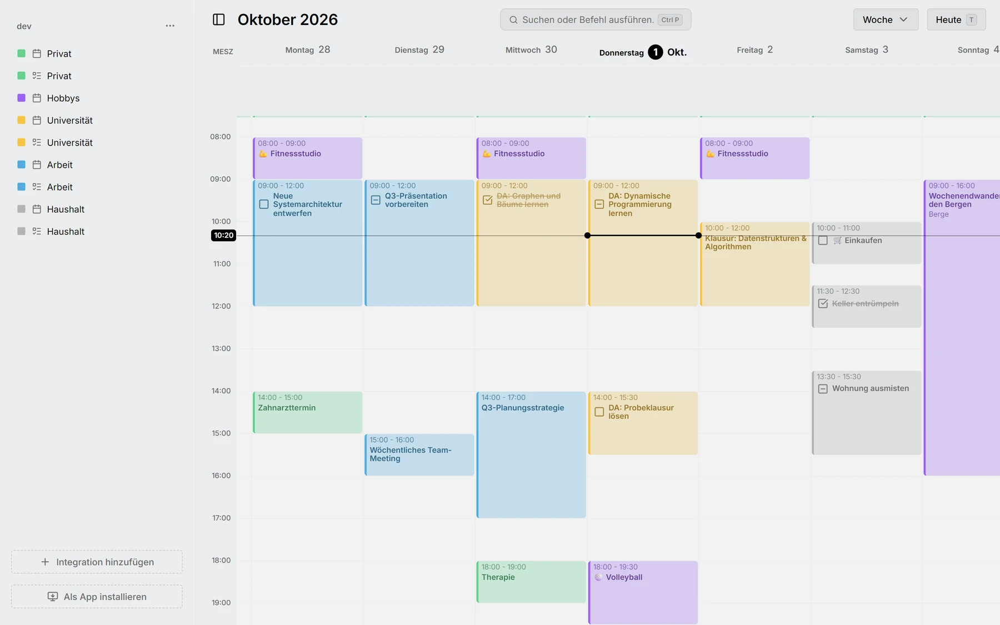

Этот выпуск напоминает о делах до их начала, даёт доступ к любому действию одним сочетанием клавиш и позволяет семье или команде пользоваться одним сервером Mitra, где у каждого свои календари. Кроме того, это первый выпуск, который можно перевести на любой язык.

## Напоминания
Mitra напоминает о начале записи push-уведомлением на телефоне или компьютере. У новых записей уже есть напоминание за полчаса, которое можно изменить или удалить.

<picture>
	<source media="(prefers-color-scheme: dark)" srcset="reminders-dark.webp">
	
</picture>

Документация: [Напоминания](../../docs/reminders.md)

## Палитра команд
Нажмите Ctrl+P или ⌘P на Mac и введите команду, дату, к которой нужно перейти, или название записи, которую нужно открыть.

<picture>
	<source media="(prefers-color-scheme: dark)" srcset="palette-dark.webp">
	
</picture>

Документация: [Быстрые клавиши](../../docs/shortcuts.md)

## Несколько пользователей и OIDC
Входите через собственного провайдера удостоверений, и у каждого человека на одном сервере Mitra будут свои календари.

<picture>
	<source media="(prefers-color-scheme: dark)" srcset="users-dark.webp">
	
</picture>

Документация: [Единый вход](../../docs/sso.md)

## Места
Начните вводить место и выберите его из подсказок, где первыми идут ваши недавние места. Если точный адрес не нужен, можно выбрать и примерное место.

<picture>
	<source media="(prefers-color-scheme: dark)" srcset="locations-dark.webp">
	
</picture>

Документация: [Место](../../docs/location.md)

## Часовые пояса в сетке
Добавьте часовые пояса людей, с которыми вы работаете, в виде дополнительных столбцов рядом со шкалой часов.

<picture>
	<source media="(prefers-color-scheme: dark)" srcset="time-zones-dark.webp">
	
</picture>

Документация: [Часовые пояса](../../docs/time-zones.md)

## Установка приложения
После установки из браузера Mitra открывается в отдельном окне со своим значком.

<picture>
	<source media="(prefers-color-scheme: dark)" srcset="install-dark.webp">
	
</picture>

Документация: [Установка приложения](../../docs/install-app.md)

## Новый логотип
У Mitra появился собственный логотип, его создал [@corruptedlotus](https://github.com/corruptedlotus). Это значок установленного приложения и его уведомлений.

<picture>
	<source media="(prefers-color-scheme: dark)" srcset="logo-dark.webp">
	
</picture>

## Интернационализация
Теперь каждое слово в Mitra можно перевести, а смена языка применяется сразу, без перезагрузки. Первым языком после английского стал немецкий.

<picture>
	<source media="(prefers-color-scheme: dark)" srcset="german-dark.webp">
	
</picture>

Документация: [Настройки](../../docs/settings.md)

## Авторы
- [@a11delavar](https://github.com/a11delavar)
- [@corruptedlotus](https://github.com/corruptedlotus)
