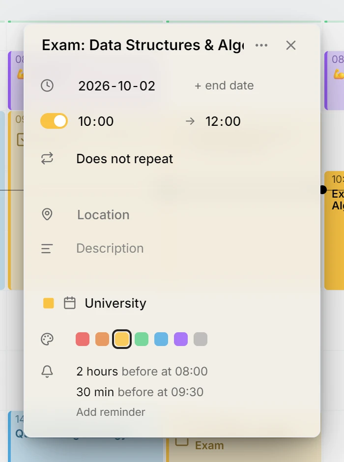
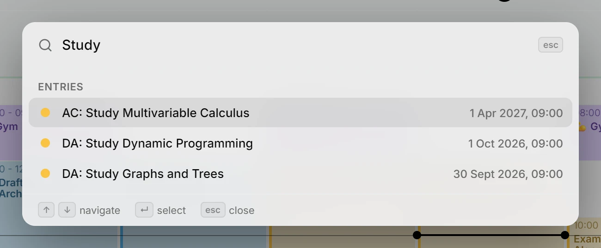
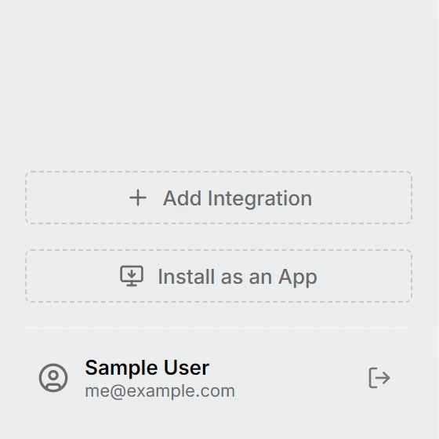
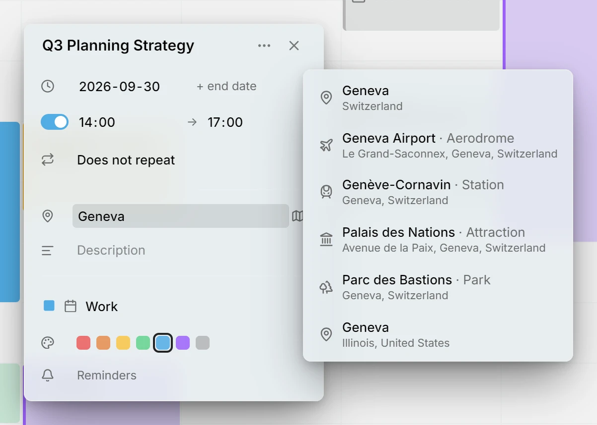
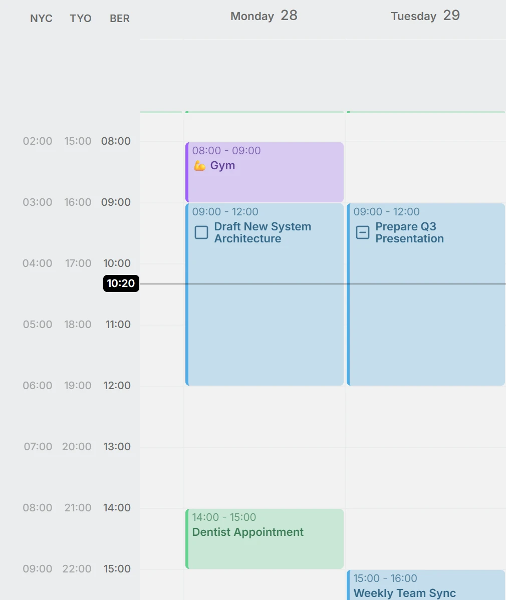
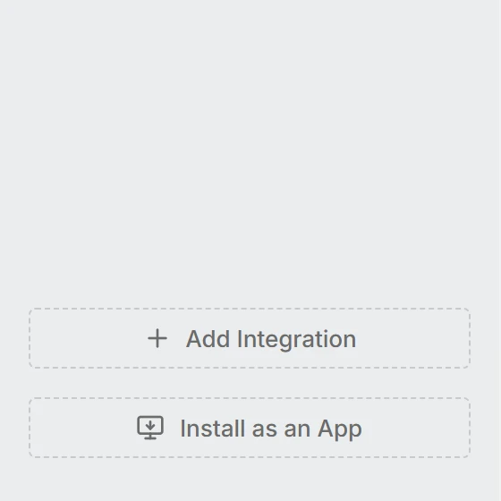
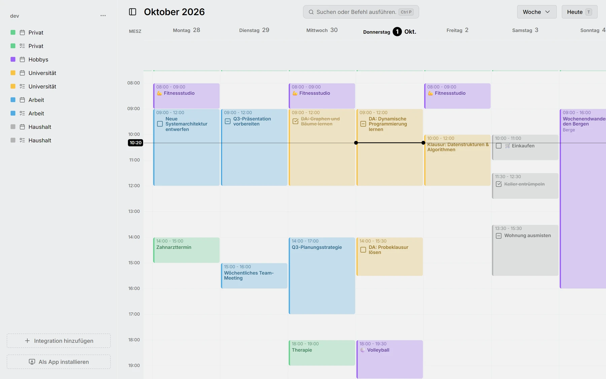

Phiên bản này nhắc bạn trước khi mọi thứ bắt đầu, đưa mọi thao tác về một phím bấm, và cho một gia đình hay một nhóm dùng chung một Mitra, mỗi người có lịch riêng của mình. Đây cũng là phiên bản đầu tiên có thể học bất kỳ ngôn ngữ nào.

## Lời nhắc
Mitra nhắc bạn trước khi một mục bắt đầu, trên điện thoại hoặc máy tính, bằng thông báo đẩy. Các mục mới có sẵn một lời nhắc trước nửa giờ, bạn có thể đổi hoặc xóa.

<picture>
	<source media="(prefers-color-scheme: dark)" srcset="reminders-dark.webp">
	
</picture>

Tài liệu: [Lời nhắc](../../docs/reminders.md)

## Bảng lệnh
Nhấn Ctrl+P, hoặc ⌘P trên máy Mac, rồi gõ: một lệnh, một ngày để chuyển đến, hoặc tiêu đề của một mục để mở.

<picture>
	<source media="(prefers-color-scheme: dark)" srcset="palette-dark.webp">
	
</picture>

Tài liệu: [Phím tắt](../../docs/shortcuts.md)

## Nhiều người dùng và OIDC
Đăng nhập qua nhà cung cấp danh tính của riêng bạn, và mỗi người có lịch riêng trên cùng một Mitra.

<picture>
	<source media="(prefers-color-scheme: dark)" srcset="users-dark.webp">
	
</picture>

Tài liệu: [Đăng nhập một lần](../../docs/sso.md)

## Địa điểm
Gõ một địa điểm và chọn từ các gợi ý, các nơi gần đây nhất lên đầu, hoặc một nơi đại khái khi địa chỉ chính xác là quá nhiều so với nhu cầu.

<picture>
	<source media="(prefers-color-scheme: dark)" srcset="locations-dark.webp">
	
</picture>

Tài liệu: [Địa điểm](../../docs/location.md)

## Múi giờ trên lưới
Thêm múi giờ của những người bạn làm việc cùng, thành các cột phụ bên cạnh các giờ.

<picture>
	<source media="(prefers-color-scheme: dark)" srcset="time-zones-dark.webp">
	
</picture>

Tài liệu: [Múi giờ](../../docs/time-zones.md)

## Cài thành ứng dụng
Cài đặt Mitra từ trình duyệt, và nó mở trong một cửa sổ riêng, với biểu tượng riêng.

<picture>
	<source media="(prefers-color-scheme: dark)" srcset="install-dark.webp">
	
</picture>

Tài liệu: [Cài thành ứng dụng](../../docs/install-app.md)

## Logo mới
Mitra có logo riêng, do [@corruptedlotus](https://github.com/corruptedlotus) thiết kế. Đó là biểu tượng của ứng dụng đã cài và của các thông báo.

<picture>
	<source media="(prefers-color-scheme: dark)" srcset="logo-dark.webp">
	
</picture>

## Quốc tế hóa
Mọi chữ trong Mitra giờ đây đều có thể dịch được, và đổi ngôn ngữ có hiệu lực ngay, không cần tải lại. Tiếng Đức là ngôn ngữ đầu tiên ngoài tiếng Anh.

<picture>
	<source media="(prefers-color-scheme: dark)" srcset="german-dark.webp">
	
</picture>

Tài liệu: [Cài đặt](../../docs/settings.md)

## Người đóng góp
- [@a11delavar](https://github.com/a11delavar)
- [@corruptedlotus](https://github.com/corruptedlotus)
