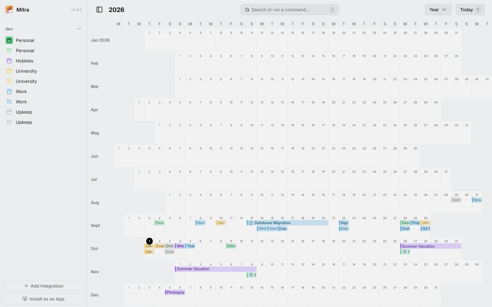
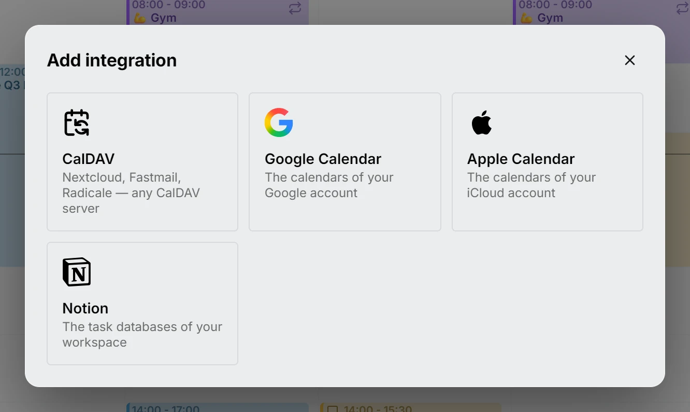
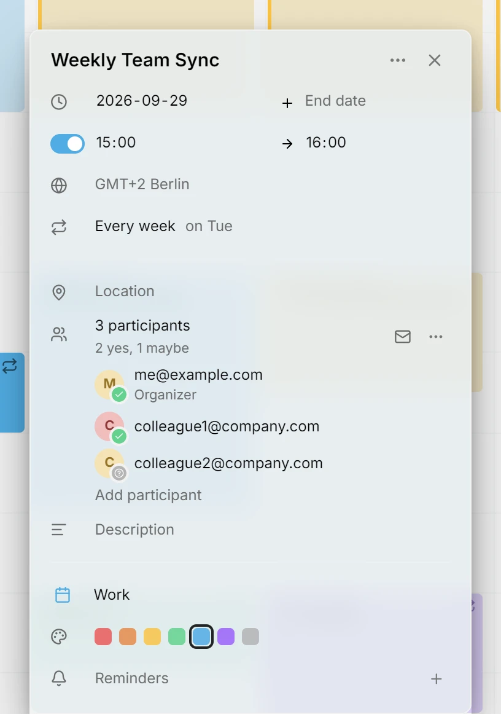
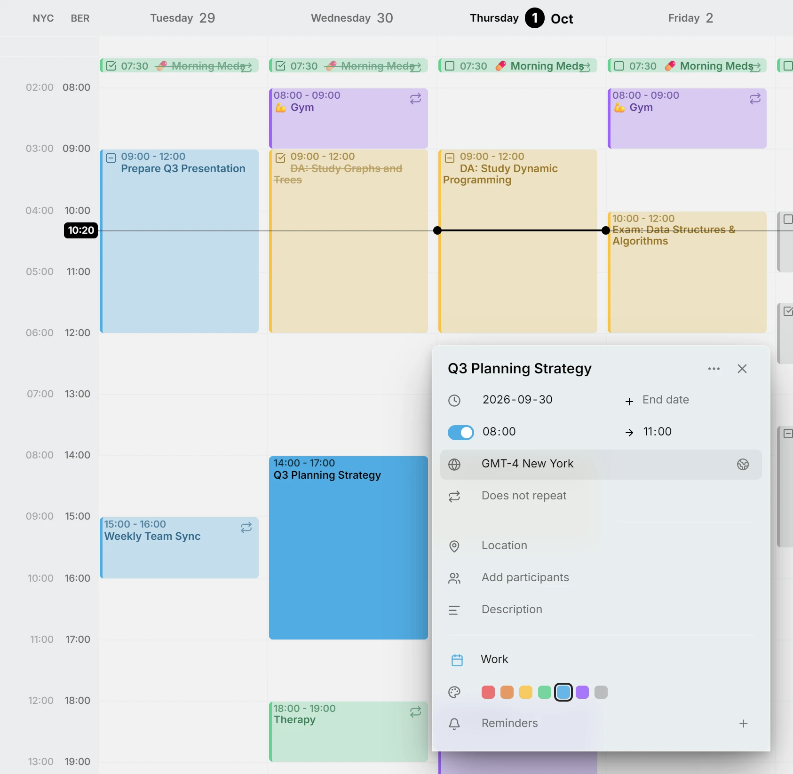
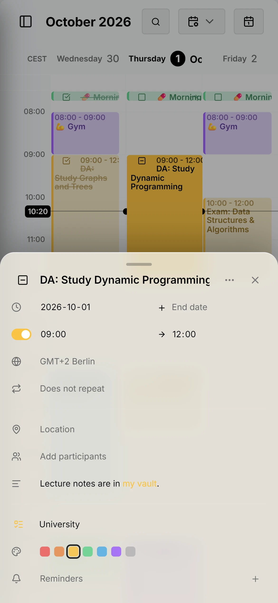
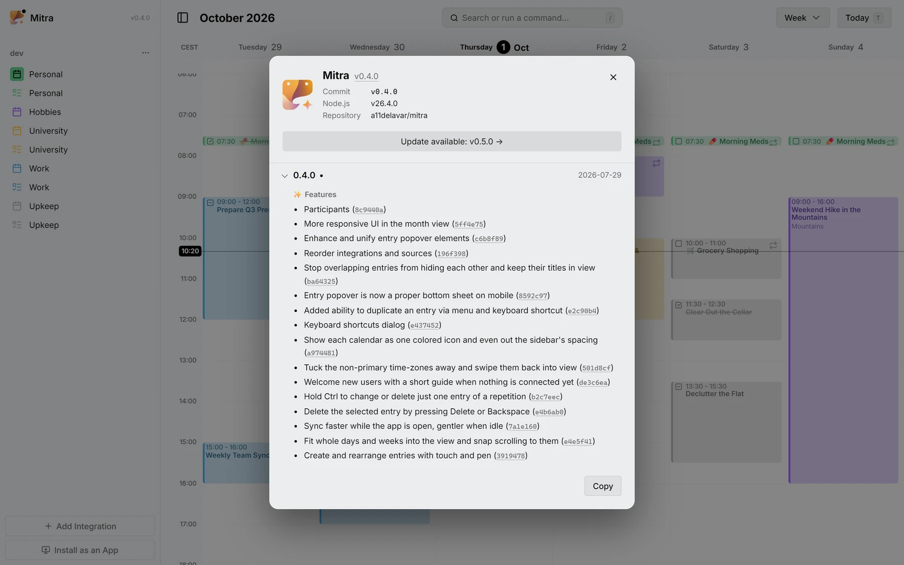

このリリースでは年ビューを追加し、多くの人がすでに使っているカレンダー（Google、Apple、Notion）とMitraを連携し、予定に人を迎え入れ、スマートフォンでもMitraが快適に使えるようにしました。

## 年ビュー
1年全体が1画面に収まり、毎日が小さなセルになります。空きの週を見つけたり、季節全体を一目で見たりするのに便利です。

<picture>
	<source media="(prefers-color-scheme: dark)" srcset="year-dark.webp">
	
</picture>

ドキュメント：[年ビュー](../../docs/views/year.md)

## Googleカレンダー、Appleカレンダー、Notion
Googleでサインインするか、iCloud用のアプリ専用パスワードを追加するか、Notionのトークンを貼り付けると、カレンダーやデータベースが同じ週の中に並んで表示されます。Notionのビューはカレンダーに、ページの本文はその項目の説明になります。

<picture>
	<source media="(prefers-color-scheme: dark)" srcset="integrations-dark.webp">
	
</picture>

ドキュメント：[連携](../../docs/integrations/README.md)

## 参加者
予定に人を招待して誰が参加するかを確認でき、届いた招待には、それを届けたカレンダーを通して返答できます。

<picture>
	<source media="(prefers-color-scheme: dark)" srcset="participants-dark.webp">
	
</picture>

ドキュメント：[参加者](../../docs/participants.md)

## 項目ごとのタイムゾーン
項目はそれぞれ独自のタイムゾーンを持てます。あるタイムゾーンを出発して別のタイムゾーンに着くフライトのように。週の横の追加タイムゾーンは収納しておけ、必要なときにスワイプで戻せます。

<picture>
	<source media="(prefers-color-scheme: dark)" srcset="time-zones-dark.webp">
	
</picture>

ドキュメント：[タイムゾーン](../../docs/time-zones.md)

## モバイルの改善
エディターが画面下からシートとして開き、項目はタッチやペンで移動・リサイズでき、レイアウトはキーボードのための場所を空けます。

<picture>
	<source media="(prefers-color-scheme: dark)" srcset="phone-dark.webp">
	
</picture>

## アップデート通知と変更履歴
新しいバージョンが出るとドットで知らせ、バージョン情報ダイアログに各バージョンの変更がコミットごとに一覧表示されます。

<picture>
	<source media="(prefers-color-scheme: dark)" srcset="updates-dark.webp">
	
</picture>

ドキュメント：[アップデート](../../docs/updates.md)

## コントリビューター
- [@a11delavar](https://github.com/a11delavar)
- [@d8monx](https://github.com/d8monx)
