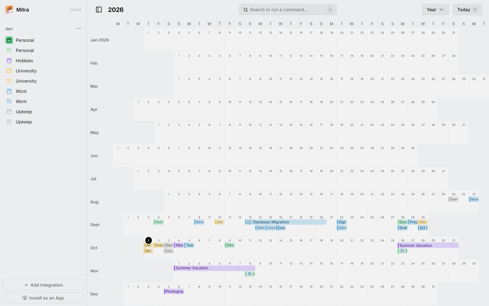
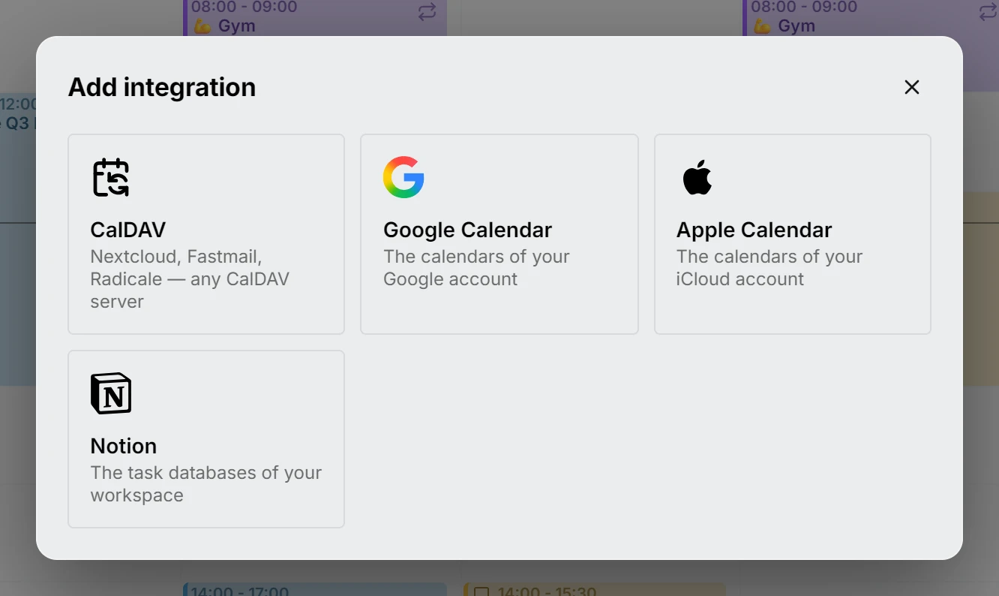
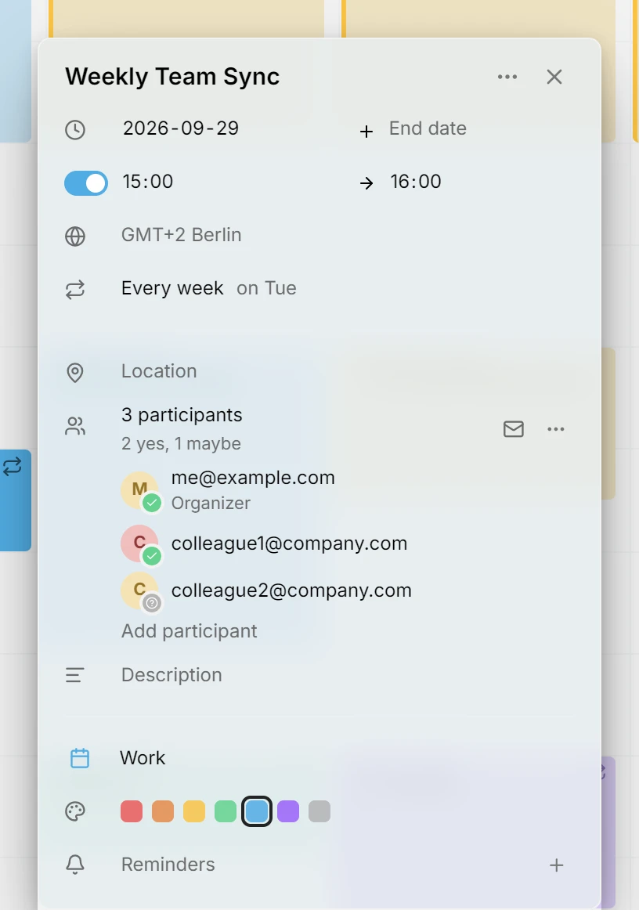
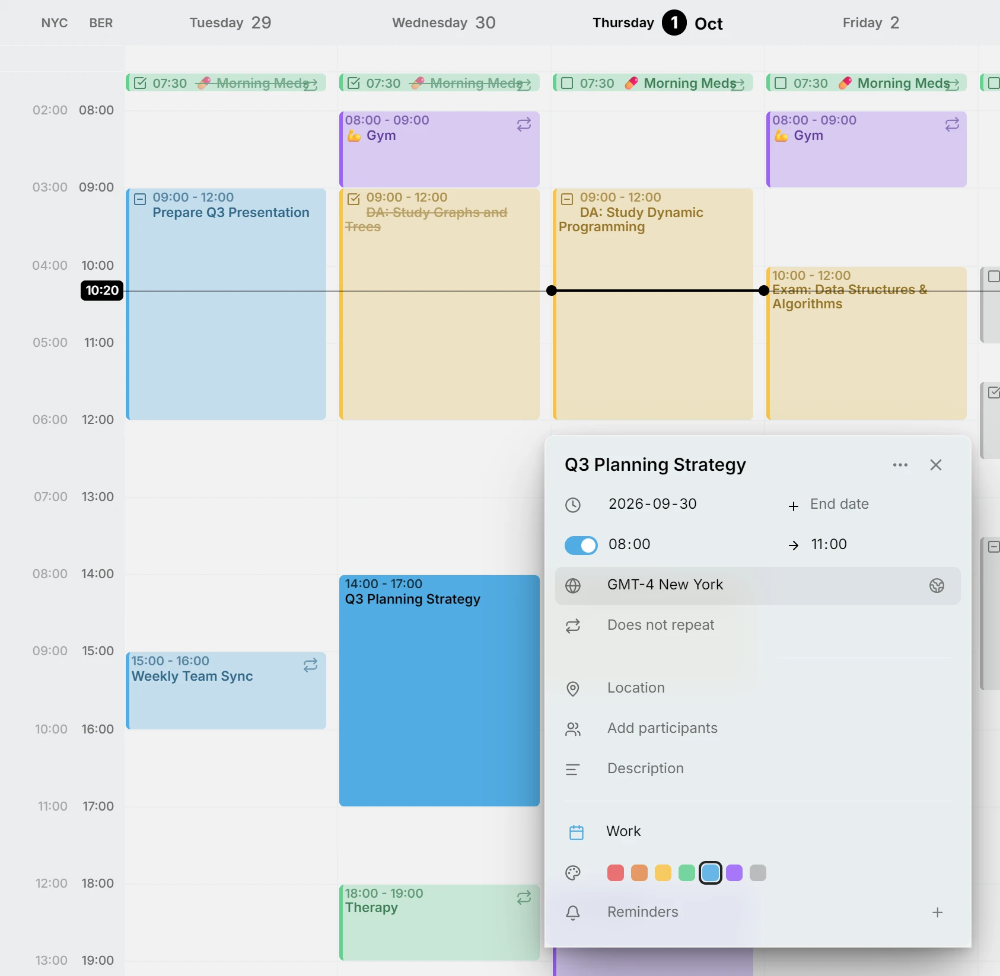
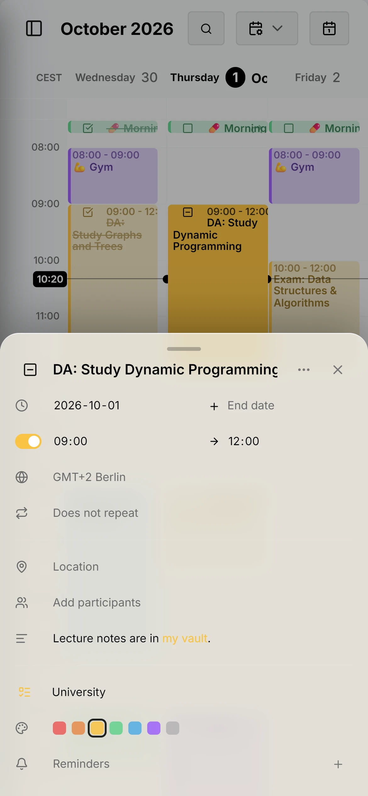
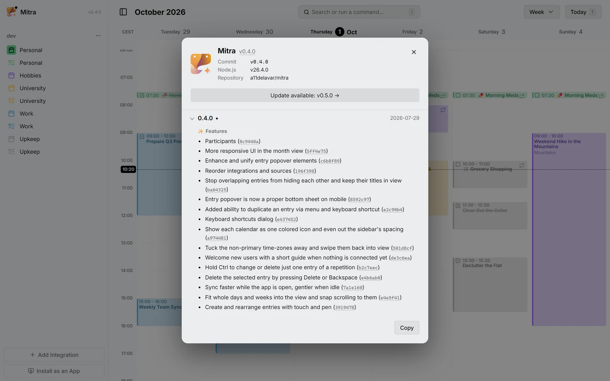

이번 릴리스는 연도 보기를 더하고, 대부분의 사람이 이미 쓰는 캘린더인 Google, Apple, Notion에 Mitra를 연결하고, 일정에 사람을 초대할 수 있게 하며, 휴대폰에서도 Mitra를 편하게 쓸 수 있게 합니다.

## 연도 보기
한 해 전체를 한 화면에, 하루를 작은 칸 하나로 보여 줍니다. 비어 있는 주를 찾거나 한 계절을 한눈에 볼 때 좋습니다.

<picture>
	<source media="(prefers-color-scheme: dark)" srcset="year-dark.webp">
	
</picture>

문서: [연도 보기](../../docs/views/year.md)

## Google 캘린더, Apple 캘린더, Notion
Google로 로그인하거나, iCloud용 앱 암호를 추가하거나, Notion 토큰을 붙여 넣으면 캘린더와 데이터베이스가 한 주 안에 나란히 놓입니다. Notion 보기는 캘린더가 되고, 페이지 본문은 항목의 설명이 됩니다.

<picture>
	<source media="(prefers-color-scheme: dark)" srcset="integrations-dark.webp">
	
</picture>

문서: [연동](../../docs/integrations/README.md)

## 참석자
일정에 사람을 초대하고, 누가 수락했는지 보고, 받은 초대에 답할 수 있습니다. 초대는 그것을 전달하는 캘린더를 통해 오갑니다.

<picture>
	<source media="(prefers-color-scheme: dark)" srcset="participants-dark.webp">
	
</picture>

문서: [참석자](../../docs/participants.md)

## 항목별 시간대
한 시간대에서 출발해 다른 시간대에 도착하는 항공편처럼, 항목마다 자기 시간대를 가질 수 있습니다. 주 옆의 추가 시간대는 접어 둘 수 있고, 필요할 때 다시 밀어서 꺼낼 수 있습니다.

<picture>
	<source media="(prefers-color-scheme: dark)" srcset="time-zones-dark.webp">
	
</picture>

문서: [시간대](../../docs/time-zones.md)

## 모바일 개선
편집기가 아래에서 올라오는 시트로 열리고, 터치와 펜으로 항목을 옮기고 크기를 조절할 수 있으며, 키보드가 나오면 화면 배치가 자리를 내어 줍니다.

<picture>
	<source media="(prefers-color-scheme: dark)" srcset="phone-dark.webp">
	
</picture>

## 업데이트 표시와 변경 내역
새 버전이 나오면 점으로 알려 주고, 정보 대화상자에서 버전마다 바뀐 내용을 커밋 단위로 보여 줍니다.

<picture>
	<source media="(prefers-color-scheme: dark)" srcset="updates-dark.webp">
	
</picture>

문서: [업데이트](../../docs/updates.md)

## 기여자
- [@a11delavar](https://github.com/a11delavar)
- [@d8monx](https://github.com/d8monx)
