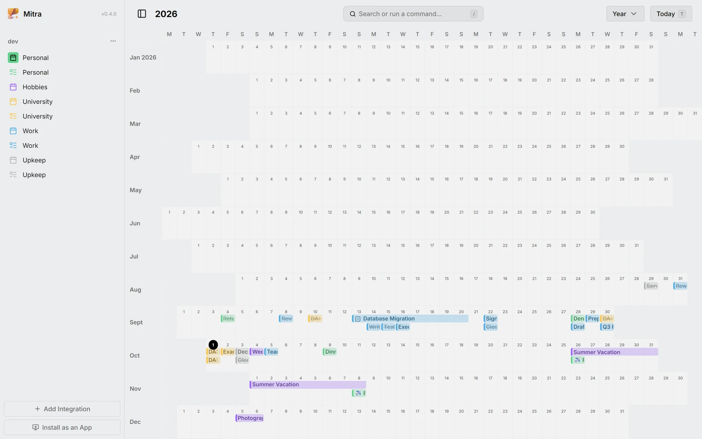
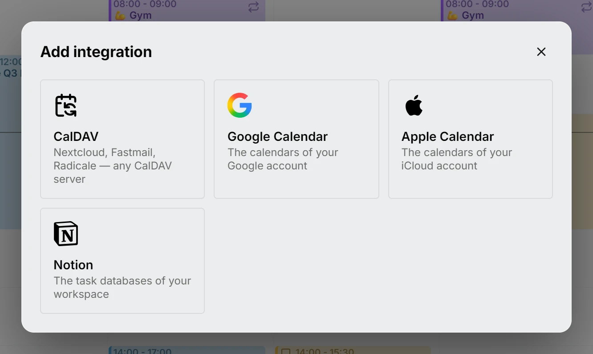
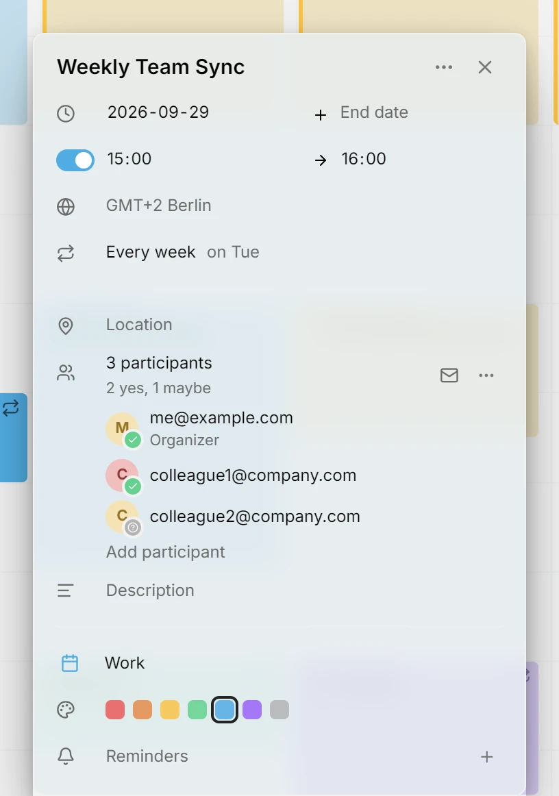
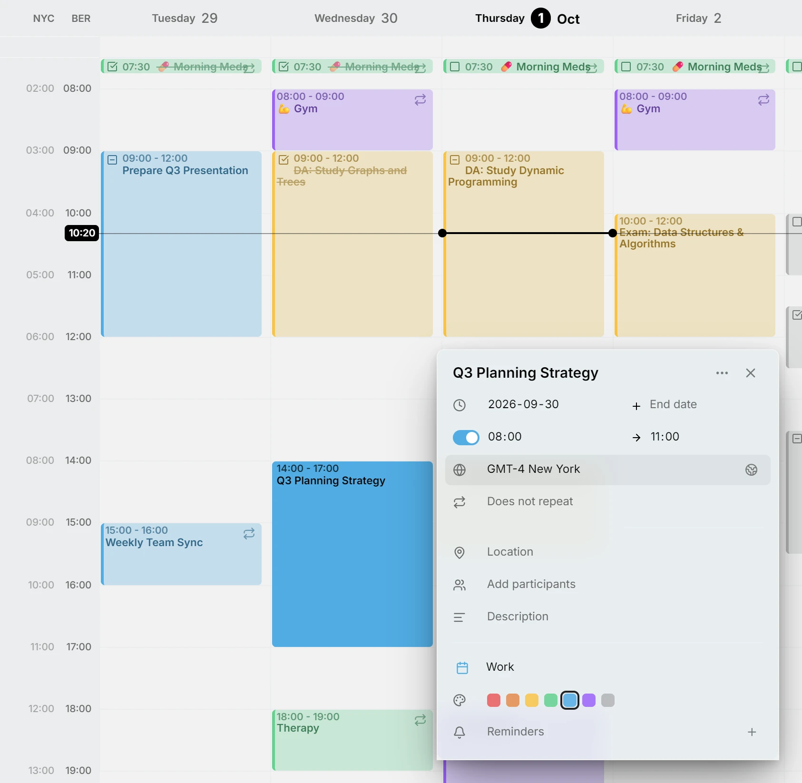
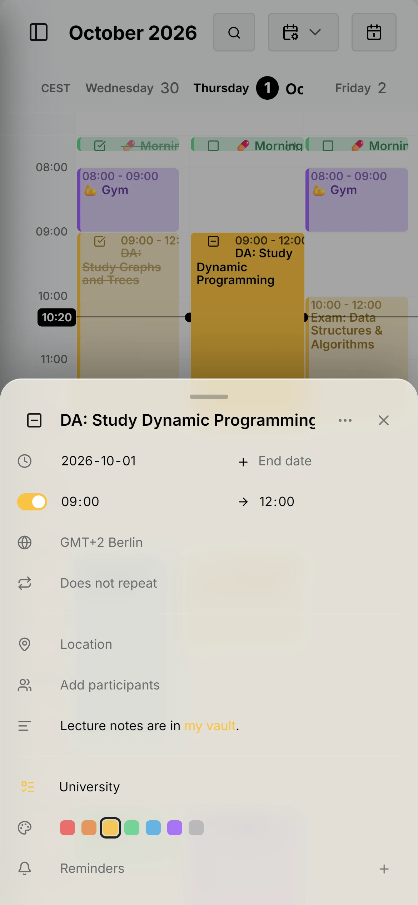
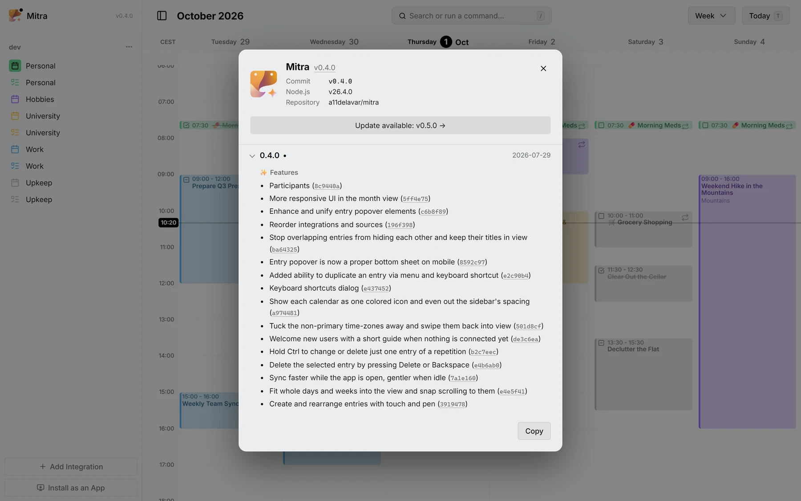

Deze versie voegt een jaarweergave toe en verbindt Mitra met de agenda's die de meeste mensen al hebben: Google, Apple en Notion. Je kunt nu ook mensen uitnodigen voor je afspraken, en Mitra voelt zich thuis op een telefoon.

## Jaarweergave
Het hele jaar op één scherm, elke dag een klein vakje, om een vrije week te vinden of een heel seizoen in één oogopslag te zien.

<picture>
	<source media="(prefers-color-scheme: dark)" srcset="year-dark.webp">
	
</picture>

Documentatie: [Jaarweergave](../../docs/views/year.md)

## Google Agenda, Apple Agenda en Notion
Log in met Google, voeg een app-specifiek wachtwoord voor iCloud toe of plak een Notion-token, en je agenda's en databases staan naast elkaar in één week. Een weergave in Notion wordt een agenda, en de inhoud van een pagina wordt de beschrijving van het item.

<picture>
	<source media="(prefers-color-scheme: dark)" srcset="integrations-dark.webp">
	
</picture>

Documentatie: [Integraties](../../docs/integrations/README.md)

## Deelnemers
Nodig mensen uit voor een afspraak, zie wie er komt, en beantwoord de uitnodigingen die je krijgt, via de agenda's die ze bezorgen.

<picture>
	<source media="(prefers-color-scheme: dark)" srcset="participants-dark.webp">
	
</picture>

Documentatie: [Deelnemers](../../docs/participants.md)

## Tijdzones per item
Een item kan een eigen tijdzone hebben, zoals een vlucht die in de ene tijdzone vertrekt en in de andere landt. De extra tijdzones naast de week klap je in, en met een veeg haal je ze weer tevoorschijn.

<picture>
	<source media="(prefers-color-scheme: dark)" srcset="time-zones-dark.webp">
	
</picture>

Documentatie: [Tijdzones](../../docs/time-zones.md)

## Verbeteringen voor mobiel
De editor schuift als paneel van onderen open, je verplaatst items en past hun duur aan met je vinger of een pen, en de lay-out maakt ruimte voor het toetsenbord.

<picture>
	<source media="(prefers-color-scheme: dark)" srcset="phone-dark.webp">
	
</picture>

## Update-indicator en changelog
Een stip laat zien wanneer er een nieuwe versie is, en het venster Over toont per versie wat er is veranderd, commit voor commit.

<picture>
	<source media="(prefers-color-scheme: dark)" srcset="updates-dark.webp">
	
</picture>

Documentatie: [Updates](../../docs/updates.md)

## Bijdragers
- [@a11delavar](https://github.com/a11delavar)
- [@d8monx](https://github.com/d8monx)
