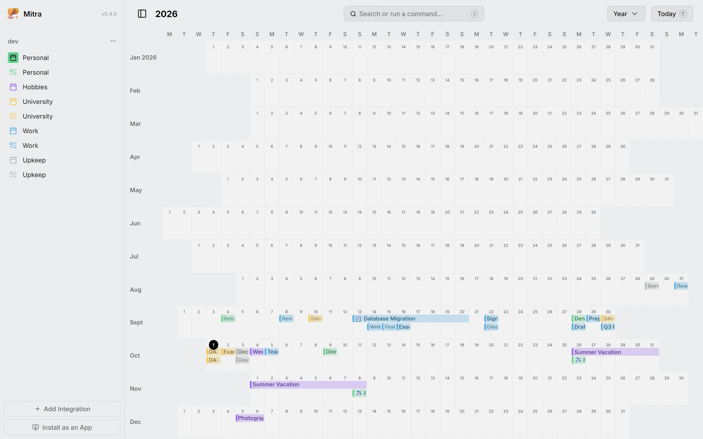
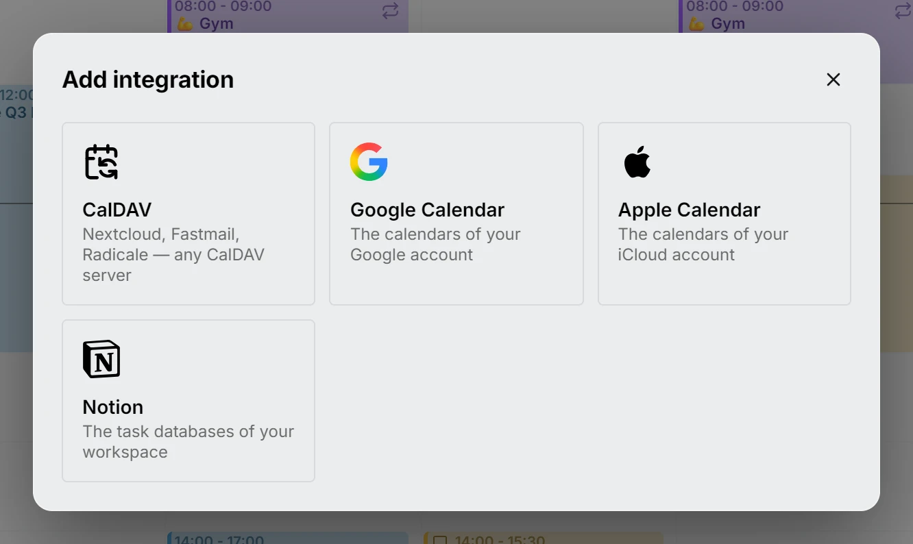
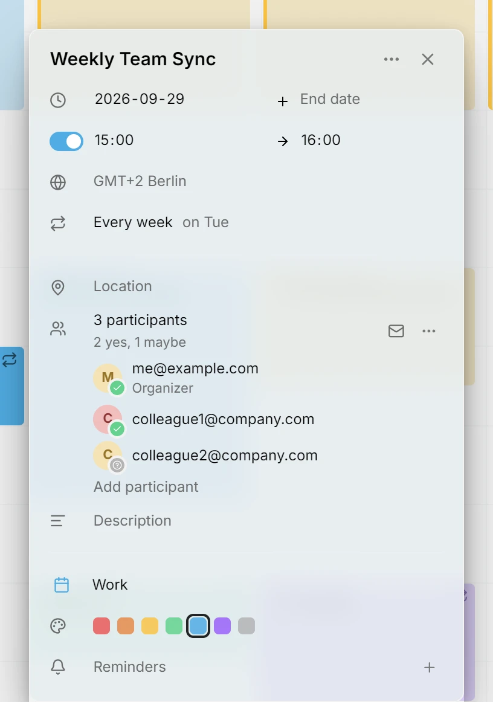
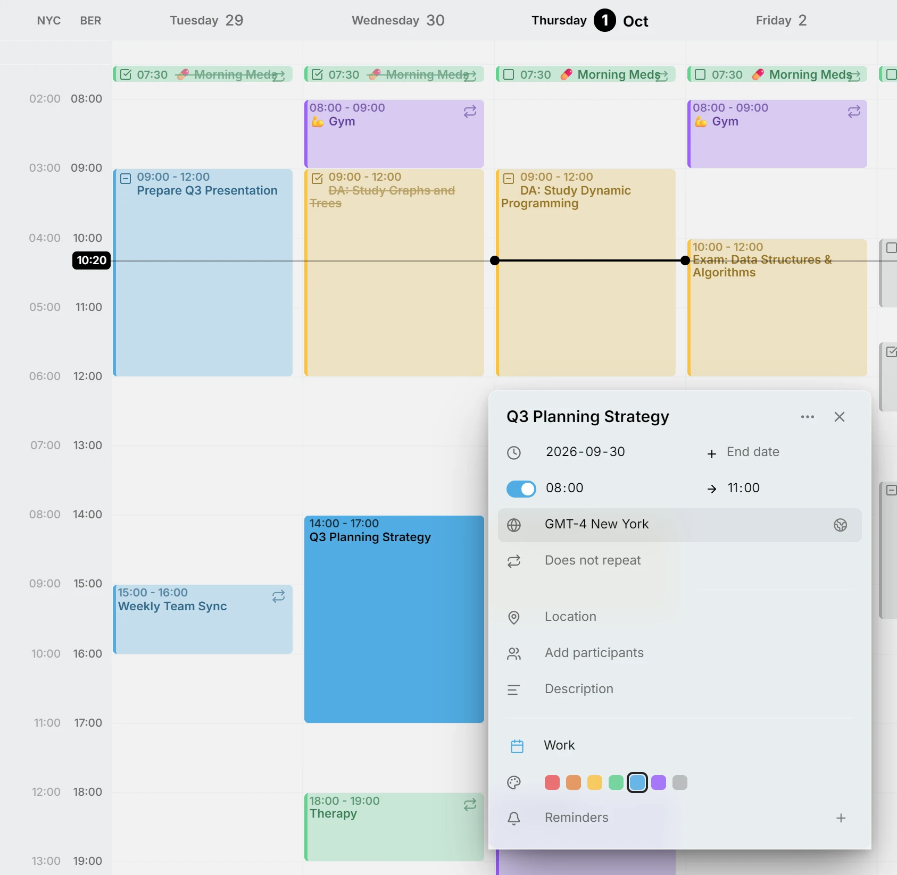
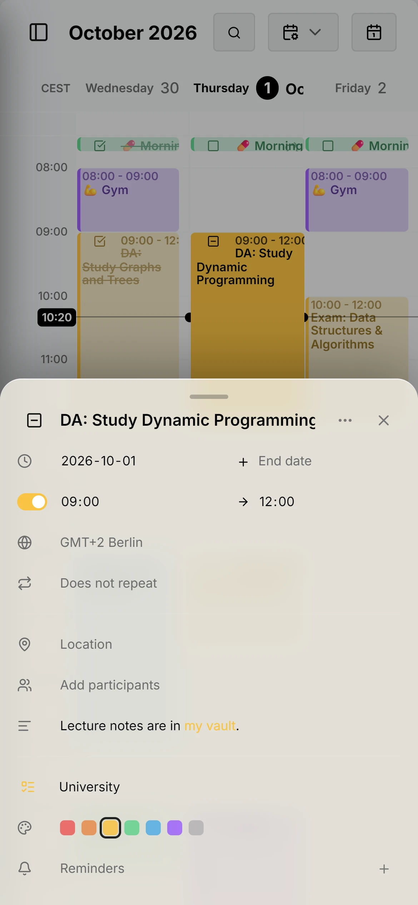
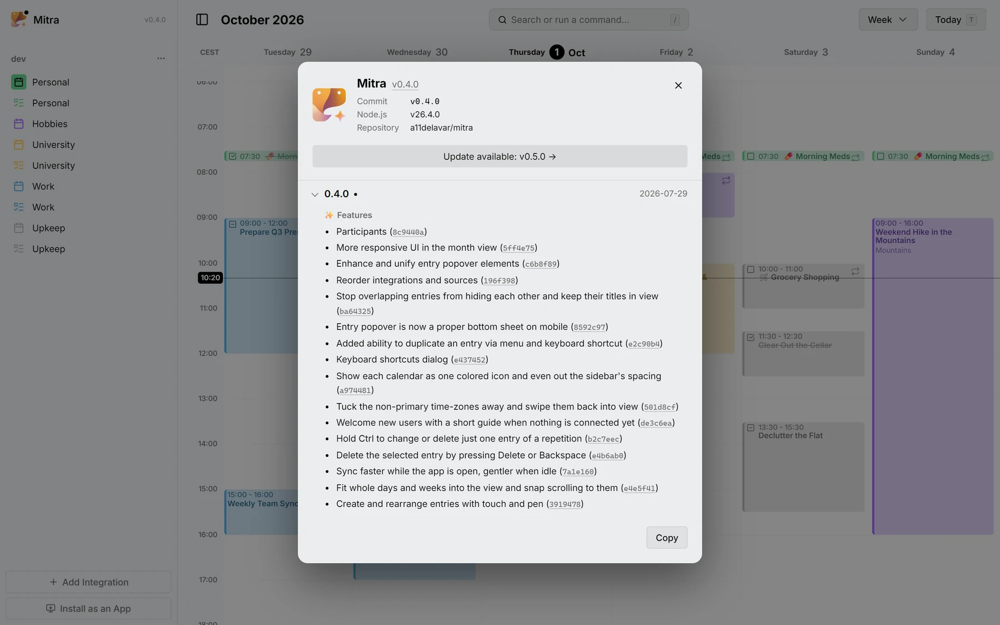

Phiên bản này thêm chế độ xem năm, kết nối Mitra với những cuốn lịch hầu hết mọi người đã có là Google, Apple và Notion, đưa mọi người vào các sự kiện của bạn, và giúp Mitra thoải mái trên điện thoại.

## Chế độ xem năm
Cả năm trên một màn hình, mỗi ngày là một ô nhỏ, để tìm tuần rảnh hoặc nhìn một mùa trong một lần.

<picture>
	<source media="(prefers-color-scheme: dark)" srcset="year-dark.webp">
	
</picture>

Tài liệu: [Chế độ xem năm](../../docs/views/year.md)

## Google Lịch, Lịch Apple và Notion
Đăng nhập bằng Google, thêm mật khẩu ứng dụng cho iCloud, hoặc dán một mã Notion, và các lịch cùng cơ sở dữ liệu của bạn nằm cạnh nhau trong một tuần. Một chế độ xem của Notion trở thành một lịch, và nội dung của một trang trở thành mô tả của mục.

<picture>
	<source media="(prefers-color-scheme: dark)" srcset="integrations-dark.webp">
	
</picture>

Tài liệu: [Tích hợp](../../docs/integrations/README.md)

## Người tham gia
Mời mọi người vào một sự kiện, xem ai đã đồng ý, và trả lời các lời mời bạn nhận được, thông qua các lịch chuyển chúng đến.

<picture>
	<source media="(prefers-color-scheme: dark)" srcset="participants-dark.webp">
	
</picture>

Tài liệu: [Người tham gia](../../docs/participants.md)

## Múi giờ cho từng mục
Một mục có thể giữ múi giờ riêng, như chuyến bay cất cánh ở một nơi và hạ cánh ở nơi khác. Các múi giờ phụ bên cạnh tuần có thể thu gọn, và vuốt lại khi bạn cần.

<picture>
	<source media="(prefers-color-scheme: dark)" srcset="time-zones-dark.webp">
	
</picture>

Tài liệu: [Múi giờ](../../docs/time-zones.md)

## Cải thiện trên thiết bị di động
Trình chỉnh sửa mở như một bảng trượt từ dưới lên, các mục di chuyển và đổi kích thước bằng cảm ứng và bút, và bố cục chừa chỗ cho bàn phím.

<picture>
	<source media="(prefers-color-scheme: dark)" srcset="phone-dark.webp">
	
</picture>

## Chỉ báo cập nhật và nhật ký thay đổi
Một chấm báo cho bạn khi có phiên bản mới, và hộp thoại Giới thiệu liệt kê những gì đã thay đổi trong từng phiên bản, từng commit một.

<picture>
	<source media="(prefers-color-scheme: dark)" srcset="updates-dark.webp">
	
</picture>

Tài liệu: [Cập nhật](../../docs/updates.md)

## Người đóng góp
- [@a11delavar](https://github.com/a11delavar)
- [@d8monx](https://github.com/d8monx)
