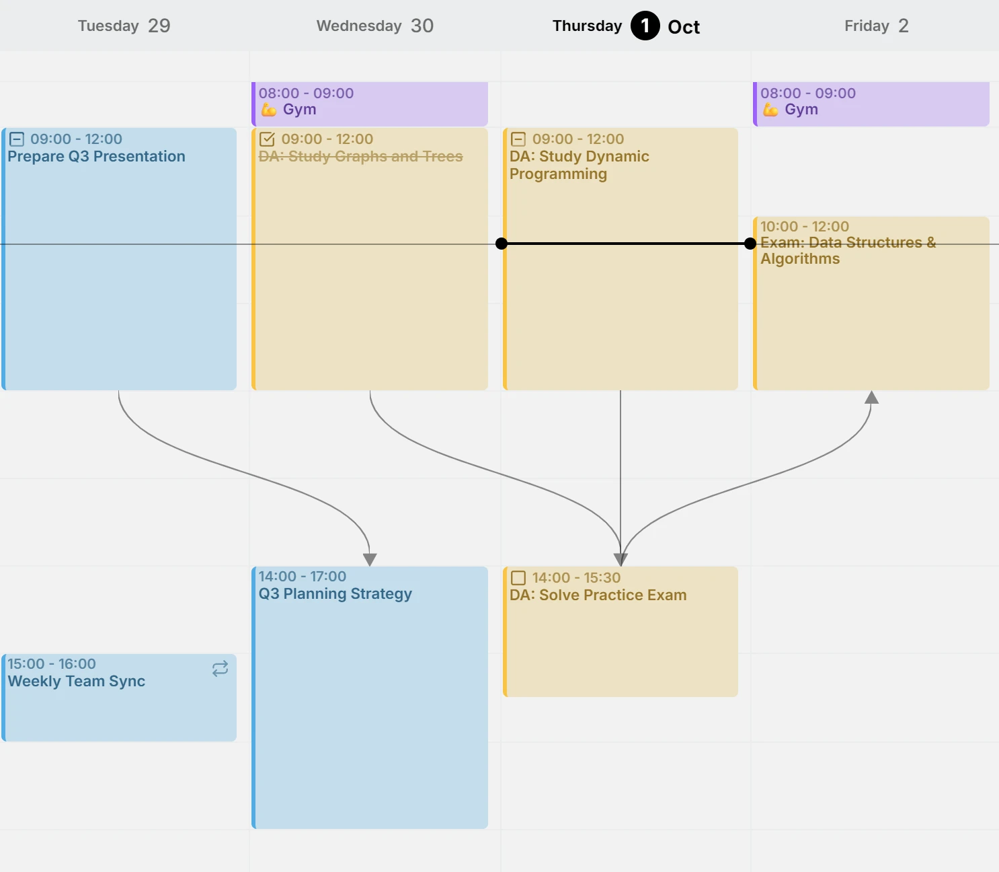
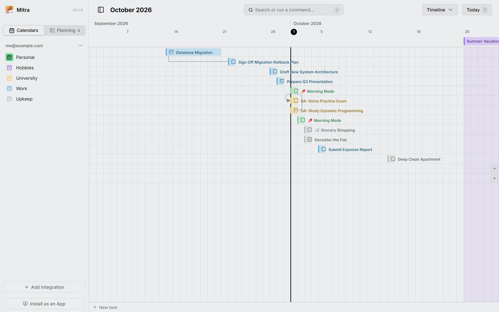
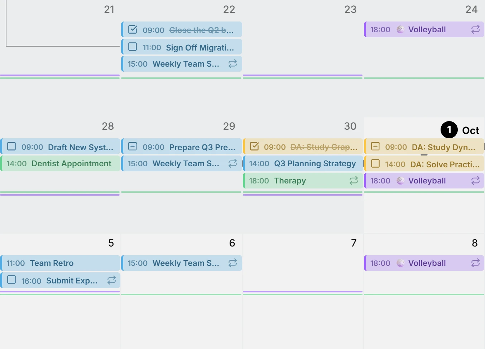
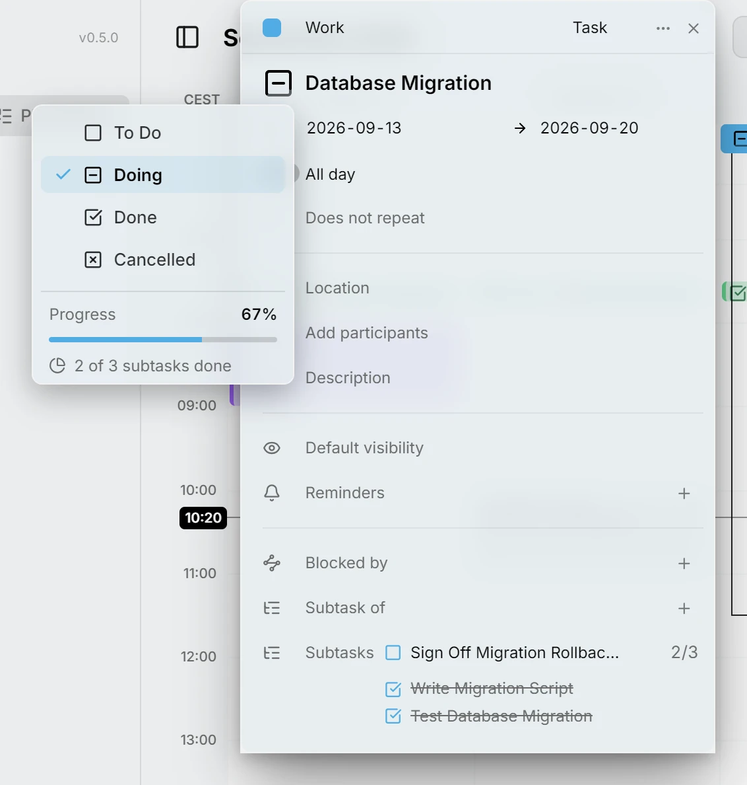
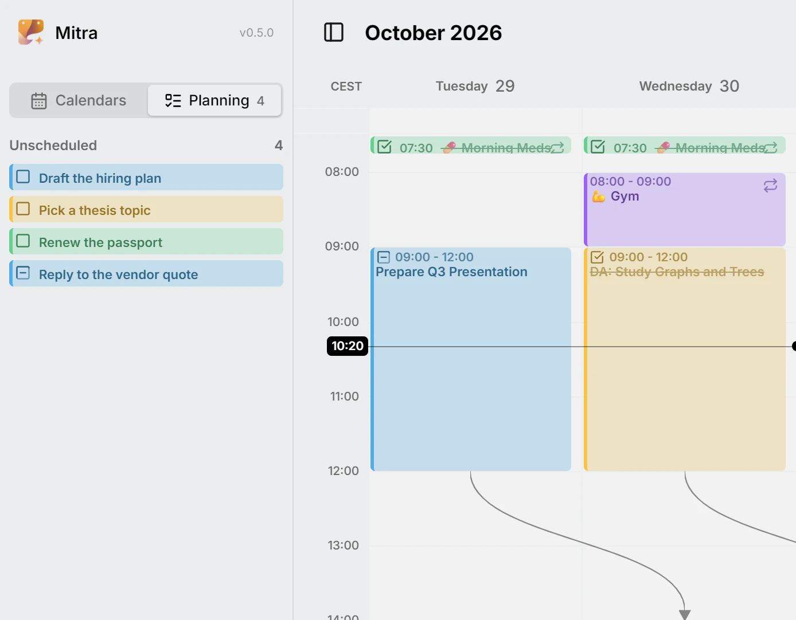
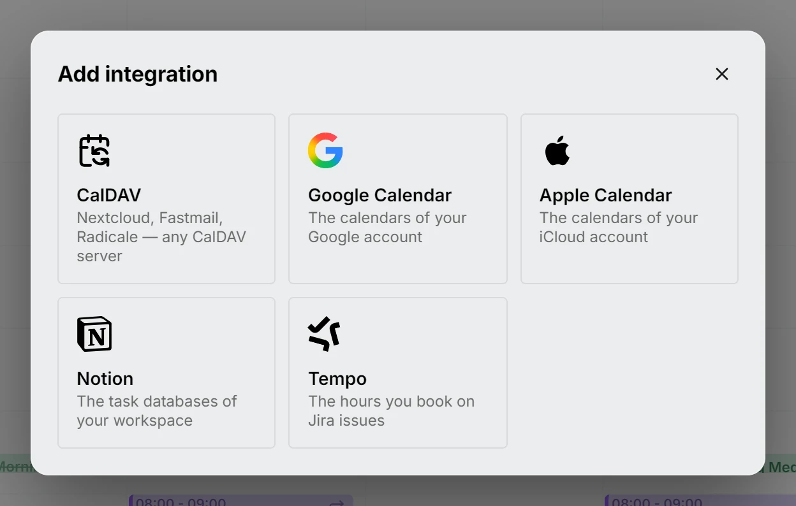
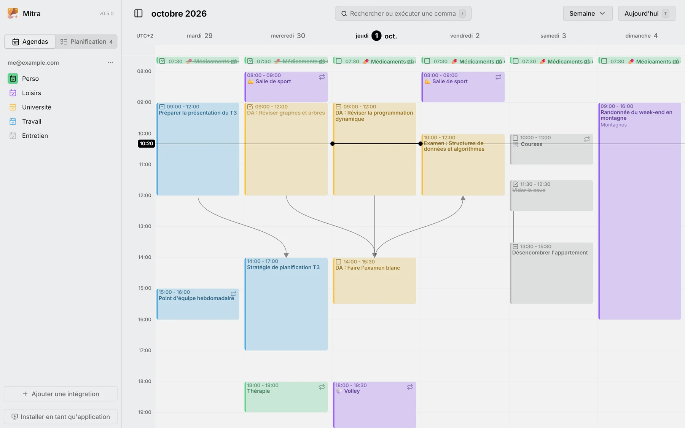

このリリースでは、項目同士を依存させることができます。タスクを、それが待っているタスクや、それを構成する部分と結び付け、週の中に描かれたつながりを眺め、どれかひとつが動くと連鎖全体が動くのを見られます。タイムラインは未完了のタスクを期日順に並べ、月ビューと年ビューは日々の習慣を控えめなマークにまとめます。

## 関連付け
ある項目を別の項目のサブタスクにしたり、先に終わらせるべき項目を待たせたりできます。項目のハンドルから所属先の項目へドラッグすると、Mitraが週の中にそのつながりを描きます。時刻指定と終日の項目の間でも同じで、Notionにも保存されます。項目を動かすと、それを待っているものすべてが一緒に動きます。待っている相手より先に始まるようになってつながりが成り立たなくなると、Mitraが知らせます。

<picture>
	<source media="(prefers-color-scheme: dark)" srcset="relationships-dark.webp">
	
</picture>

ドキュメント：[依存関係](../../docs/dependencies.md)

## タイムラインビュー
未完了のタスクが1行にひとつずつ、開始から期日までのバーとして並ぶので、ひと続きの作業は計画する前に形が見えます。重なり、隙間、期日を過ぎたタスクが一目で分かります。画面からスクロールアウトしたタスクは端にマーカーを残してそこから戻れ、ルーティンは次の回だけを表示します。

<picture>
	<source media="(prefers-color-scheme: dark)" srcset="timeline-dark.webp">
	
</picture>

ドキュメント：[タイムラインビュー](../../docs/views/timeline.md)

## ルーティン
毎日や毎週すること、運動や薬などは、月ビューと年ビューでは小さなマークにまとめられるので、忙しい月でも一目で読めます。

<picture>
	<source media="(prefers-color-scheme: dark)" srcset="routines-dark.webp">
	
</picture>

ドキュメント：[ルーティン](../../docs/routines.md)

## タスクの進捗
サブタスクのあるタスクは、サブタスクが終わるごとにリングが埋まっていき、最後のひとつが終わると、タスクも完了にするかMitraが尋ねます。サブタスクのないタスクには、自分で決めたパーセンテージを付けられます。

<picture>
	<source media="(prefers-color-scheme: dark)" srcset="progress-dark.webp">
	
</picture>

ドキュメント：[サブタスク](../../docs/subtasks.md)

## 日付未定のタスク
タスクに日付はなくてもよくなりました。いつにするか決まるまで日付未定のままにしておき、決まったら予定を組みましょう。

<picture>
	<source media="(prefers-color-scheme: dark)" srcset="unscheduled-dark.webp">
	
</picture>

ドキュメント：[計画](../../docs/planning.md)

## Tempo
TempoからのJira作業ログがカレンダーとして表示され、そこに作った項目は、タイトルに書いたチケットに時間を記録します。

<picture>
	<source media="(prefers-color-scheme: dark)" srcset="tempo-dark.webp">
	
</picture>

ドキュメント：[Tempo](../../docs/integrations/tempo.md)

## 対応言語の追加
Mitraは英語とドイツ語に加えて、フランス語、スペイン語、ポルトガル語、イタリア語を話せるようになりました。

<picture>
	<source media="(prefers-color-scheme: dark)" srcset="languages-dark.webp">
	
</picture>

ドキュメント：[設定](../../docs/settings.md)

## コントリビューター
- [@a11delavar](https://github.com/a11delavar)
