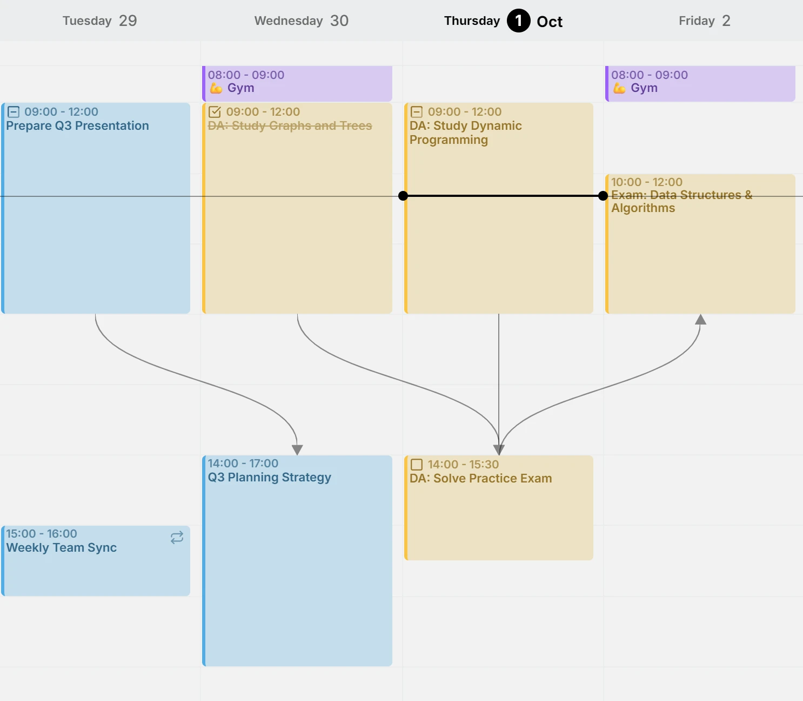
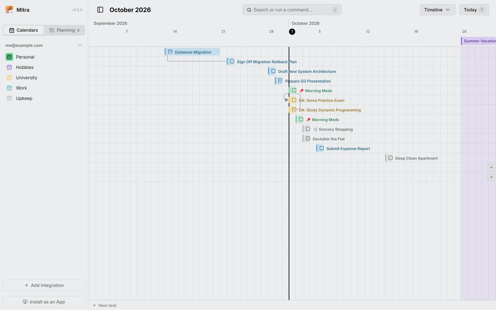
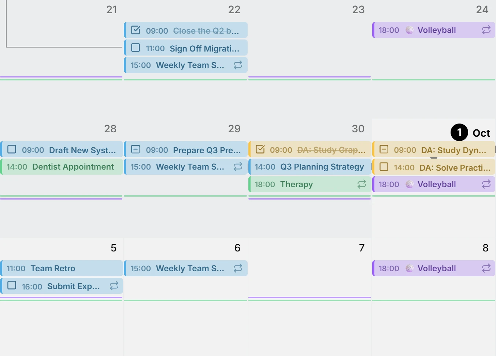
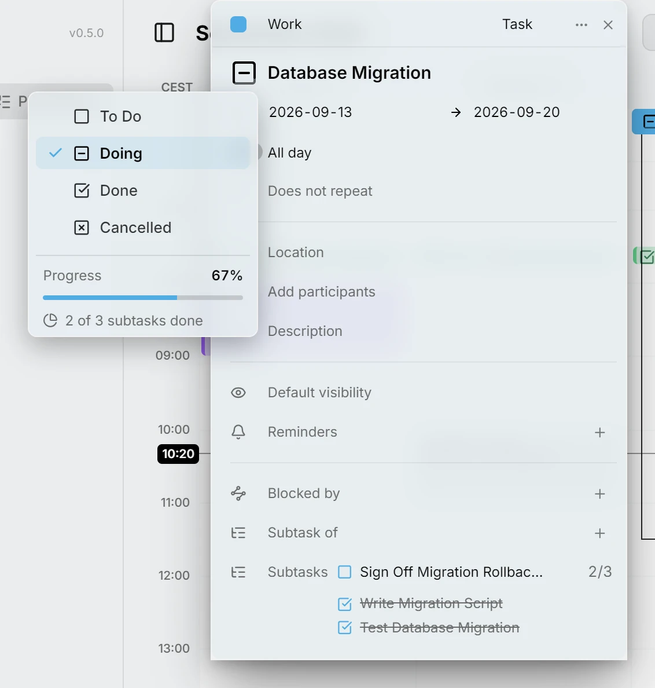
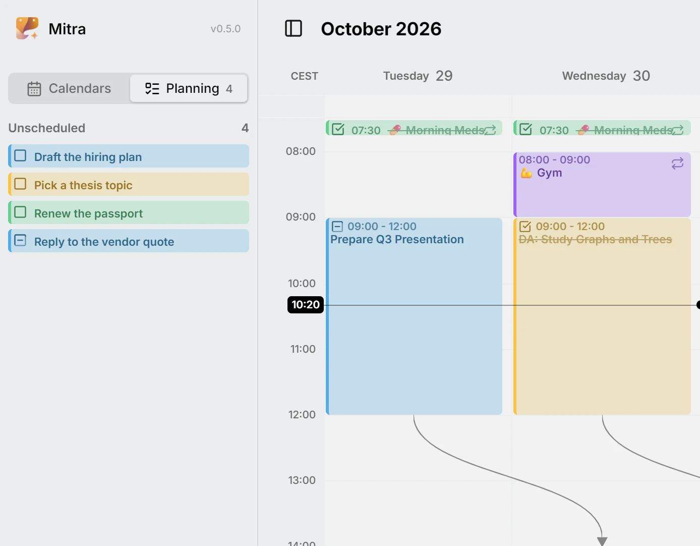
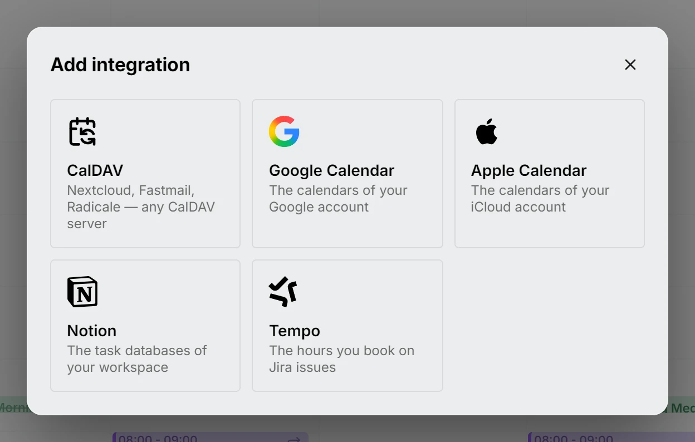
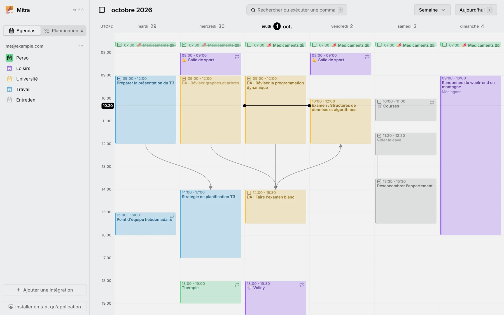

이번 릴리스에서는 항목끼리 서로 의존할 수 있습니다. 작업을 그 작업이 기다리는 작업이나 그 작업을 이루는 부분과 연결하고, 주 보기에 그려지는 연결을 보고, 하나가 움직이면 연결된 전체가 함께 움직이는 모습을 확인하세요. 타임라인은 열린 작업을 마감 시점에 따라 펼쳐 보여 주고, 월 보기와 연도 보기는 일상의 습관을 조용한 표시로 접어 둡니다.

## 관계
한 항목을 다른 항목의 하위 작업으로 만들거나, 먼저 끝나야 하는 항목을 기다리게 할 수 있습니다. 항목의 핸들을 그 항목이 속한 항목으로 끌면, Mitra가 시간이 정해진 항목이든 종일 항목이든 가리지 않고 주 보기에 연결선을 그리며, Notion에도 그 연결을 유지합니다. 항목을 옮기면 그 항목을 기다리는 모든 항목이 함께 움직입니다. 무언가가 기다리는 항목보다 먼저 시작하게 되어 연결이 더 이상 성립하지 않으면 Mitra가 알려 줍니다.

<picture>
	<source media="(prefers-color-scheme: dark)" srcset="relationships-dark.webp">
	
</picture>

문서: [종속 관계](../../docs/dependencies.md)

## 타임라인 보기
열린 작업이 한 행에 하나씩, 시작부터 마감까지 막대로 펼쳐지므로, 일의 흐름이 계획하기 전에 모양을 드러냅니다. 겹치는 부분, 빈 부분, 날짜를 넘긴 작업이 한눈에 보입니다. 화면 밖으로 스크롤된 작업은 가장자리에 표시를 남겨 두어 다시 불러올 수 있고, 루틴은 다음에 해야 할 때만 보여 줍니다.

<picture>
	<source media="(prefers-color-scheme: dark)" srcset="timeline-dark.webp">
	
</picture>

문서: [타임라인 보기](../../docs/views/timeline.md)

## 루틴
운동이나 약 먹기처럼 매일 또는 매주 하는 일은 월 보기와 연도 보기에서 작은 표시로 접히므로, 바쁜 달도 한눈에 읽힙니다.

<picture>
	<source media="(prefers-color-scheme: dark)" srcset="routines-dark.webp">
	
</picture>

문서: [루틴](../../docs/routines.md)

## 작업 진행률
하위 작업이 있는 작업은 하위 작업이 끝날 때마다 링이 차오르고, 마지막 하위 작업이 끝나면 Mitra가 작업도 끝낼지 묻습니다. 하위 작업이 없는 작업에는 직접 정한 백분율을 둘 수 있습니다.

<picture>
	<source media="(prefers-color-scheme: dark)" srcset="progress-dark.webp">
	
</picture>

문서: [하위 작업](../../docs/subtasks.md)

## 날짜 미정 작업
이제 작업에 날짜가 꼭 필요하지 않습니다. 언제 할지 알 때까지 날짜 미정으로 두었다가, 정해지면 일정에 넣으세요.

<picture>
	<source media="(prefers-color-scheme: dark)" srcset="unscheduled-dark.webp">
	
</picture>

문서: [계획](../../docs/planning.md)

## Tempo
Tempo의 Jira 워크로그가 캘린더로 나타나고, 그곳에 만든 항목은 제목에 적힌 티켓에 시간을 기록합니다.

<picture>
	<source media="(prefers-color-scheme: dark)" srcset="tempo-dark.webp">
	
</picture>

문서: [Tempo](../../docs/integrations/tempo.md)

## 더 많은 언어
Mitra가 영어와 독일어에 더해 프랑스어, 스페인어, 포르투갈어, 이탈리아어를 지원합니다.

<picture>
	<source media="(prefers-color-scheme: dark)" srcset="languages-dark.webp">
	
</picture>

문서: [설정](../../docs/settings.md)

## 기여자
- [@a11delavar](https://github.com/a11delavar)
