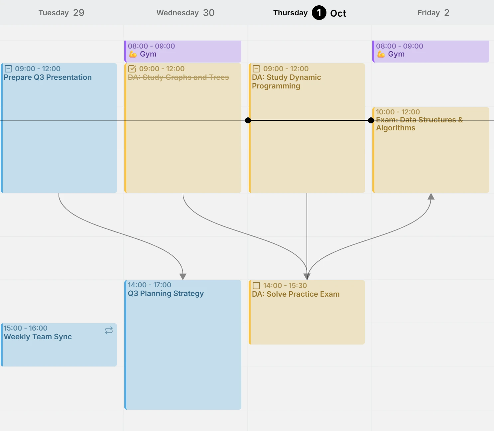
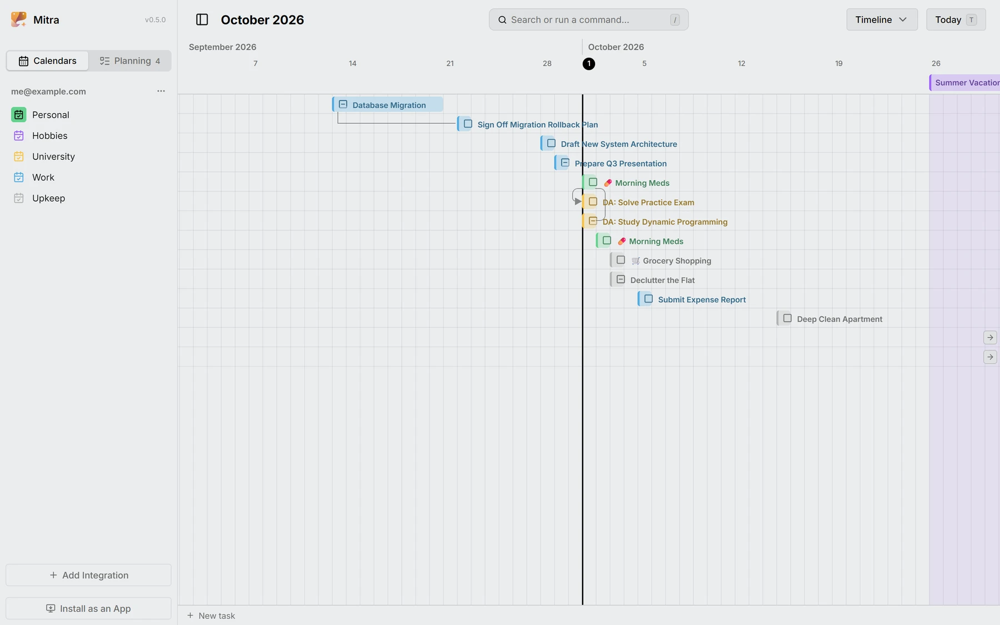
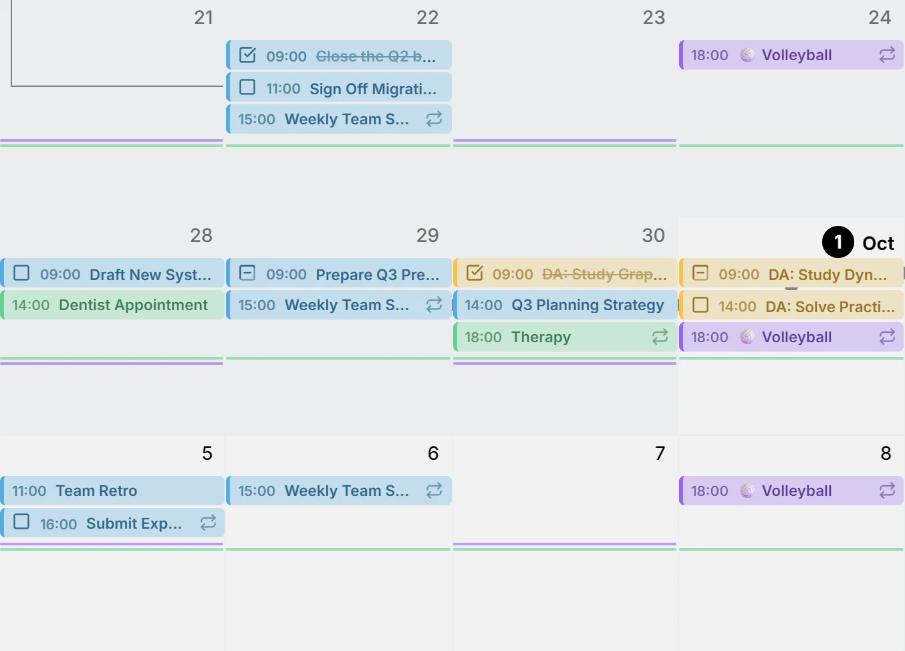
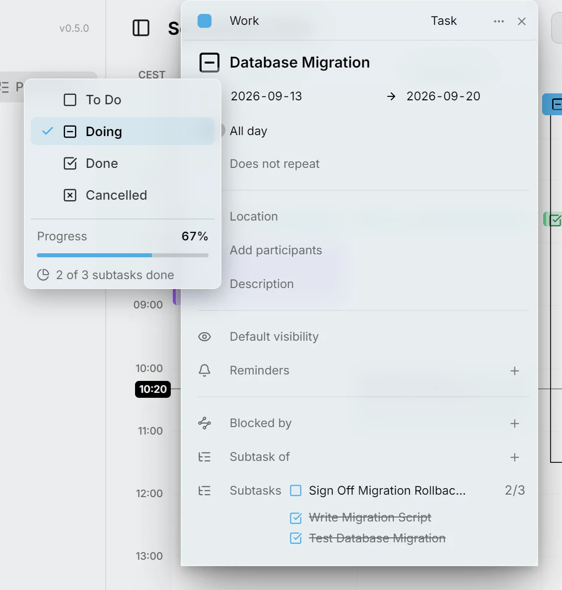
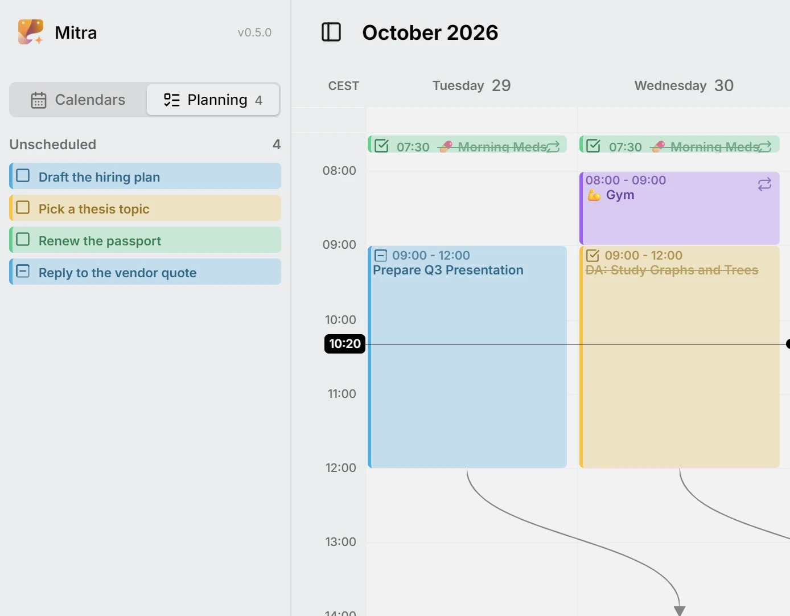
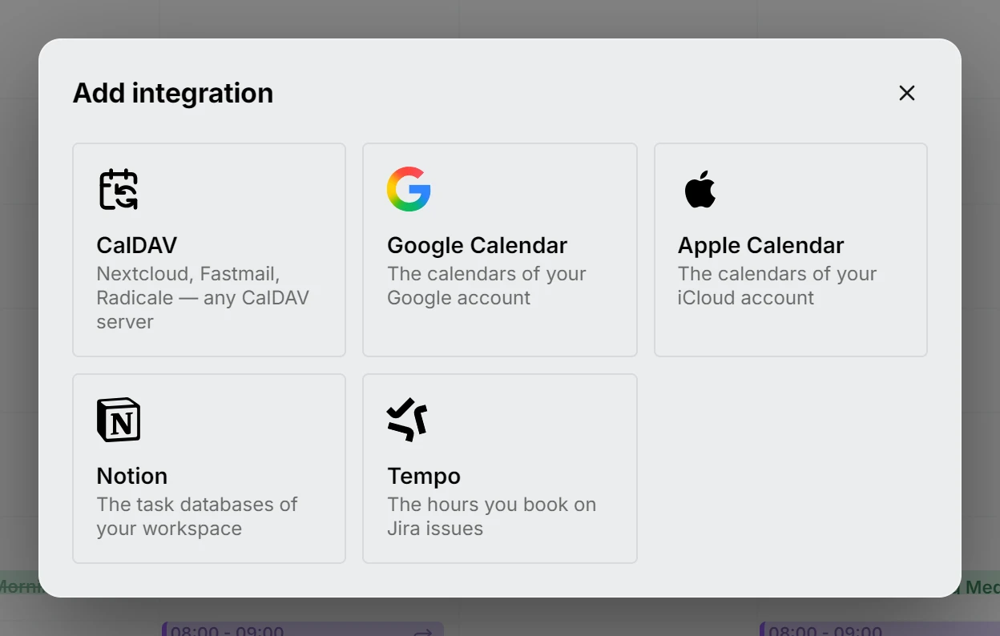
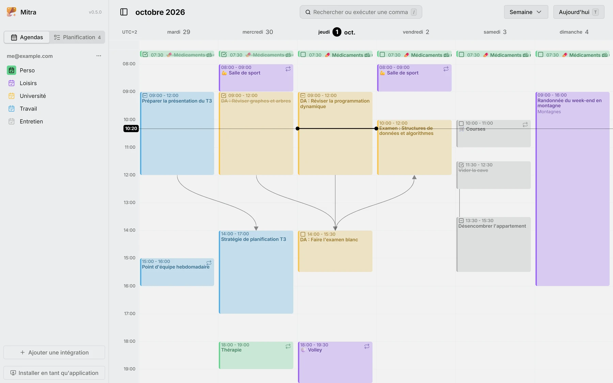

W tym wydaniu wpisy mogą od siebie zależeć. Połącz zadanie z tymi, na które czeka, albo z częściami, z których się składa, zobacz powiązania narysowane w widoku tygodnia i patrz, jak cały łańcuch przesuwa się razem z jednym z jego wpisów. Oś czasu układa otwarte zadania według terminów, a widoki miesiąca i roku zamieniają codzienne rutyny w dyskretne znaczniki.

## Powiązania
Zrób z wpisu podzadanie innego wpisu albo każ mu czekać na wpis, który musi się zakończyć wcześniej. Przeciągnij uchwyt wpisu na wpis, do którego należy, a Mitra narysuje powiązanie w widoku tygodnia, zarówno między wpisami z godziną, jak i całodniowymi, i zachowa je także w Notion. Gdy przeniesiesz wpis, wszystko, co na niego czeka, przesunie się razem z nim. Gdy powiązania nie da się już utrzymać, bo coś zaczyna się teraz przed tym, na co czeka, Mitra da ci znać.

<picture>
	<source media="(prefers-color-scheme: dark)" srcset="relationships-dark.webp">
	
</picture>

Dokumentacja: [Zależności](../../docs/dependencies.md)

## Widok osi czasu
Twoje otwarte zadania, każde w osobnym wierszu, jako paski od początku do terminu, dzięki czemu widzisz kształt większego kawałka pracy, zanim go zaplanujesz. Zadania, które się nakładają, luki między nimi i zadanie, które wychodzi poza swój termin, widać na pierwszy rzut oka. Zadanie, które zniknie z widoku, zostawia przy krawędzi znacznik, który do niego prowadzi, a rutyny pokazują tylko swój najbliższy termin.

<picture>
	<source media="(prefers-color-scheme: dark)" srcset="timeline-dark.webp">
	
</picture>

Dokumentacja: [Widok osi czasu](../../docs/views/timeline.md)

## Rutyny
To, co robisz codziennie albo co tydzień, na przykład trening czy tabletka, zwija się w widokach miesiąca i roku do małych znaczników, więc nawet napięty miesiąc da się ogarnąć jednym spojrzeniem.

<picture>
	<source media="(prefers-color-scheme: dark)" srcset="routines-dark.webp">
	
</picture>

Dokumentacja: [Rutyny](../../docs/routines.md)

## Postęp zadań
W miarę jak kolejne podzadania są gotowe, pierścień przy zadaniu się wypełnia, a gdy gotowe jest ostatnie, Mitra pyta, czy zakończyć też samo zadanie. Zadanie bez podzadań może mieć procent postępu, który ustawiasz sam.

<picture>
	<source media="(prefers-color-scheme: dark)" srcset="progress-dark.webp">
	
</picture>

Dokumentacja: [Podzadania](../../docs/subtasks.md)

## Zadania niezaplanowane
Zadanie nie musi już mieć dnia. Zostaw je niezaplanowane, dopóki nie wiesz, kiedy się nim zająć, i zaplanuj, gdy już będziesz wiedzieć.

<picture>
	<source media="(prefers-color-scheme: dark)" srcset="unscheduled-dark.webp">
	
</picture>

Dokumentacja: [Planowanie](../../docs/planning.md)

## Tempo
Czas zalogowany w Jirze przez Tempo pojawia się jako kalendarz, a wpis, który w nim utworzysz, rejestruje czas w zgłoszeniu, którego klucz podasz w tytule.

<picture>
	<source media="(prefers-color-scheme: dark)" srcset="tempo-dark.webp">
	
</picture>

Dokumentacja: [Tempo](../../docs/integrations/tempo.md)

## Więcej języków
Mitra mówi teraz po francusku, hiszpańsku, portugalsku i włosku, a także po angielsku i niemiecku.

<picture>
	<source media="(prefers-color-scheme: dark)" srcset="languages-dark.webp">
	
</picture>

Dokumentacja: [Ustawienia](../../docs/settings.md)

## Współtwórcy
- [@a11delavar](https://github.com/a11delavar)
