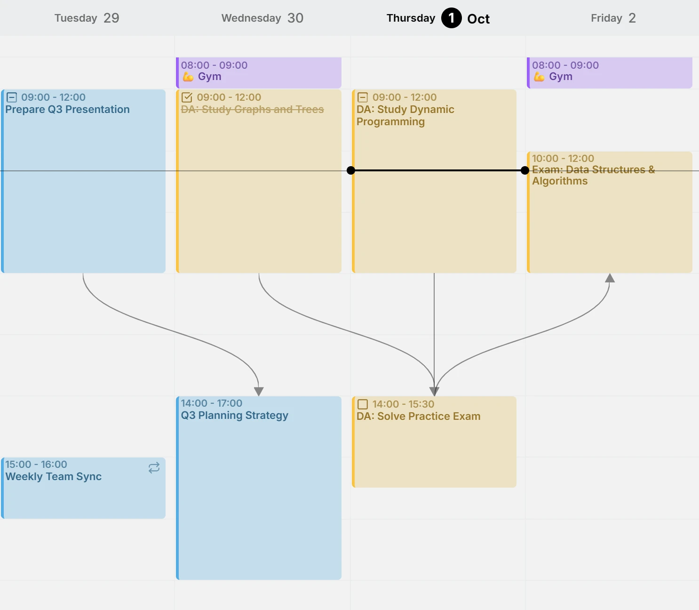
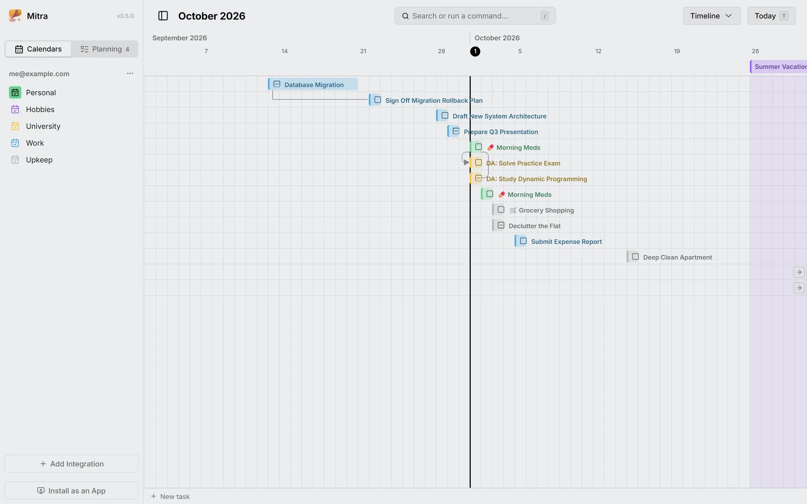
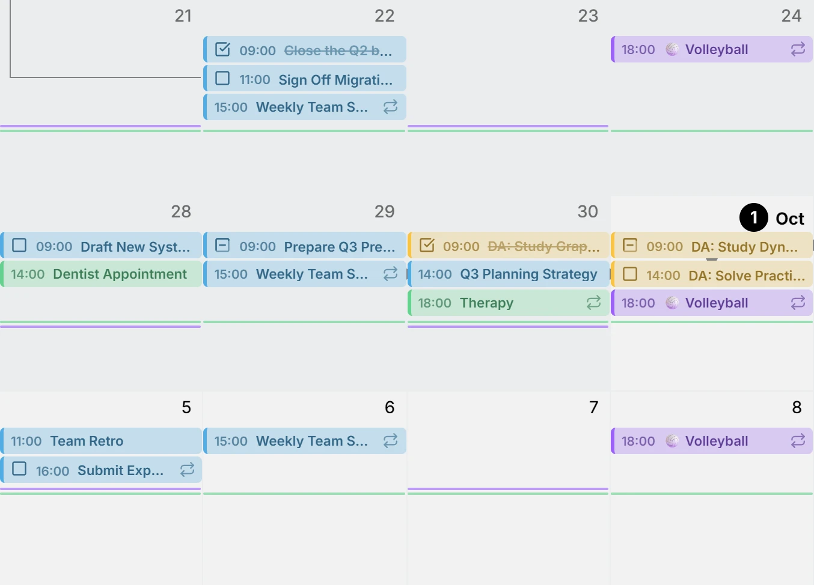
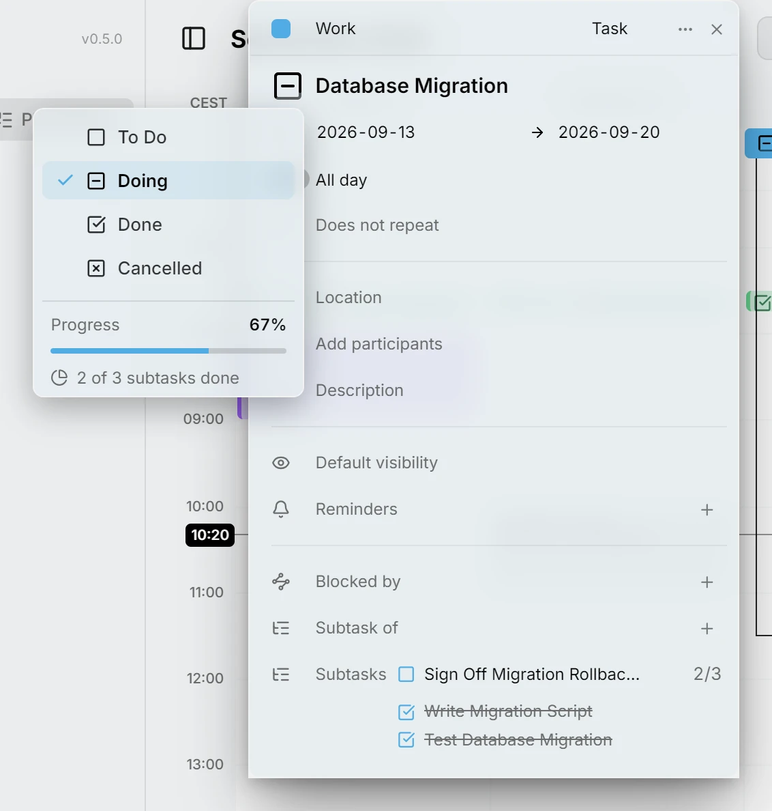
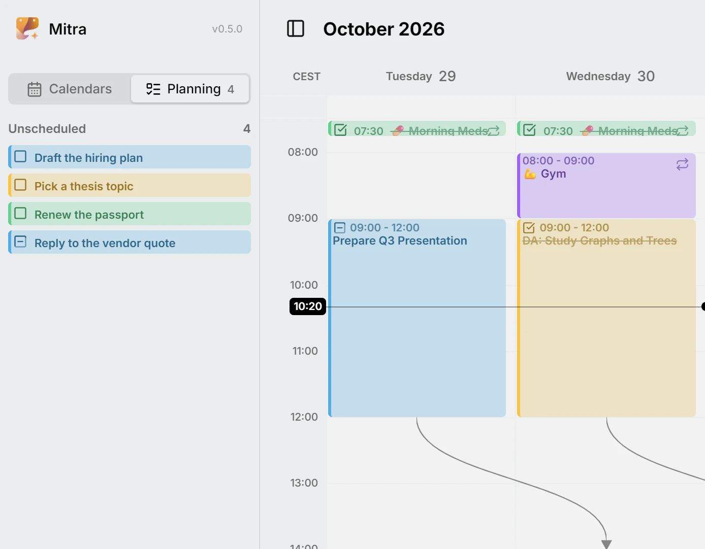
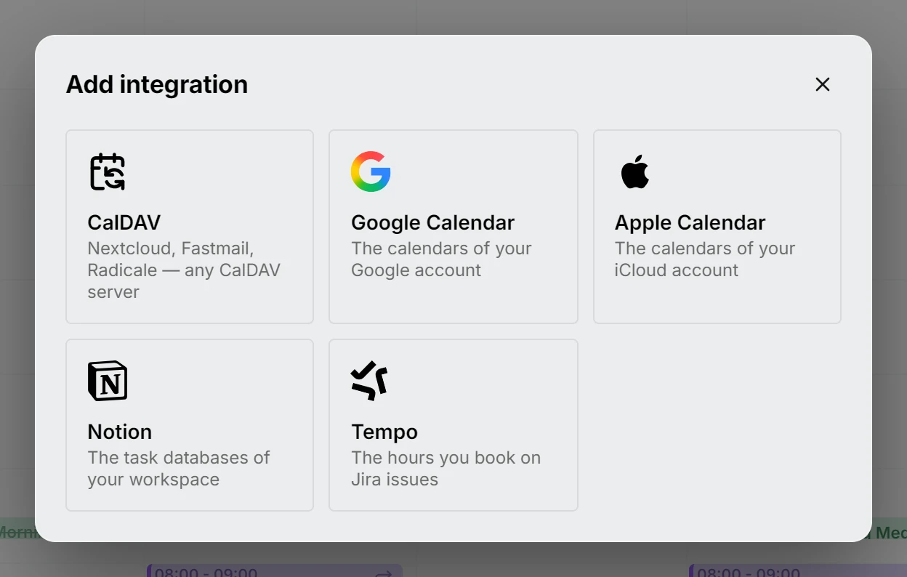
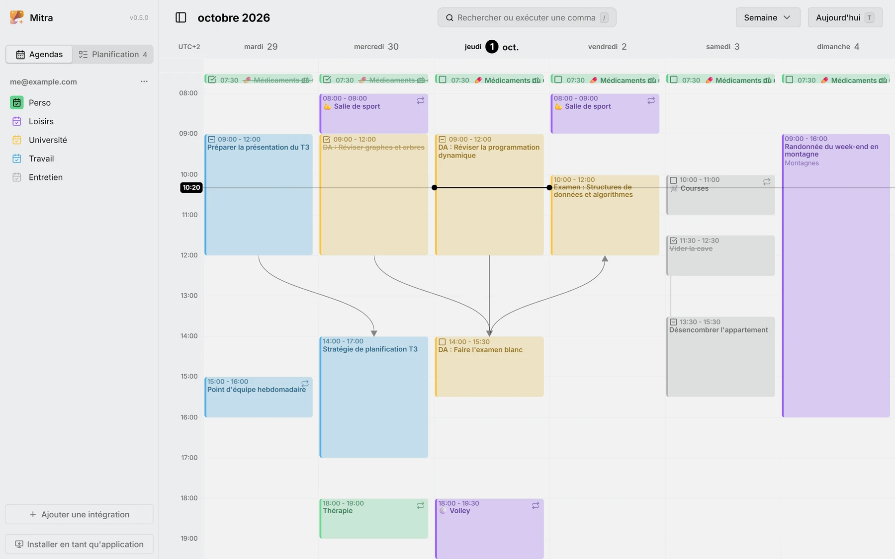

Phiên bản này cho phép các mục phụ thuộc vào nhau. Liên kết một công việc với những việc nó phải chờ hoặc những phần cấu thành nó, xem các liên kết được vẽ xuyên qua tuần, và nhìn cả chuỗi dịch chuyển khi một mục trong đó dịch chuyển. Chế độ xem dòng thời gian bày các công việc đang mở theo hạn của chúng, còn chế độ xem tháng và năm gộp các thói quen hằng ngày thành những dấu lặng lẽ.

## Quan hệ
Biến một mục thành công việc con của mục khác, hoặc cho nó chờ một mục phải xong trước. Kéo từ tay nắm trên một mục đến mục mà nó thuộc về, và Mitra vẽ liên kết xuyên qua tuần, giữa các mục có giờ cũng như các mục cả ngày, và giữ nó cả trong Notion. Di chuyển một mục, và mọi thứ đang chờ nó cũng di chuyển theo. Khi một liên kết không còn đứng vững, vì có thứ giờ bắt đầu trước thứ mà nó chờ, Mitra sẽ báo cho bạn.

<picture>
	<source media="(prefers-color-scheme: dark)" srcset="relationships-dark.webp">
	
</picture>

Tài liệu: [Phụ thuộc](../../docs/dependencies.md)

## Chế độ xem dòng thời gian
Các công việc đang mở của bạn, mỗi việc một hàng, bày thành các thanh từ lúc bắt đầu đến hạn, để một chặng công việc lộ ra hình dạng của nó trước khi bạn lên kế hoạch. Chỗ chồng lấn, khoảng trống và công việc chạy quá ngày hạn nổi bật ngay trong một cái nhìn. Một công việc cuộn ra khỏi tầm nhìn để lại một dấu ở mép giúp đưa nó trở lại, và các thói quen chỉ hiện lần đến hạn tiếp theo.

<picture>
	<source media="(prefers-color-scheme: dark)" srcset="timeline-dark.webp">
	
</picture>

Tài liệu: [Chế độ xem dòng thời gian](../../docs/views/timeline.md)

## Thói quen
Những gì bạn làm mỗi ngày hoặc mỗi tuần, một buổi tập hay một viên thuốc, được gộp thành các dấu nhỏ trong chế độ xem tháng và năm, nên một tháng bận rộn vẫn đọc được trong một cái nhìn.

<picture>
	<source media="(prefers-color-scheme: dark)" srcset="routines-dark.webp">
	
</picture>

Tài liệu: [Thói quen](../../docs/routines.md)

## Tiến độ công việc
Một công việc có công việc con sẽ đầy dần một vòng tròn khi chúng được hoàn thành, và khi việc cuối cùng xong, Mitra hỏi có nên hoàn thành cả công việc cha không. Một công việc không có công việc con có thể mang một tỷ lệ phần trăm do bạn tự đặt.

<picture>
	<source media="(prefers-color-scheme: dark)" srcset="progress-dark.webp">
	
</picture>

Tài liệu: [Công việc con](../../docs/subtasks.md)

## Công việc chưa lên lịch
Một công việc không còn cần một ngày. Cứ để nó chưa lên lịch cho đến khi bạn biết khi nào, rồi lên lịch khi đã biết.

<picture>
	<source media="(prefers-color-scheme: dark)" srcset="unscheduled-dark.webp">
	
</picture>

Tài liệu: [Kế hoạch](../../docs/planning.md)

## Tempo
Các worklog Jira của bạn từ Tempo hiện ra như một lịch, và một mục bạn tạo ở đó sẽ ghi thời gian vào ticket mà tiêu đề của nó nêu tên.

<picture>
	<source media="(prefers-color-scheme: dark)" srcset="tempo-dark.webp">
	
</picture>

Tài liệu: [Tempo](../../docs/integrations/tempo.md)

## Thêm ngôn ngữ
Mitra nói được tiếng Pháp, Tây Ban Nha, Bồ Đào Nha và Ý, bên cạnh tiếng Anh và tiếng Đức.

<picture>
	<source media="(prefers-color-scheme: dark)" srcset="languages-dark.webp">
	
</picture>

Tài liệu: [Cài đặt](../../docs/settings.md)

## Người đóng góp
- [@a11delavar](https://github.com/a11delavar)
