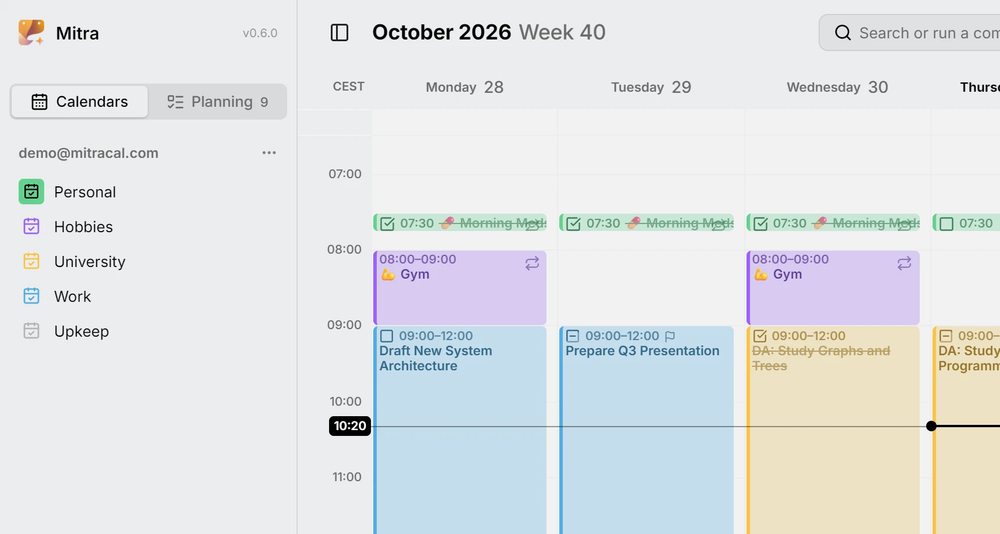
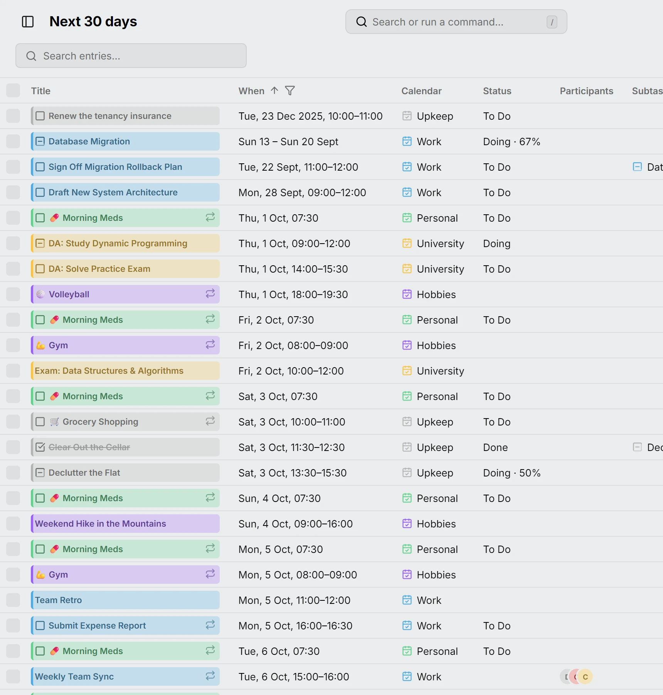
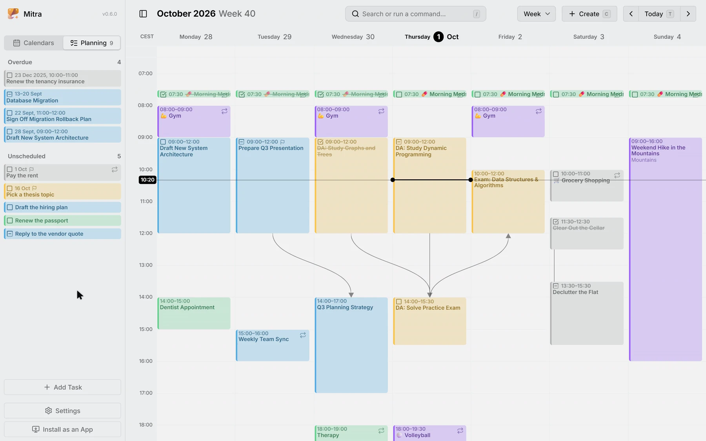
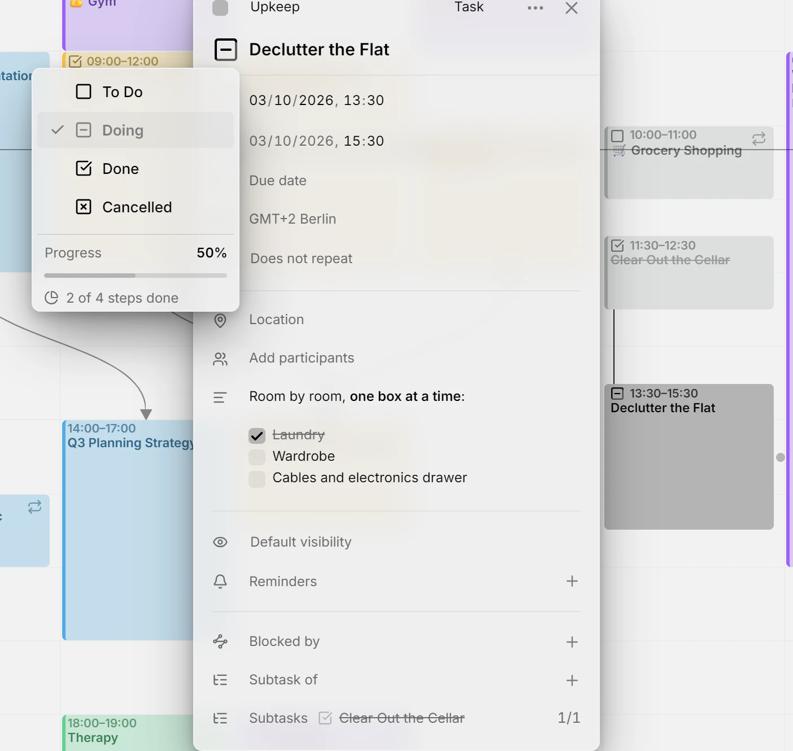
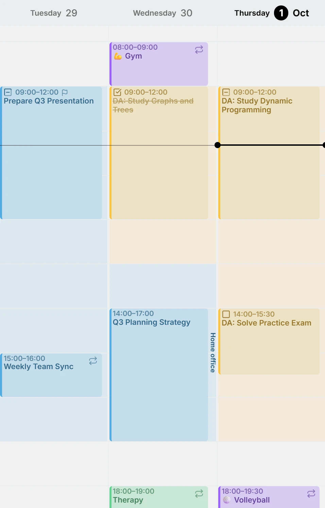
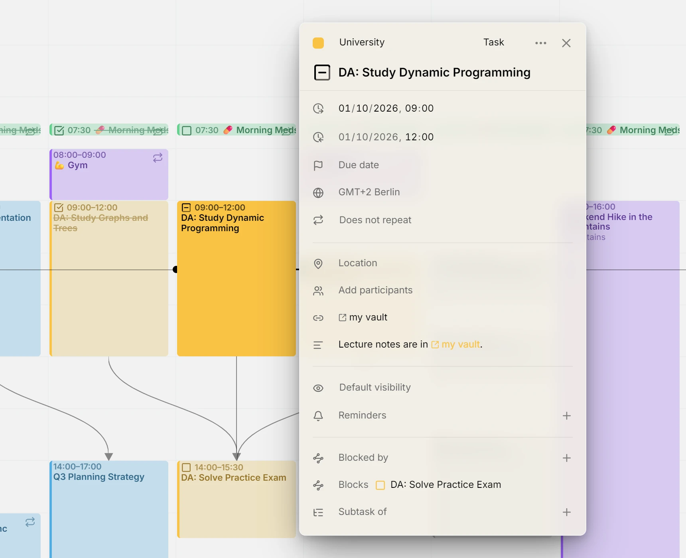
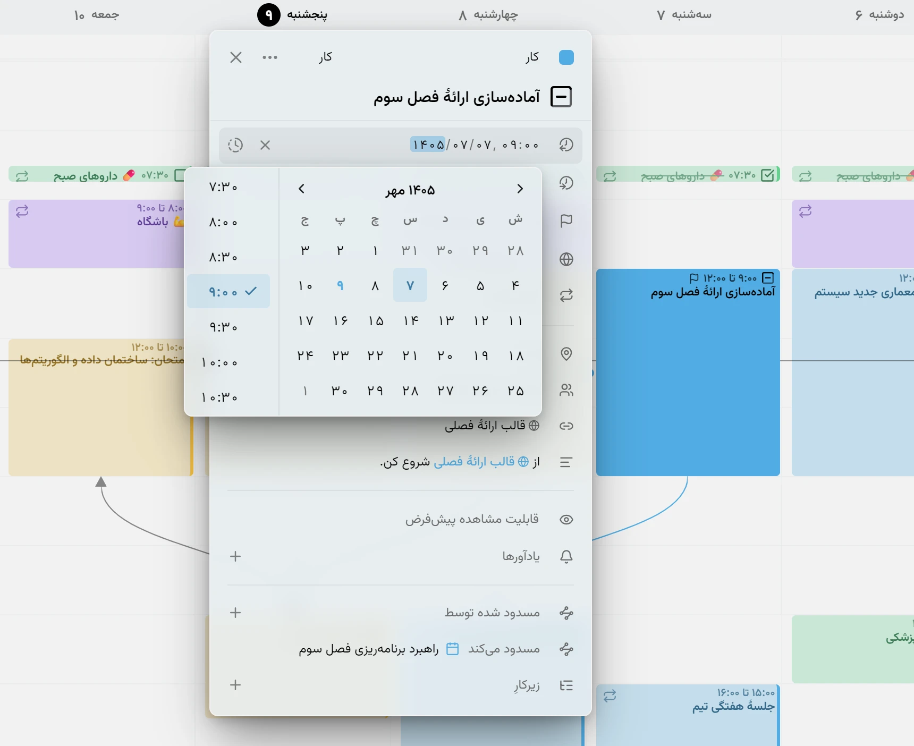

このリリースでは、Mitra自身のカレンダーができ、項目をテーブルとして並べ、タスクにこれまで足りなかった制約（期日、見積もり、空けておく時間）を与えます。ペルシャ語も話せるようになり、カレンダー付きです。

## Mitraカレンダー
カレンダーをMitraの中だけに置けるようになりました。背後のアカウントも、サインイン先もありません。Mitraをインストールして、カレンダーを追加して、すぐに計画を始められます。使っているすべてのデバイスに表示され、その項目はアカウントを連携したときにいつでも連携先へ移せます。

<picture>
	<source media="(prefers-color-scheme: dark)" srcset="calendars-detail-dark.webp">
	
</picture>

ドキュメント：[Mitraカレンダー](../../docs/integrations/mitra.md)

## テーブルビュー
すべての項目が1行ずつ。表示する日付の範囲は過去1か月から全期間まで選べ、タイトル・場所・説明をまたいで検索し、複数の列で同時に並べ替え、ステータス・カレンダー・種類・繰り返しで絞り込めます。行を選べばまとめて変更できます。タイトルはカレンダーが描くのと同じチップなので、その場で項目を開けます。

<picture>
	<source media="(prefers-color-scheme: dark)" srcset="table-detail-dark.webp">
	
</picture>

ドキュメント：[テーブルビュー](../../docs/views/table.md)

## 期日と見積もり
タスクは、時刻が決まる前から期日と見積もりを持てます。日付未定のタスクは計画タブに期日の早い順に並び、週にドラッグすると見積もりがその長さになります。予定日を過ぎたタスクは、その上の期限切れセクションに集まります。

<picture>
	<source media="(prefers-color-scheme: dark)" srcset="plan-task-dark.webp">
	
</picture>

ドキュメント：[計画](../../docs/planning.md)

## 説明の中のチェックリスト
タスクの説明にはMarkdownで書くチェックリストを入れられ、チェックボックスは本物です。エディターでひとつチェックするとMitraがテキストに書き戻すので、そのカレンダーを使うほかのアプリからも見えます。ボックスとサブタスクはどちらも1ステップとして一緒に数えます。ボックス3つとサブタスク1つのタスクは4ステップで、ボックス1つにチェックが付きサブタスクも終わると、ステータスメニューには「4ステップ中2完了」と表示され、チップのリングは半分まで埋まります。

<picture>
	<source media="(prefers-color-scheme: dark)" srcset="checklist-dark.webp">
	
</picture>

ドキュメント：[サブタスク](../../docs/subtasks.md)

## 対応可能時間
働く時間、鍛える時間、空けておく時間を、どのカレンダーにも描けます。週ビューに影が付いて、空いている時間が際立ちます。予定ありの時間は、カレンダーを共有している人には予定ありと見え、空きの時間は自分だけのものです。

<picture>
	<source media="(prefers-color-scheme: dark)" srcset="availability-detail-dark.webp">
	
</picture>

ドキュメント：[対応可能時間](../../docs/availability.md)

## リンクをひとつの行に
項目の説明や場所にあるリンクはすべて、エディターの「リンク」行に集まり、リンク先に応じた名前が付きます。ページはサイト名、会議はサービス名、メモはアプリ名で。リンクになっている場所は、そのリンクとして表示されます。

<picture>
	<source media="(prefers-color-scheme: dark)" srcset="links-detail-dark.webp">
	
</picture>

ドキュメント：[リンク](../../docs/links.md)

## ペルシャ暦
Mitraはペルシャ語を話せるようになり、言語と一緒にそのカレンダーも付いてきます。ヘッダーやピッカーにはペルシャの月と週が並び、日付はペルシャ語の書き方で入力できます。項目はそのままの場所にいます。変わるのは読み方だけです。

<picture>
	<source media="(prefers-color-scheme: dark)" srcset="persian-calendar-detail-dark.webp">
	
</picture>

ドキュメント：[設定](../../docs/settings.md)

## コントリビューター
- [@a11delavar](https://github.com/a11delavar)
