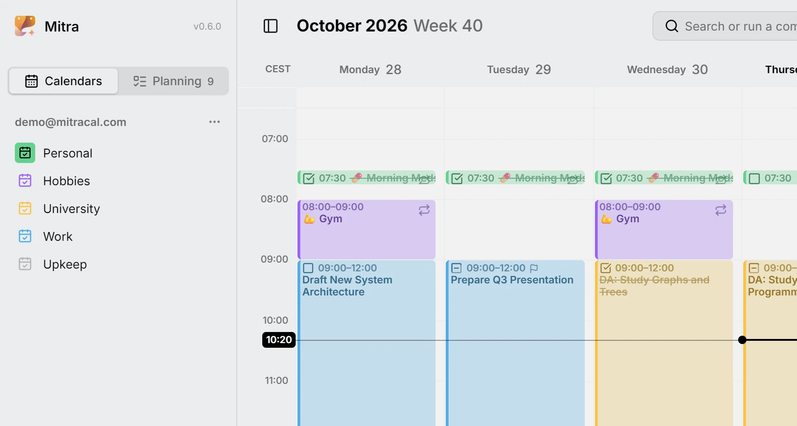
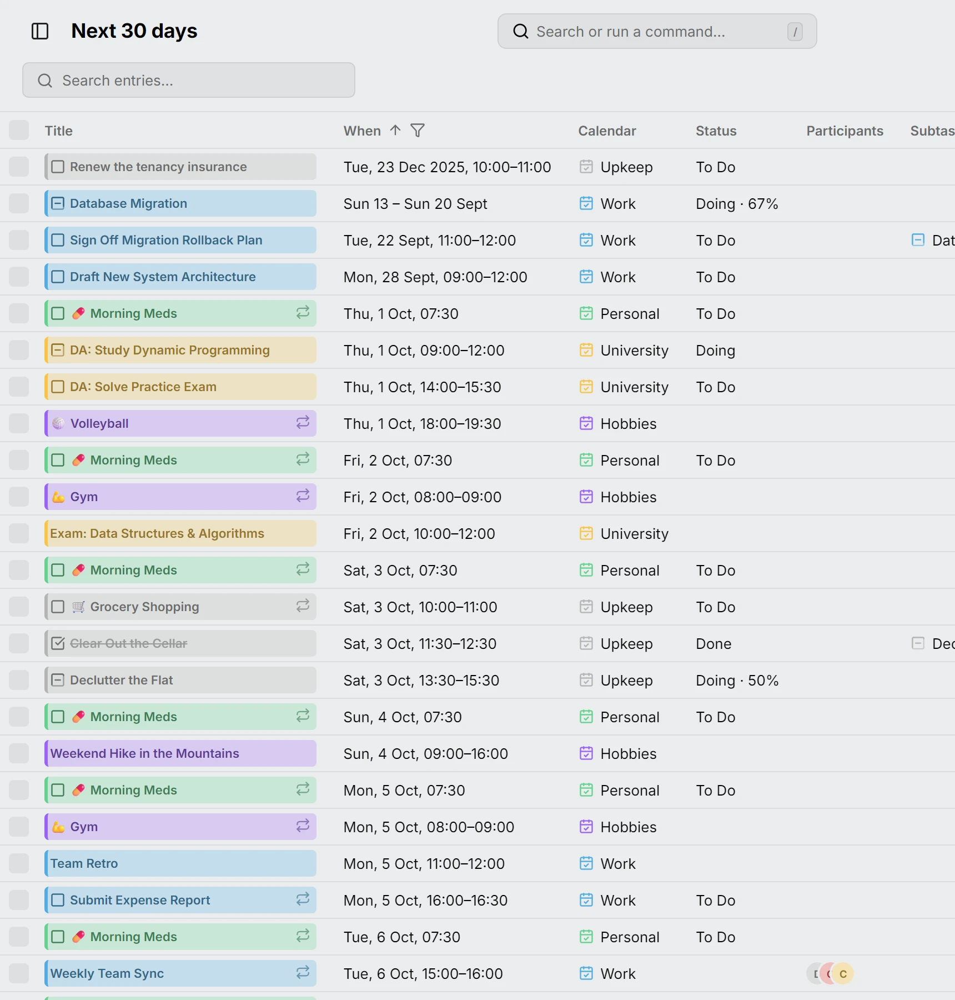
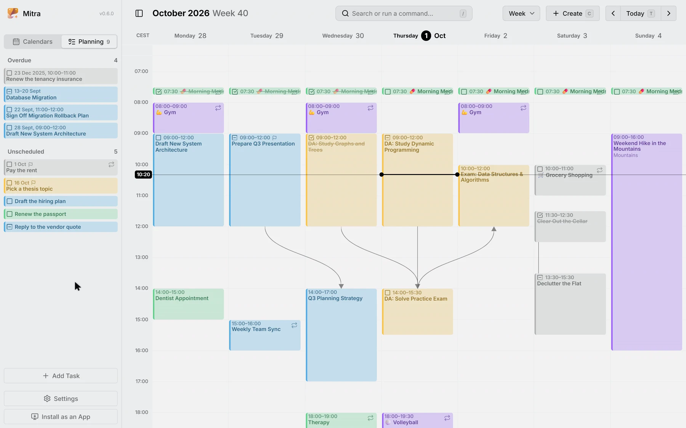
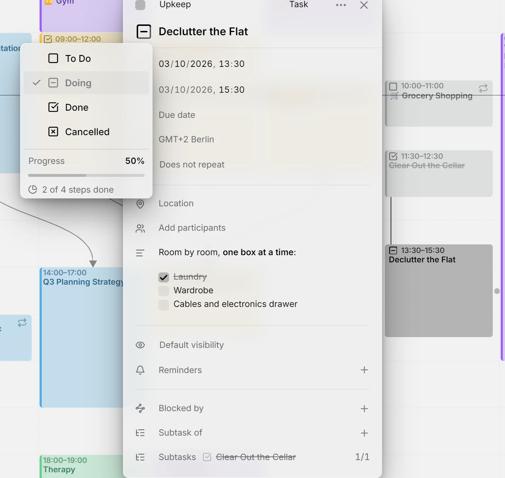
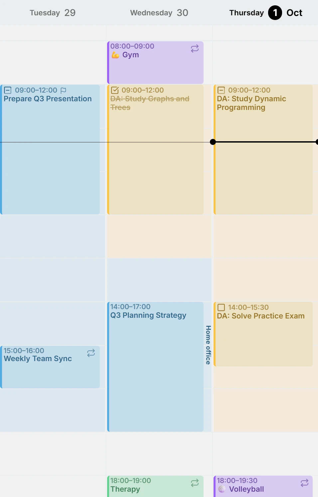
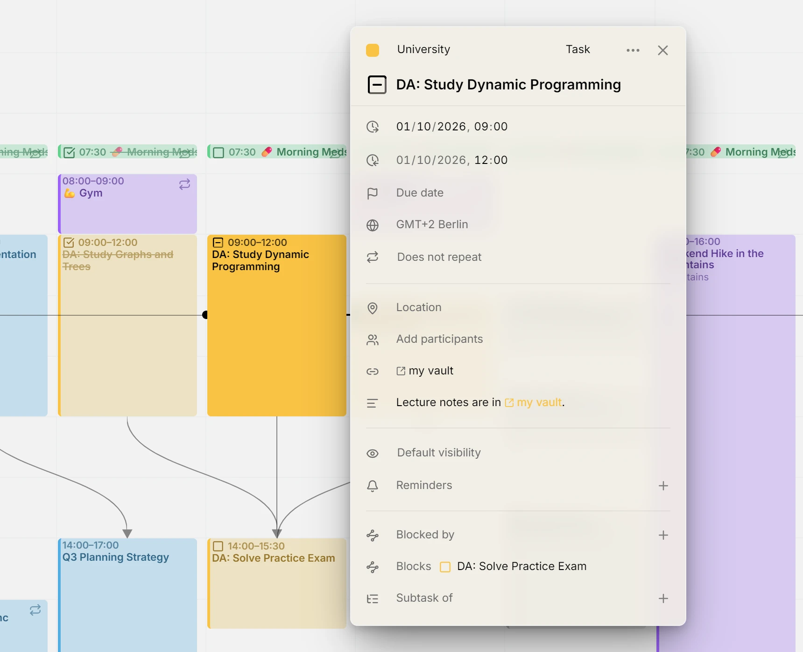
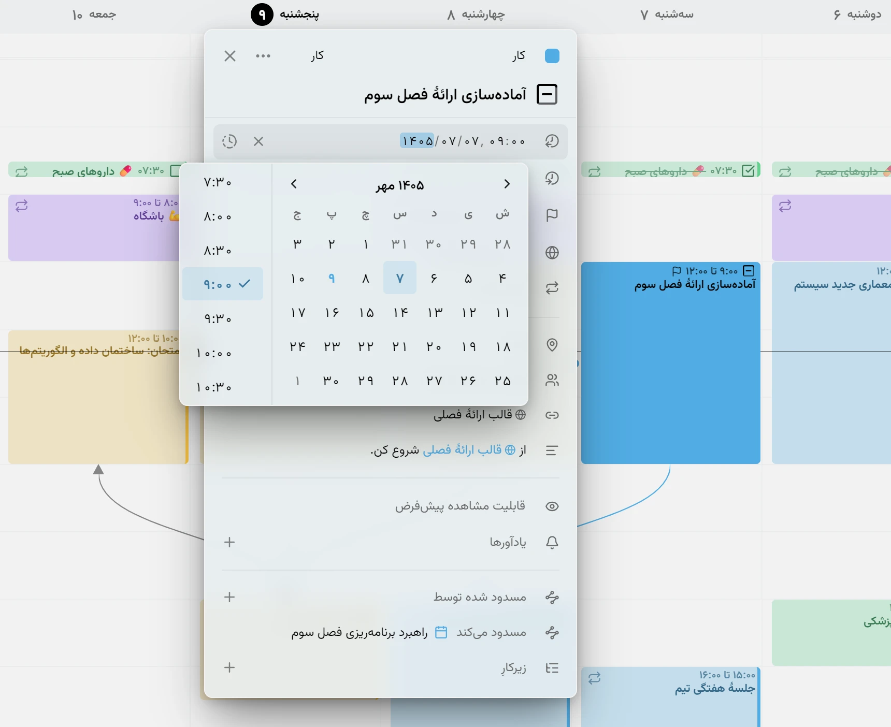

이번 릴리스에서는 Mitra에 자체 캘린더가 생기고, 항목을 표로 펼쳐 볼 수 있으며, 작업에 그동안 없던 조건이 생깁니다. 마감일, 예상 시간, 그리고 비워 두는 시간입니다. 페르시아어도 지원하며, 페르시아력까지 함께 들어왔습니다.

## Mitra 캘린더
캘린더를 Mitra 안에 둘 수 있습니다. 뒤에 계정이 필요 없고 로그인할 곳도 없습니다. Mitra를 설치하고 캘린더를 추가하면 바로 계획을 시작할 수 있습니다. 사용하는 모든 기기에 나타나며, 나중에 계정을 연결하면 언제든 항목을 그 계정으로 옮길 수 있습니다.

<picture>
	<source media="(prefers-color-scheme: dark)" srcset="calendars-detail-dark.webp">
	
</picture>

문서: [Mitra 캘린더](../../docs/integrations/mitra.md)

## 표 보기
모든 항목이 한 행씩 표시됩니다. 지난 한 달부터 전체 항목까지 나열할 날짜를 고르고, 제목, 장소, 설명을 가로질러 검색하고, 여러 열로 한 번에 정렬하고, 상태, 캘린더, 유형, 반복으로 필터링할 수 있습니다. 행을 선택하면 여러 항목을 한 번에 바꿀 수 있습니다. 제목은 캘린더에 그려지는 것과 같은 칩이라서 항목을 그 자리에서 바로 열 수 있습니다.

<picture>
	<source media="(prefers-color-scheme: dark)" srcset="table-detail-dark.webp">
	
</picture>

문서: [표 보기](../../docs/views/table.md)

## 마감일과 예상 시간
작업은 시간이 정해지기 전에도 마감일과 예상 시간을 가질 수 있습니다. 날짜 미정 작업은 계획에서 마감이 빠른 순서로 줄을 서고, 하나를 주 보기로 끌어 놓으면 예상 시간이 그 작업의 길이가 됩니다. 날짜를 놓친 작업은 그 위의 기한 지남 섹션에 모입니다.

<picture>
	<source media="(prefers-color-scheme: dark)" srcset="plan-task-dark.webp">
	
</picture>

문서: [계획](../../docs/planning.md)

## 설명 속 체크리스트
작업의 설명에 Markdown으로 쓴 체크리스트를 담을 수 있고, 그 상자는 실제로 동작합니다. 편집기에서 하나를 체크하면 Mitra가 그것을 본문에 다시 써 넣으므로, 같은 캘린더를 쓰는 다른 앱에서도 보입니다. 상자와 하위 작업은 각각 한 단계로 함께 셉니다. 상자 세 개와 하위 작업 하나가 있는 작업은 네 단계이고, 상자 하나를 체크하고 하위 작업을 마치면 상태 메뉴에 4단계 중 2단계 완료라고 표시되며 칩의 링은 절반까지 찹니다.

<picture>
	<source media="(prefers-color-scheme: dark)" srcset="checklist-dark.webp">
	
</picture>

문서: [하위 작업](../../docs/subtasks.md)

## 가용 시간
일하는 시간, 운동하는 시간, 비워 두는 시간을 어느 캘린더에든 그려 넣으세요. 이 시간들이 주 보기에 음영을 넣어 비어 있는 시간이 눈에 띄게 합니다. 바쁨으로 둔 시간은 캘린더를 공유하는 사람들에게 바쁨으로 보이고, 한가함으로 둔 시간은 나만 봅니다.

<picture>
	<source media="(prefers-color-scheme: dark)" srcset="availability-detail-dark.webp">
	
</picture>

문서: [가용 시간](../../docs/availability.md)

## 한 행에 모인 링크
항목의 설명이나 장소에 있는 모든 링크가 편집기의 링크 행에 모이고, 어디로 가는지에 따라 이름이 붙습니다. 페이지는 사이트로, 회의는 서비스로, 노트는 앱으로 표시됩니다. 링크인 장소는 그 링크로 표시됩니다.

<picture>
	<source media="(prefers-color-scheme: dark)" srcset="links-detail-dark.webp">
	
</picture>

문서: [링크](../../docs/links.md)

## 페르시아력
Mitra가 페르시아어를 지원하며, 언어와 함께 그 달력도 들어왔습니다. 헤더와 선택기에 페르시아력의 달과 주가 표시되고, 날짜를 페르시아어 방식대로 입력할 수 있습니다. 항목은 제자리에 그대로 있고, 읽히는 방식만 바뀝니다.

<picture>
	<source media="(prefers-color-scheme: dark)" srcset="persian-calendar-detail-dark.webp">
	
</picture>

문서: [설정](../../docs/settings.md)

## 기여자
- [@a11delavar](https://github.com/a11delavar)
